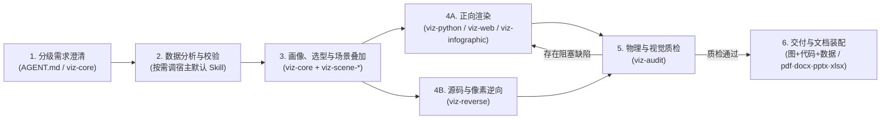
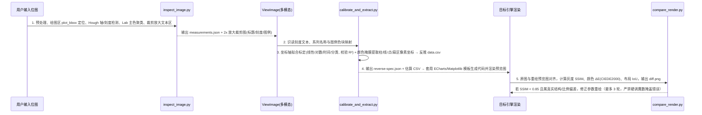

# 专业数据可视化 Agent 架构与开发规划（PLAN.md）

> **目标形态**：完全基于 **顶层系统提示词（`AGENT.md`）+ 精选宿主默认 Skill + 10 个自建可视化 Skill** 组合而成的本地专业数据可视化 Agent。  
> **适用宿主**：主适配 YOYOClaw，目录结构与 `SKILL.md` 规范天然兼容 Claude Code、Antigravity、Codex 等支持标准 Skill 的 Agent 环境。  
> **核心理念**：零外部包管理器、零构建发布基建、100% 离线自包含；用系统提示词与 Skill 边界解决协同，用 Skill 内部黄金代码模板与确定性脚本保证交付质量。

---

## 1. 项目目标与设计准则

### 1.1 核心能力范围

Agent 在**本地运行、离线优先、结果可验证**的前提下，覆盖三类核心任务：

1. **正向生成（数据/文本 → 视觉产物）**：将 CSV/Excel/SQL 结果或结构化文本转化为出版级科研静态图、交互式单文件 Web 图表/看板、结构化信息图，并支持多图任务的全局视觉统一。
2. **图表逆向（图像/网页/代码 → 可编辑代码与数据）**：从公开网页提取 DOM/运行时图表配置，或通过 OpenCV 像素几何检测 + 多模态文本识读 + 坐标轴标定，从位图截图中反推估算 CSV 数据、提取样式 Token、生成 ECharts/Matplotlib 可编辑代码，并通过 SSIM 往返比对闭环校准。
3. **视觉与物理质检（产物 → 诊断与修复）**：对生成的或用户提供的图表（PNG/SVG/PDF/HTML）执行物理尺寸、DPI、裁切白边、WCAG 对比度、色盲友好度及统计防误导审查，阻塞级问题自动回退修正。

### 1.2 四条架构铁律

1. **纯 Skill + 系统提示词协同**：不造 `skill.json`、`assemble.py`、`build.py`、`install.py` 等外围工具链。模块启用靠宿主原生勾选，职责路由与交接靠 `AGENT.md` 全局规则 + 各 `SKILL.md` 的正负向 `description` 边界。
2. **语义归模型，计算归内聚脚本**：需求澄清、图表选型、版式审美交给大模型；大表统计画像、系统字体探测、Headless 截图、物理指标体检、OpenCV 像素测量与 SSIM 比对封装为对应 Skill 内部的 PEP 723 单文件脚本，按需通过 `uv run` 自主调用。
3. **底稿填空优于手搓，轻量协议替代万能编译器**：正向绘图采用「设计 Token + 引擎黄金代码底稿/模板（Recipes & Templates）」，不自研跨语言万能图表编译器；仅在逆向工程中使用结构化 `reverse-spec.json` 承载像素测量与证据分级。
4. **离线自包含与诚实交付**：所有运行时静态依赖（ECharts、D3、`.mplstyle`、色板、SVG 图标）内置于各自 Skill 的 `assets/` 目录，严禁依赖外部 CDN；严禁编造数据或统计显著性；未执行的视觉验证与像素估算误差必须显式声明。

### 1.3 明确非目标（防范围蔓延）

- **不越界做统计推断与复杂数据清洗**：显著性检验、效应量计算、数据质量审计交由上游分析/统计 Skill 负责，可视化模块只消费结论做标注。
- **不做服务端实时 BI 平台**：仅交付本地静态图片、矢量文档或离线自包含单文件 HTML，不连生产数据库、不做权限与定时刷新。
- **不用 AI 文生图冒充数据图表**：所有含数值比例的图表必须由代码精确渲染。
- **不打包受限资产**：不内置商业专有字体、不内置中国及敏感地区行政区划底图（由用户自备合规 GeoJSON）、不修改宿主内置默认 Skill 文件。

---

## 2. Agent 整体架构与技能组合

### 2.1 端到端工作流闭环



### 2.2 顶层系统提示词（`AGENT.md`）核心规范

`AGENT.md` 作为专业 Agent 的系统提示词（或工作区顶层指令），定义全局行为准则与技能调度协议：

```markdown
# 角色定位
你是专业数据可视化搭档。你的目标不是“尽快画出一张能看的图”，而是将数据转化为可信、清晰、符合场景规范且可复现的视觉证据。

# 标准执行顺序
1. 分级需求澄清（Intake）：动手前评估目标、受众、交付介质、数据口径与格式是否明确；模糊任务最多追问 3 个带默认推荐项的关键问题；需求完整或用户要求“直接做”时，用 1 句话列出默认假设立即执行。
2. 上游分析协同：涉及复杂探索、统计显著性检验或口径校验时，先调用对应的数据分析/统计/验证 Skill，不在绘图代码中自行编造或重算统计推断。
3. 选型与场景叠加：通过 `viz-core` 执行数据画像与图表选型，读取 `.viz-suite/EXTEND.md`（若存在）及当前激活的 `viz-scene-*` 场景差分规则。
4. 渲染与逆向执行：
   - 静态/科研出版图 → `viz-python`
   - 交互图表/单文件看板 → `viz-web`
   - 文本转结构化信息图 → `viz-infographic`
   - 图表截图/网页/代码复刻与数据提取 → `viz-reverse`
5. 交付前质检：调用 `viz-audit` 执行物理参数检查与多模态看图验收；存在阻塞级缺陷（裁切、乱码、文字重叠、基线误导）必须修正重绘后再交付。
6. 最终交付：输出产物路径、核心视觉结论、数据口径/过滤说明、默认假设及验证状态；需装入报告或演示文稿时交由 `pdf`/`docx`/`pptx`/`xlsx` Skill 处理。

# 三条硬边界
- 严禁重复出图：若上游默认技能已生成基础草图，只在此基础上升级重绘或审计，不并行输出两张同义主图。
- 严禁伪造精度：逆向工程严格区分 SOURCE / PARTIAL / GUESS 证据等级；未调用看图工具验收时必须声明“未完成视觉验证”。
- 尊重显式指定：仅当自建渲染模块未启用、执行异常或用户明确指定使用宿主默认画图技能时，才回退使用默认基础画图技能。
```

### 2.3 技能组合矩阵

#### A. 协同的宿主默认 Skill（以 YOYOClaw 为例）

不挂载全量百余个默认技能，仅勾选与数据可视化上下游直接协同的精干集合：

| 协同方向 | 选用的默认 Skill | 职责边界 |
| :--- | :--- | :--- |
| **分析与统计上游** | `data-analysis-workflows`、`data-exploration`、`data-context-extractor`、`statistical-analysis`、`data-validation`、`sql-queries`（可选） | 负责分析路径规划、数据分布探索、指标口径提取、假设检验（p 值/CI/效应量）与数据质量校验；**出图环节统一交接给 `viz-*` 模块** |
| **办公文档与网页 I/O** | `xlsx`、`pdf`、`docx`、`pptx`、`browser` | `xlsx`/`pdf` 负责复杂工作簿解析与 PDF 页面提取；`docx`/`pptx` 负责最终文档排版装配；`browser` 仅用于公开网页 DOM/配置只读提取 |
| **降级兜底与排除项** | 保留 `data-figure-studio` 作极端兜底；**排除** `interactive-dashboard-builder`、`generate-image` | 避免与 `viz-web` 抢夺看板任务，杜绝用文生图生成伪数据图表 |

#### B. 自建 10 个可视化 Skill 全景表

包含 **6 个核心能力模块 + 4 个独立可勾选的场景差分模块**：

| 分层 | Skill 名称 | 核心职责 | 正向触发场景 | 负向边界（不触发） | 依赖的宿主能力 |
| :--- | :--- | :--- | :--- | :--- | :--- |
| **L0 认知层** | `viz-core` | 需求澄清、轻量数据画像、图表选型、设计 Token 与多图台账 | 图表选型咨询、多图风格统一、所有正向可视化前置规划 | 纯架构/流程图、纯数据分析 | `Execute` |
| **L1 引擎层** | `viz-python` | Matplotlib/Seaborn 基础模板与高阶科研黄金配方渲染 | 静态统计图、论文插图、多面板复合图、矢量 PDF/高 DPI 导出、Python 代码交付 | 网页交互图、Excel 原生图表修改 | `Execute`, `ViewImage` |
| **L1 引擎层** | `viz-web` | 原生 SVG / ECharts / D3 交互图表与离线单文件看板 | 交互图表、筛选联动看板、前端可视化组件、响应式 HTML | 带后端鉴权的完整 Web 应用 | `Execute`, `ViewImage` |
| **L1 引擎层** | `viz-infographic` | 结构化文本转 12 布局 × 4 风格信息图（本地 SVG 图标） | 时间轴、金字塔、四象限、流程/对比/总结一页纸信息图 | 精确数值统计图、UI 原型设计 | `Execute`, `ViewImage` |
| **L2 场景层** | `viz-scene-academic` | 科研期刊出版级 12 槽位视觉差分规范 | Nature/Science/IEEE 投稿图、单双栏物理尺寸、显著性标注 | 商业交互看板 | 配合 `viz-python` |
| **L2 场景层** | `viz-scene-bi` | 商业经营分析与监控看板 12 槽位差分规范 | KPI 驾驶舱、IBCS 预实对比、留存/漏斗经营周月报 | 学术论文插图 | 配合 `viz-web`/`viz-python` |
| **L2 场景层** | `viz-scene-story` | 管理汇报与数据新闻叙事 12 槽位差分规范 | 高管汇报配图、麦肯锡/经济学人风格、结论先行 Action Title | 探索性原始监控表 | 配合任意 L1 引擎 |
| **L2 场景层** | `viz-scene-geo` | 地理空间表达与投影分箱 12 槽位差分规范 | 行政区划分级设色、空间气泡/流向图、GeoJSON 制图 | 在线瓦片导航地图 | 配合 `viz-python`/`viz-web` |
| **L3 逆向层** | `viz-reverse` | 网页配置提取 + OpenCV 像素几何标定反推 CSV 与代码复刻 | 图表截图转 JS/Python 代码、提取图内数据/配色、换肤复刻 | 纯公式转 LaTeX、普通图片描述 | `Execute`, `ViewImage`, `Browser`(可选) |
| **L3 质检层** | `viz-audit` | 导出物理指标体检 + 无障碍校验 + 多模态视觉审图与重绘建议 | 成图交付前自检、存量丑图诊断美化、逆向还原度对照 | 原始数据逻辑与统计方法审计 | `Execute`, `ViewImage` |

> **常用挂载预设参考**（直接在宿主界面勾选对应目录，无需脚本解析）：
> - **日常全能专业版**：精选默认上游 Skill + 全部 10 个 `viz-*` 模块
> - **科研论文专精版**：分析/统计/PDF 默认 Skill + `viz-core` + `viz-python` + `viz-scene-academic` + `viz-audit`
> - **商业分析看板版**：分析/表格/PPT 默认 Skill + `viz-core` + `viz-web` + `viz-scene-bi` + `viz-audit`
> - **图表复刻改造版**：`browser`/`pdf` + `viz-core` + `viz-reverse` + `viz-web` + `viz-python` + `viz-audit`

### 2.4 运行环境与工具边界约束

1. **Python 脚本执行**：所有内置脚本采用 PEP 723 顶部注释声明依赖，统一要求 Python ≥ 3.10 并通过 `uv run <script.py> --json` 调用，开头强制设置 `sys.stdout.reconfigure(encoding="utf-8")` 兼容中文路径与输出。
2. **截图与渲染预览**：宿主的 `Browser` 工具仅用于读取网页内容与提取 DOM，**不用于本地截图**；本地生成的 HTML/SVG 统一由脚本调用系统已安装的 Chrome 或 Edge `--headless=new` 渲染多视口 PNG。
3. **文字识读与视觉审查**：不引入重型本地 OCR 依赖；截图中的坐标轴标签、图例文字识读以及最终成图审美验收，统一由脚本裁剪放大后配合宿主多模态 `ViewImage` 完成。若当前宿主不支持看图或未安装浏览器，脚本如实返回 `verified: false` 并在交付中声明。

---

## 3. 全局核心协议与设计系统

### 3.1 分级需求澄清协议（Intake）

避免“拿到数据盲目开画导致返工”，同时避免“简单需求变成审问问卷”：

| 输入完整度 | 判定标准 | Agent 行为准则 |
| :--- | :--- | :--- |
| **完整明确** | 已提供数据、分析目的、受众/场景及期望输出形式 | **零追问**：用 1 句话复述理解与默认设置，直接进入画像与渲染 |
| **局部模糊** | 仅有“帮我画张图/做个看板/复刻这张图”等笼统指令 | **轻量提问**：从「核心问题、目标受众、交付介质（16:9/A4/网页/期刊）、输出栈、逆向保真策略」中最多挑 **3 个最关键问题**，每题附默认推荐项 |
| **缺失硬条件** | 缺少数据源、关键指标口径有歧义或地理图缺 GeoJSON | **必须阻塞提问**：明确指出缺失项，绝不编造数据 |
| **用户要求跳过** | 用户明确说“别问了/先按默认出一版” | **立即执行**：采用场景推荐默认值出图，并在交付说明底部列出全部默认假设 |

### 3.2 视觉设计系统、色彩派生引擎与 `EXTEND.md` 定制

#### 色彩角色账本与智能色板派生
严禁模型临场编造高饱和刺眼纯色（如 `#FF0000`、`#00FF00`）或滥用“紫蓝渐变毛玻璃”AI 廉价风格。所有图表通过语义化色彩角色与派生算法统一管理色值：

- **9 大色彩角色**：`focal`（焦点主色）、`context`（冷灰背景对比序列 `#CBD5E1`）、`positive`（正向达标）、`negative`（负向异常）、`alert`（阈值告警）、`grid`（弱网格线，对比度 ≤15%）、`background`（画布底色）、`text`（主文本）、`muted_text`（次要说明与来源注记）。
- **标准科学色板与最大差异取色序（`category_order`）**：内置于 `viz-core/assets/palettes.json`（汇聚 Okabe-Ito、MetBrewer CC0、ColorBrewer Apache-2.0、Wong 及自研低饱和学术/商业主题色组）。每套色板除保留和谐原序外，预计算维护 **`category_order`（最大感知色差优先索引）**，确保仅有 2～4 个分类时优先抽取区分度最高的主色而非相邻近似色。
- **主题色自动派生热图色阶与自适应文本对比度**：
  - **连续顺序色阶（Sequential）**：自动由 `90% 画布白 + 10% 主题首色` 平滑插值至主题首色，保证单图与热图视觉同源。
  - **发散对称色阶（Diverging）**：自动选取主题首色与色板中色彩距离最远的另一色作为两极，使用奇数查找表精确锁死纯白中性零点（严禁使用 Jet/Rainbow 伪彩色）。
  - **合成底色自适应黑白字（Alpha-Composited Contrast Text）**：针对带透明度的色块或热力图单元格，按 `填充色 × alpha + 背景色 × (1 - alpha)` 计算真实合成 RGB 与 WCAG 相对亮度，自动切换深灰 `#2D2D2D` 或纯白 `#FFFFFF` 标签文字，彻底杜绝深底黑字或浅底白字。

#### 微质感准则、受约束安全版式旋钮与尺寸反推
- **高级微质感准则**：柱体/箱体/小提琴默认采用**“同色系浅色半透明填充 + 深色实线描边”**替代沉闷纯色块；折线节点与散点默认加细白边（`edgecolor='white'`）防重叠糊团；不确定性区间采用多层递减透明度色带呈现层次；图中批注框统一白底细灰边。
- **受约束的六维安全版式旋钮（Constrained Layout Families）**：预置经审美验证的自洽版式族（如 `clean_open` 极简左下轴、`soft_grid` 柔和横虚线、`framed_journal` 期刊四面内刻度、`bold_edge` 白边强调），仅开放 6 个有限安全档位（边框 `open/journal`、网格 `none/y/both`、线宽档位、字号档位、图例框有无、画布底色 `white/soft_tint`），并在 `open` 模式下显式关闭上/右多余刻度点，保证任意组合均自洽美观。
- **引用尺寸反推预计算与空间预算**：
  - 动笔定画布前按目标排版宽度代入 **`上页实际字号 = 代码字号 × 目标引用宽度 ÷ 原生画布宽度`** 反推 `figsize` 与基准字号，杜绝“画大画布缩印后字如蚁足”。
  - 根据 `分类数量 × 最长标签字数` 预判空间：长标签自动切换为**水平条形图**（严禁 45° 歪脖子斜排）；系列数 ≤5 时优先尾端直接标注（Direct Labeling）。
- **统计诚实基线**：柱状图与面积图强制零基线（`zero_baseline = true`）；饼/环图分类数严格 ≤6；默认禁用双 Y 轴与无深度数据维度的伪 3D 图表。

#### 样式覆盖优先级与 `EXTEND.md`
视觉规则按以下顺序覆盖：`用户当前指令 > 项目级 .viz-suite/EXTEND.md > 用户级 ~/.viz-suite/EXTEND.md > 激活的 viz-scene-* 差分 > 引擎默认版式族 > viz-core 基线`。

`EXTEND.md` 采用简洁 YAML 定义团队品牌规范，升级 Skill 目录时零冲突：
```yaml
colors:
  focal: "#0F62FE"
  context: "#CBD5E1"
  positive: "#198038"
  negative: "#DA1E28"
typography:
  font_zh: "HarmonyOS Sans SC, Microsoft YaHei, sans-serif"
  font_en: "Inter, Arial, sans-serif"
brand:
  footer: "数据来源：商业分析部 | 内部资料"
stack:
  preferred_web: "echarts"
  preferred_python: "matplotlib"
```

### 3.3 多图全局一致性台账（`figure-manifest.json`）

当单次任务需产出 **≥3 张图表**（如完整论文插图组、季度汇报整套配图）时，由 `viz-core` 在工作区初始化 `figure-manifest.json`，全局锁定色板 ID、系列语义颜色映射（确保同一业务实体跨图同色）、版式族、中英文字体栈、目标引用物理宽度、唯一图号序列及统一数据源注记；同一具体图型在整套图集中避免机械重复，优先组合互补视角。

### 3.4 脚本输出协议与逆向证据分级

所有 Skill 内部脚本统一通过 `--json` 返回标准结构，严禁静默丢弃数据或谎报状态：
```json
{
  "status": "success | partial | error",
  "outputs": ["out/fig-01.pdf", "out/fig-01.png"],
  "rows_used": 1240,
  "rows_dropped": 12,
  "verified": true,
  "warnings": ["已过滤 12 行缺失值；请在图注说明"]
}
```

逆向工程（`viz-reverse`）提取的每一项关键字段与数据均须标记三级证据状态（未标记一律视为 `GUESS`）：
- **`SOURCE`**：来自原始文件、SVG DOM 节点、前端图表实例配置（如 `getOption()`）的精确硬证据。
- **`PARTIAL`**：经像素坐标轴拟合标定、颜色聚类采样推导出的高置信近似值（附带拟合优度 `R²` 或置信度）。
- **`GUESS`**：遮挡区域补全、模糊刻度推测或相近字体匹配；**严禁将 `GUESS` 混入精确数据表**，代码中须加注 `TODO` 提示替换。

---

## 4. 10 个自建 Skill 详细规格

> **编写规范**：每个能力模块的 `SKILL.md` 控制在 **120–200 行**（场景模块 **60–100 行**），正文只写触发条件、标准工作流、核心铁律与文件索引；详细选型表、保真卡片、API 护栏表与代码底稿按需从模块内 `catalog/`、`references/`、`recipes/`、`templates/` 读取，确保单次任务注入上下文精简高效。

### 4.1 `viz-core`（认知底座：访谈、画像、选型与设计规范）

- **标准工作流**：
  1. 按分级澄清协议确认目标、受众、目标引用尺寸/介质与数据口径；存在 `.viz-suite/EXTEND.md` 时读取自定义品牌 Token。
  2. 调用 `scripts/profile_data.py` 对输入表格做轻量画像（<100 行 JSON：行列规模、字段类型、缺失率、分位数/偏度、组内有效样本数、分类基数与最长标签字符数），避免原始大表进入上下文。
  3. 结合 `references/chart-taxonomy.md` 与 `references/decision-tree.md`，主动评估**精致单图、同坐标系图层融合（In-Axis Fusion）与共享轴多面板组合**的表达收益，给出 **1 个首选方案 + 1~2 个备选方案 + 误用禁忌提示**。
  4. 若为 ≥3 张图任务，写入 `figure-manifest.json` 锁定全局色板、版式族与物理尺寸，随后交接对应渲染引擎。
- **内置组件**：
  - `scripts/profile_data.py`（依赖：`pandas`, `numpy`, `openpyxl`）
  - `assets/palettes.json`（含 `category_order` 差异取色索引）、`assets/tokens.json`
  - `references/`：`intake-guide.md`、`chart-taxonomy.md`、`decision-tree.md`、`typography-and-color.md`、`anti-patterns.md`

### 4.2 `viz-python`（静态与出版级图表引擎：卡片检索 + 底稿保真闭环）

- **「索引 + 预览看图 + 保真卡 + AST 核对」标准工作流**：
  1. **跨库检索与实图预览选型**：检索 `catalog/selection-index.jsonl`，定位 1～3 个契合数据形态与表达目的的候选配方，**调用 `ViewImage` 实际查看 `catalog/previews/<id>.png` 候选预览图**并阅读 `catalog/cards/<id>.md`，确认图层结构与信息密度匹配当前数据（杜绝只看文件名盲选）。
  2. **字体与尺寸预计算**：调用 `scripts/detect_fonts.py` 获取本机无乱码中英文 `rcParams`；结合激活的 `viz-scene-*` 或目标引用宽度反推 `figsize` 与字号。
  3. **底稿拉取与槽位适配**：调用 `scripts/get_recipe.py` 将目标配方与共享视觉库 `viz_style.py` 拷入工作区。**对照该配方卡片的「源码保真要点」，仅修改顶部 `PARAMS` 参数槽位与数据映射**，严禁顺手删改底稿中的浅填深边层次、多层透明置信带、白边标记或边缘子图对齐逻辑。
  4. **AST 样式防丢核对与渲染导出**：运行 `uv run` 生成矢量 PDF/SVG 及 300/600 DPI PNG；改动较大时调用 `scripts/check_recipe_fidelity.py` 静态比对底稿与当前脚本的 AST 样式特征（检查透明度层级、描边、图层调用是否意外丢失），最后交 `viz-audit` 并看预览图与成品图完成验收。
- **三层高表达力黄金配方库（`recipes/`，独立清洁自研共 28 套）**：
  - **A. 精致单图（8 套）**：分组误差棒柱图（浅填深边+均值线）、堆叠柱+总量折线图、多序列嵌套置信带折线图、堆叠面积+事件竖线图、外置引线圆环图、排名徽章棒棒糖图、多维平行坐标图、流量分配桑基图。
  - **B. 同坐标系多层融合图（12 套，单一共享坐标系叠合互补编码）**：竖向/横向雨云图（散点+窄箱+多层透明半小提琴+白边均值菱形）、对称小提琴+箱线+显著性检验括号、前后对比哑铃图、两阶段排名斜率图、多阶段名次凹凸轨迹图、消融阶梯瀑布与增益色带图、Bland–Altman 一致性偏差带图、Meta 分析三层置信漏斗图、差异倍数火山图（背景核密度+阈值带+防碰撞引线）、PCA 样本得分与载荷双标图、多指标点区间与汇总菱形森林图、社区网络与半透明凸包图。
  - **C. 共享轴多面板复合模版（8 套，多视角精准对齐）**：散点回归+二维 KDE 等高线+双边际核密度图、下三角相关矩阵+双侧层次聚类树状图、多指标方法排名聚类热力图、SHAP 蜂群散点+右侧平均贡献条组合图、Kaplan–Meier 生存阶梯曲线+下方在险人数表、概率校准曲线+下方预测分布直方图、帕累托降序柱+右轴累计占比曲线、残差分布小提琴+相关矩阵复合模版。
- **内置组件**：
  - `scripts/viz_style.py`（自研共享视觉运行时库：封装 6 套安全版式族与约束旋钮、`category_order` 取色、主题色自动派生连续/发散色阶、合成底色自适应黑白字 `contrast_text`）
  - `scripts/detect_fonts.py`、`scripts/get_recipe.py`、`scripts/check_recipe_fidelity.py`（基于标准库 `ast` 的底稿样式保真对比器）
  - `catalog/`：`selection-index.jsonl`、`cards/*.md`（含源码保真要点）、`previews/*.png`
  - `assets/styles/*.mplstyle`（基于 MIT 协议 SciencePlots 提纯样式）
  - `references/`：`matplotlib-seaborn-guardrails.md`、`stats-annotations.md`

### 4.3 `viz-web`（交互图表与离线单文件看板引擎）

- **渲染器规模阶梯（硬规则）**：
  - **< 1,000 图元且轻交互**：优先原生语义化 SVG + HTML（零运行时体积、文字清晰可检索）。
  - **标准交互或 1,000 ~ 50,000 数据点**：使用 **ECharts 5**（声明式 `dataset` 映射，大数据量自动开启 `large: true` / LTTB 降采样 / `ResizeObserver` 防抖）。
  - **非标拓扑与叙事定制**：使用 **D3.js v7**（桑基、弦图、力导向、定制坐标过渡）。
  - **> 50,000 数据点**：先在 Python 侧预聚合/分箱（Hexbin/降采样）再送入前端渲染，明细表限制最多渲染 2,000 行并附全量 CSV。
- **标准工作流**：
  1. 选定单图模板或多图联动看板骨架（`templates/`），注入 CSS 变量语义色（同时兼容浅色/深色主题与 `EXTEND.md`）。
  2. 将本地 `assets/vendor/echarts.min.js` 或 `d3.min.js` 内联（或相对路径引用）打包为**零外部网络请求的自包含 HTML**；所有动态文本强制 HTML 转义并使用 `textContent` 防注入；补齐 `<figure>`、`aria-label` 与无障碍隐藏摘要表。
  3. 调用 `scripts/lint_html.py` 检查外链泄漏、零宽高容器隐患与脚本语法，再调用 `scripts/capture_html.py` 截取桌面端（`1280×800`）与移动端（`390×844`）预览图交 `viz-audit` 审查。
- **内置组件**：
  - `scripts/capture_html.py`（Chrome/Edge Headless 多视口截图）、`scripts/lint_html.py`
  - `templates/`：15 类 ECharts 标准模板、4 类 D3 v7 定制骨架、多图筛选联动 Dashboard 模板、轻量静态 KPI 卡片页模板
  - `assets/vendor/`：`echarts.min.js`（Apache-2.0）、`d3.min.js`（ISC）
  - `references/`：`echarts-d3-guardrails.md`（D3 v7 `selection.join`/`d3.pointer` 规范与 ECharts 废弃写法黑名单）、`responsive-dashboard-guide.md`

### 4.4 `viz-infographic`（结构化信息图引擎）

- **标准工作流**：
  1. **内容提炼**：遵循“一图一核心主张、单模块 ≤7 个要点、文案精炼短促、有数值必注来源”原则，先将长文蒸馏为紧凑 JSON 数据结构。
  2. **正交选型（12 布局 × 4 风格）**：
     - **12 种信息结构布局**：`list-grid`（网格并列）、`list-row`（横向卡片）、`sequence-steps`（步骤流）、`timeline`（时间轴）、`pyramid`（金字塔）、`funnel`（转化漏斗）、`quadrant`（四象限矩阵）、`compare-binary`（左右双栏对比）、`hierarchy-tree`（层级树）、`mindmap`（思维导图）、`cycle`（循环闭环）、`stat-cards`（核心大数卡）。
     - **4 种视觉皮肤**：`editorial`（报刊社论风）、`minimal`（高留白极简风）、`technical`（等宽工程网格风）、`warm`（柔和圆角亲和风）。
  3. 调用 `scripts/render_infographic.py` 结合本地语义 SVG 图标库（禁止使用廉价 Emoji 充当图标）生成响应式 SVG/HTML，并通过 Headless 截图检查多行中文折行与卡片对齐。
- **内置组件**：
  - `scripts/render_infographic.py`
  - `assets/`：`layouts.json`、`styles.json`、`icons/*.svg`（精选 100 个 MIT/ISC 协议 Lucide 语义图标）
  - `references/`：`infographic-design-rules.md`

### 4.5 四大独立场景差分模块（`viz-scene-*`）

4 个场景 Skill 均可按需独立勾选。每个模块仅包含精简的 `SKILL.md` 与 `scene-delta.md`，只声明相对于 `viz-core` 基线的 **12 槽位增量覆盖规则**，不重复存放渲染代码：

| 差分槽位 | `viz-scene-academic`（科研出版） | `viz-scene-bi`（商业看板） | `viz-scene-story`（汇报叙事） | `viz-scene-geo`（地理空间） |
| :--- | :--- | :--- | :--- | :--- |
| **1. 标题范式** | 图内无大标题（说明归入图注）；子图左下/左上标 `a, b, c` | 模块化指标短标题 + 顶栏时间范围与口径标签 | **Action Title 结论先行**（直接写出核心洞察句） | 区域范围 + 核心指标 + 时间切片 |
| **2. 画布比例** | 物理栏宽：单栏 `85–89mm`，双栏 `175–183mm` | 12 列响应式栅格（顶栏 KPI 卡 + 主图 + 明细） | `16:9` 宽屏演示比例（兼容 `4:5` 竖版报告） | 依区域长宽比自适应 + 独立图例区 |
| **3. 色彩策略** | 色盲安全 + 黑白打印可区分（叠加线型/纹理填充） | IBCS 语义（实心=实际、空框=预算、斜纹=预测）+ 红黄绿阈值 | **单一焦点主色高亮 + 其余对比序列全部冷灰置灰** | 顺序/发散色阶 + **无数据区域固定浅灰斜纹** |
| **4. 字体字号** | Arial/Helvetica 或宋体/黑体，紧凑 `6–8 pt`，线宽 `0.5–1.5 pt` | 正文 `12–14 px`，KPI 核心大数等宽对齐 | 投影安全底线：全图最小字号 `≥ 14 px`，标题 `1.5×` | 行政区标签防碰撞抽稀，图例刻度清晰 |
| **5. 坐标轴网格** | 经典 L 型轴或闭合框，刻度朝外，默认无背景网格 | 弱虚线水平网格 + 目标基准线（Target Line） | 弱化坐标轴线，优先在数据点旁直接标数值 | 按需展示经纬网、比例尺，隐藏无关边框 |
| **6. 批注重点** | 强制注明样本量 `n`、误差棒定义（SD/SEM/95% CI）及显著性括号 | 同比/环比（YoY/MoM）涨跌箭头、异常波动标记 | 关键拐点事件气泡批注、差距倍数箭头标注 | 数据统计分箱方法（自然断点/分位数）说明 |
| **7. 偏好图种** | 云雨图、箱线散点复合图、森林图、火山图、UpSet、ROC | 子弹图、增减瀑布图、漏斗图、留存热力矩阵、迷你趋势线 | 坡度图、哑铃图、高亮折线图、排序条形图 | 分级设色图（Choropleth）、空间气泡图、OD 流向图 |
| **8. 交互粒度** | 纯静态印刷级交付 | 跨图维度筛选联动、时间粒度切换、Hover 十字准星 | 静态高清图或分步叙事（Stepper）轻交互 | 区域缩放平移、Hover 详情浮层 |
| **9. 交付格式** | 矢量 PDF + 可编辑 SVG + `300–600 DPI` PNG + 复现脚本 | 离线自包含 HTML + 汇总 CSV + 多视口截图 | `16:9` 高清 SVG/PNG（可直接拖入 PPT） | SVG / 自包含 ECharts/Python 地图输出 |
| **10. 来源口径** | 区分真实零值、缺失值与剔除异常值，写明统计检验名称 | 标明数据截至时间（As-of）与指标计算公式 | 固定左下角标注数据来源与核心推演假设 | **强制标注地图投影、坐标系（WGS-84/GCJ-02）与底图来源** |
| **11. 无障碍** | 灰度打印完全可辨识 + 附原始统计汇总表 | 键盘 Tab 焦点可达、涨跌双重编码（颜色+符号） | 高对比度远距可读、避免纯色块指代 | 色阶分级 ≤7 档并附排序条形图辅助小区域读数 |
| **12. 专项禁令** | 严禁编造 p 值；严禁使用 Jet/Rainbow 连续色标 | 严禁满屏无重点仪表盘与装饰性发光边框 | 严禁只摆指标名称无结论的“哑巴图表” | **严禁直接用绝对总量做面积着色（须转为密度/人均比率）；严禁擅自下载未审核边界底图** |

### 4.6 `viz-reverse`（源码/DOM 提取与像素级图表逆向引擎）

将“别人的图表”诚实转化为可编辑代码、估算数据表与可复用样式配置。

#### A. 逆向通道优先级与保真度分级

优先寻找确定性硬证据，无源码时进入像素级几何测量管线：

| 保真级别 | 适用输入条件 | 技术通道 | 交付承诺 |
| :--- | :--- | :--- | :--- |
| **A 级（源码级）** | 公开网页 URL、本地 HTML/SVG 文件、旧图表源码 | 调用 `web_extract.py` 配合 `Browser` 提取 SVG DOM、ECharts `getOption()`、Chart.js `config`、Plotly `_fullData` 或静态解析源码 | **精确原始数据** + 精确图表结构 + 高保真目标栈代码（`SOURCE` 级证据） |
| **B 级（像素标定级）** | 清晰位图文件（柱/条、折线/面积、散点/气泡、饼/环、矩阵热力、坡度/哑铃图，建议宽度 ≥800px） | OpenCV 几何检测 + 多模态刻度识读 + 坐标轴最小二乘标定 + 颜色掩膜图元测量 + SSIM 往返对照 | **带置信度的估算 `data.csv`**（干净图目标 MAPE ≤5%）+ 可运行 ECharts/Matplotlib 代码 + 对照差异图 |
| **C 级（结构骨架级）** | 低分辨率高压缩图、箱线/小提琴分布细节、复杂网络/桑基图，或聊天窗口无本地路径的纯可见图片 | 多模态视觉结构拆解 + Lab 主色提取 + 目标栈代码骨架生成 | **可编辑代码骨架 + 样式 Token + 明确标注 `TODO` 的占位/近似数据**（严禁伪装成精确提取） |
| **X 级（诚实拒绝数据）** | 3D 透视柱/饼图、实拍扭曲照片、手绘艺术图、动态视频帧 | 识别失真原因并拦截数值反推 | 说明物理不可逆原因，仅提供 **2D 规范化重构代码建议** |

#### B. 像素级逆向五步核心管线（B 级标准流程）



- **No-Compensation（零作弊补偿）铁律**：迭代修正时只允许修正有视觉/几何证据支撑的字段（如遗漏网格、图例方位、内边距比例、坐标轴范围读错），严禁为了凑高 SSIM 分数而篡改估算数据平滑曲线或塞入硬编码像素偏移常数。若原图自身存在截断柱状图基线等误导设计，默认提供「忠实复刻版」并同步提示「诚实零基线修正建议」。
- **内置组件**：
  - `scripts/inspect_image.py`（依赖：`opencv-python-headless`, `numpy`, `Pillow`）
  - `scripts/calibrate_and_extract.py`（依赖：`opencv-python-headless`, `numpy`, `scipy`）
  - `scripts/web_extract.py`（静态 SVG/HTML 解析与前端实例只读提取脚本生成，不绕过登录/付费墙，不执行未知页面恶意脚本）
  - `scripts/compare_render.py`（依赖：`scikit-image`, `numpy`, `Pillow`）
  - `references/`：`reverse-pipeline.md`、`evidence-grading-rules.md`

### 4.7 `viz-audit`（物理规格、无障碍与视觉质检引擎）

作为所有正向生成与逆向重绘交付前的守门员，也可单独用于审查改造用户现有的粗糙图表：

1. **第一关：确定性脚本物理体检（`scripts/audit_export.py`）**
   - **图像/PDF 检查**：校验实际像素尺寸、物理栏宽（mm）、DPI、四周异常裁切或过大空白边、PDF 字体嵌入状态（防跨机乱码）及矢量图元保留情况。
   - **色彩与无障碍检查**：计算文本与背景 WCAG 对比度（正文 ≥4.5:1，图形 ≥3:1）、模拟常见色盲（红绿/蓝黄色觉异常）下的系列最小色差距离。
   - **HTML 检查**（配合 `viz-web`）：确认无外部 CDN 泄漏、无未转义脚本注入、具备响应式容器与无障碍替代文本。
2. **第二关：多模态看图审美与防误导审查（`ViewImage` + `references/audit-checklist.md`）**
   - 逐项核查：是否存在中文方块乱码（`□□□`）、轴标签踩踏重叠、图例遮挡数据线、柱状图非零基线误导、意面折线图过绘、移动端 `390px` 竖屏下主图被挤压不可读。
3. **分级处置**：输出结构化诊断项（`severity: blocking | warning`）。凡命中 **`blocking`（数据失真、文字裁切重叠、乱码、白屏）**，必须回退修改代码模板参数重新渲染并复检，严禁带病交付。

---

## 5. 极简目录结构、内置脚本与资产合规

### 5.1 仓库目录结构（零构建自包含）

无需任何 `build.py` 或 `install.py`；开发态目录即最终运行态目录，直接放入宿主 `skills/` 即可工作：

```text
data-viz-agent/
├── PLAN.md                          # 本规划文档
├── AGENT.md                         # 顶层专业可视化 Agent 系统提示词
├── THIRD_PARTY_NOTICES.md           # 开源色板、样式表、前端库与图标协议声明
├── skills/                          # 10 个独立自包含 Skill 目录
│   ├── viz-core/
│   │   ├── SKILL.md
│   │   ├── scripts/profile_data.py
│   │   ├── assets/                  # palettes.json(含 category_order), tokens.json
│   │   └── references/              # intake, taxonomy, decision-tree, anti-patterns
│   ├── viz-python/
│   │   ├── SKILL.md
│   │   ├── scripts/                 # viz_style.py, detect_fonts.py, get_recipe.py, check_recipe_fidelity.py
│   │   ├── catalog/                 # selection-index.jsonl, cards/*.md(保真要点), previews/*.png
│   │   ├── recipes/                 # 8 套精致单图 + 12 套同轴融合图 + 8 套多面板复合图 (.py)
│   │   ├── assets/styles/           # 精选 .mplstyle 期刊与清爽样式表
│   │   └── references/              # matplotlib/seaborn 现代语法护栏与统计标注规范
│   ├── viz-web/
│   │   ├── SKILL.md
│   │   ├── scripts/                 # capture_html.py, lint_html.py
│   │   ├── templates/               # SVG / ECharts / D3 单图与联动看板 HTML 模板
│   │   ├── assets/vendor/           # echarts.min.js, d3.min.js
│   │   └── references/              # ECharts/D3 v7 负向护栏与响应式规范
│   ├── viz-infographic/
│   │   ├── SKILL.md
│   │   ├── scripts/render_infographic.py
│   │   ├── assets/                  # layouts.json, styles.json, icons/*.svg
│   │   └── references/              # 信息图提炼与排版准则
│   ├── viz-scene-academic/          # SKILL.md + scene-delta.md
│   ├── viz-scene-bi/                # SKILL.md + scene-delta.md
│   ├── viz-scene-story/             # SKILL.md + scene-delta.md
│   ├── viz-scene-geo/               # SKILL.md + scene-delta.md
│   ├── viz-reverse/
│   │   ├── SKILL.md
│   │   ├── scripts/                 # inspect_image.py, calibrate_and_extract.py, web_extract.py, compare_render.py
│   │   └── references/              # 像素逆向管线与证据分级规范
│   └── viz-audit/
│       ├── SKILL.md
│       ├── scripts/audit_export.py
│       └── references/              # 视觉诊断清单与常见丑图改造范式
└── examples/                        # 端到端实战金标案例集（兼作回归验证基准）
    ├── fixtures/                    # 典型脏数据 CSV 与逆向测试基准图
    └── golden-runs/                 # 验证通过的标准输出样例
```

### 5.2 全套内置确定性脚本与工具库总览（共 13 个）

砍掉一切可以由模型通过提示词直接完成的伪脚本，仅保留 **13 个高杠杆的计算/样式/检测组件**：

| 序号 | 所属模块 | 脚本/模块名称 | 核心职责 | PEP 723 核心依赖 |
| :---: | :--- | :--- | :--- | :--- |
| 1 | `viz-core` | `profile_data.py` | 大体积 CSV/Excel 统计分布、组内有效样本数与标签空间预算画像 | `pandas`, `numpy`, `openpyxl` |
| 2 | `viz-python` | `viz_style.py` | 自研共享视觉工具层：6 套安全版式族与约束旋钮、`category_order` 差异取色、主题色自动派生连续/发散色阶、合成底色自适应黑白字 | `matplotlib`, `numpy` |
| 3 | `viz-python` | `detect_fonts.py` | 扫描本机可用中英文字体，输出无方块乱码的 `rcParams` | `matplotlib` |
| 4 | `viz-python` | `get_recipe.py` | 按配方 ID 检索并复制黄金底稿与 `viz_style.py` 至工作区 | Python 标准库 |
| 5 | `viz-python` | `check_recipe_fidelity.py` | 静态解析 AST 比对底稿与适配脚本，核查透明度层、描边与图层调用是否误丢 | Python 标准库（`ast`） |
| 6 | `viz-web` | `capture_html.py` | 调用 Chrome/Edge Headless 渲染桌面与移动端视口截图 | Python 标准库（调用系统浏览器） |
| 7 | `viz-web` | `lint_html.py` | 校验 HTML 离线自包含（零外链）、字符转义、容器尺寸与无障碍属性 | Python 标准库（`html.parser`） |
| 8 | `viz-infographic` | `render_infographic.py` | 将紧凑 JSON 数据与本地布局/Lucide 图标渲染为 SVG/HTML | Python 标准库 |
| 9 | `viz-reverse` | `inspect_image.py` | OpenCV 绘图区检测、Hough 轴线刻度定位、Lab 色彩聚类与文本区裁剪放大 | `opencv-python-headless`, `numpy`, `Pillow` |
| 10 | `viz-reverse` | `calibrate_and_extract.py` | 坐标轴拟合标定（线性/对数/时间/分类）与图元像素坐标反推估算 CSV | `opencv-python-headless`, `numpy`, `scipy` |
| 11 | `viz-reverse` | `web_extract.py` | 解析本地 HTML/SVG 数据结构或生成前端图表实例只读提取辅助代码 | `defusedxml`, Python 标准库 |
| 12 | `viz-reverse` | `compare_render.py` | 计算原图与重绘图的 SSIM、CIEDE2000 色差 ΔE 与布局 IoU 并生成差异图 | `scikit-image`, `numpy`, `Pillow` |
| 13 | `viz-audit` | `audit_export.py` | 一站式检测 PNG/SVG/PDF 物理尺寸、DPI、边缘白边裁切、WCAG 对比度、色盲区分度与 PDF 字体嵌入 | `Pillow`, `numpy`, `pypdf`, `defusedxml` |

### 5.3 开源素材提取与清洁室（Clean-Room）合规方案

面向未来开源发布与团队/商业分发，严格区分**“可直接提取的宽松协议资产”**与**“吸收工程机制并独立重实现的清洁室边界”**：

- **可直接提取复用（保留版权头写入 `THIRD_PARTY_NOTICES.md`）**：
  - `SciencePlots`（MIT）：提取 8~10 套经典 `.mplstyle` 参数并剥离专有字体硬编码。
  - `MetBrewer`（CC0）、`Okabe-Ito`（公开学术标准）、`ColorBrewer`（Apache-2.0）、`Wong`（MIT）：整理并预计算最大差异取色索引后写入 `palettes.json`。
  - `The-Python-Graph-Gallery`（MIT/0BSD）、`data_to_viz`（MIT）、`scientific-agent-skills`（MIT）：作为 28 套 Python 配方算法与选型决策树的底层宽松协议源码基座。
  - `ECharts`（Apache-2.0）、`D3.js`（ISC）、`Lucide Icons`（ISC）：内置于 `viz-web` 与 `viz-infographic`。
- **`vivid-figures-skill` & `vivid-illustration-skill` 清洁重实现规范（100% 吸收机制，0% 复制私有文件）**：
  - **允许并全面吸收的方法论与通用数学逻辑**（不受著作权排他限制）：① `selection-index.jsonl` + 预览实图看图选型 + 源码保真卡工作流；② 基于 Python 标准库 `ast` 独立编写的样式保真对比器；③ 最大色差索引排序、线性插值派生连续/发散色阶与 WCAG 合成亮度文本对比公式；④ 受约束六维安全版式旋钮、引用尺寸反推公式及“浅填深边+多层透明带+同轴融合/多面板对齐”设计范式。
  - **严格隔离红线**：**绝不复制** Vivid 仓库中的任何 `.py` 源码文件、私有 7 套色板 HEX 定义、Markdown 原文段落、HTML 快照或预览图片；本项目的全部 28 套配方、保真卡片与预览实图均基于上述宽松开源基座与自有测试数据**从零独立编写并实跑渲染生成**，确保本仓库具备 100% 纯净的 MIT 开源与商业分发资格。
- **其他隔离项**：`ggsci` / `maidr-skill`（GPL-3）不复制任何代码；FT 海报与咨询公司模板仅提炼公开分类学与版式原则，不复制原图与商标。

---

## 6. 零无用功的开发流程与阶段门禁

### 6.1 防止做无用功的四条开发原则

1. **探针先行，不盲铺目录**：第 1 天先用极简测试 Skill 验证宿主的“多 Skill 同时勾选加载、`AGENT.md` 指令优先级、`uv run` 执行、Chrome Headless 截图、`ViewImage` 读图”五件事，跑通真实环境再写模块。
2. **先立共享美学工具层与 2 套标杆底稿，再扩充全库**：绝不闭门硬写 28 个独立脚本再去返工样式。先打磨好共享 `viz_style.py`（版式旋钮+色彩派生）与 2 套标杆配方（含对应的预览图、保真卡片与 `check_recipe_fidelity.py`），跑通「看预览图选型 → 读保真卡改顶部槽位 → AST 核对防丢样式 → 渲染审图」完整闭环，再按统一标准批量生成其余 26 套配方（每测通一套顺手保存其输出 PNG 即自动建成 `previews/` 图库，零额外返工）。
3. **底座稳固后再叠加场景差分**：`viz-scene-*` 的本质是对渲染引擎的参数覆盖。必须在 `viz-python` 和 `viz-web` 渲染底座定型后再写 4 个场景模块，避免底层模板改动导致场景规则反复返工。
4. **逆向工程分层攻坚、果断止损**：先拿下 100% 确定性的网页 DOM/配置提取（A 级）与通用代码生成骨架，再集中攻克高频核心图种（柱、线、散点、饼、热力）的 OpenCV 像素标定闭环（B 级）；对物理上不可逆的 3D/重叠复杂图直接走规则降级，不在边缘长尾死胡同里消耗工期。

### 6.2 分阶段实施路线图（预估总工期：22–29 人日）


#### Stage 0：宿主探针与全局底座定型（1–1.5 天）
- **核心动作**：
  1. 在宿主创建 2 个 20 行的最小测试 Skill，验证多 Skill 同时挂载的上下文表现、提问交互方式、`uv run` Python 3.12 环境、Chrome/Edge `--headless=new` 中文截图及 `ViewImage` 识读能力。
  2. 建立 `skills/` 目录骨架，完成 `AGENT.md` 初稿、`viz-core/assets/palettes.json`（含色盲校验与 `category_order` 差异取色序）及 `tokens.json`。
- **准出门禁（Gate 0）**：宿主真实对话中可稳定按需读取多个 Skill、正常执行 `uv` 脚本并完成本地网页截图看图闭环。

#### Stage 1：共享美学引擎与正向最小闭环 MVP（4–5 天）
- **核心动作**：
  1. 完成 `viz-core`（`SKILL.md`、分级澄清指南、`profile_data.py`、选型决策树与反模式表）。
  2. 完成 `viz-python` 核心底座：自研共享视觉库 `viz_style.py`（6 套安全版式族、色阶派生、自适应黑白字）、`detect_fonts.py`、`get_recipe.py`、`check_recipe_fidelity.py`，并精调 **2 套标杆配方**（1 套浅填深边分组误差柱图 + 1 套多层透明雨云融合图）及其 `selection-index.jsonl` / `cards/` / `previews/`。
  3. 完成 `viz-audit` 核心闭环（`SKILL.md`、`audit_export.py` 物理/对比度/色盲检查、多模态审图清单）。
- **准出门禁（Gate 1）**：放入一份含缺失值与超长中文标签的真实脏 CSV，Agent 能自主完成「轻量追问 → 画像 → 看候选预览实图选型 → 按保真卡适配底稿 → AST 样式核对 → 无乱码高质感出图 → 审图验收」全链路。

#### Stage 2：Python 28 套融合/复合配方库与 Web 引擎扩充（6–8 天）
- **核心动作**：
  1. **扩充 `viz-python`**：基于 `viz_style.py` 批量完成剩余 26 套配方（涵盖 8 套精致单图、12 套同轴多层融合图、8 套共享轴多面板复合模版，如边际密度回归、聚类树热图、SHAP 蜂群贡献组合、KM 生存曲线+风险表、消融阶梯瀑布等），实跑测试同步生成全套 `catalog/previews/*.png` 与保真卡。
  2. **构建 `viz-web`**：内置本地 ECharts/D3，完成 `capture_html.py` 与 `lint_html.py`，交付 15 类 ECharts 标准模板、4 类 D3 定制骨架及响应式多图联动看板模板。
  3. 验证 `EXTEND.md` 品牌换肤与 `figure-manifest.json` 多图风格锁定机制。
- **准出门禁（Gate 2）**：28 套 Python 配方与全部 Web 模板一次运行渲染成功率 100%，全套 `previews/` 与 `cards/` 齐备；生成 HTML 零外部请求、在 `1280px` 桌面与 `390px` 手机视口下均无溢出与遮挡。

#### Stage 3：信息图引擎与四大场景差分模块（3–4 天）
- **核心动作**：
  1. 完成 `viz-infographic`（12 种布局 × 4 种风格配置、100 个本地 Lucide SVG 图标、`render_infographic.py` 文本防溢出渲染）。
  2. 完成 `viz-scene-academic`、`viz-scene-bi`、`viz-scene-story`、`viz-scene-geo` 四个独立场景 Skill（12 槽位增量规范与专属验收项）。
- **准出门禁（Gate 3）**：同一份经营/实验数据在分别勾选 `academic`、`bi`、`story` 三个场景 Skill 时，产出的版式、标题、配色与导出规格呈现出鲜明且准确的专业场景差异。

#### Stage 4：源码/DOM 与像素级逆向工程 `viz-reverse`（6–8 天）
- **核心动作**（严格按先易后难分三步推进）：
  1. **Step 4.1 源码与网页通道（1.5 天）**：完成 `web_extract.py` 与代码生成模板，打通 SVG DOM 及 ECharts/Chart.js/Plotly 配置级精确复刻（A 级）与通用结构骨架生成（C 级）。
  2. **Step 4.2 OpenCV 测量与轴标定管线（3–4 天）**：完成 `inspect_image.py`（绘图区定位、色彩聚类、刻度检测与文本裁剪放大）与 `calibrate_and_extract.py`（四类坐标轴拟合标定 + 柱/线/散点/饼/热力五大核心图种图元提取反推 CSV）。
  3. **Step 4.3 往返比对与诚实分级闭环（1.5–2.5 天）**：完成 `compare_render.py`（SSIM / ΔE / IoU 与 `diff.png`），联调最多 3 轮修正闭环及 3D/不可逆图种的诚实拒绝逻辑。
- **准出门禁（Gate 4）**：在基准测试图集上，五大核心清晰截图反推数据误差中位数 ≤5%、往返重绘 SSIM ≥0.85；低清图与 3D 饼图 100% 触发正确的证据降级与风险说明。

#### Stage 5：全局联调、路由打磨与金标案例沉淀（2–3 天）
- **核心动作**：
  1. 用 10~12 个覆盖全场景的真实端到端任务（科研多面板组图、销售联动看板、复盘一页纸信息图、截图逆向换品牌色、问题丑图诊断修复、分析→统计→绘图→PPT/PDF 全流程交接）实测全局协同。
  2. 根据实测表现微调 `AGENT.md` 与 10 个 `SKILL.md` 的 `description` 正负向触发词，消除边界误判。
  3. 整理 `THIRD_PARTY_NOTICES.md` 并将验收通过的输入输出固化至 `examples/` 作为长期回归基准。
- **最终交付标准**：10 个自包含 Skill 目录 + 顶层 `AGENT.md` + 实战金标样例，无冗余文件、无外部隐式依赖，开箱即用。
