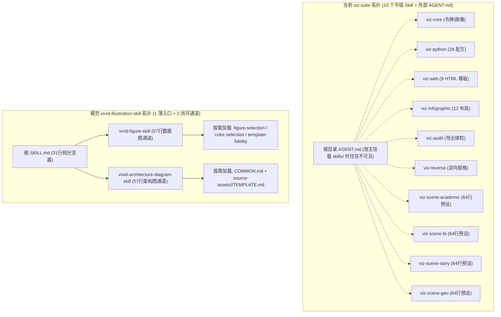
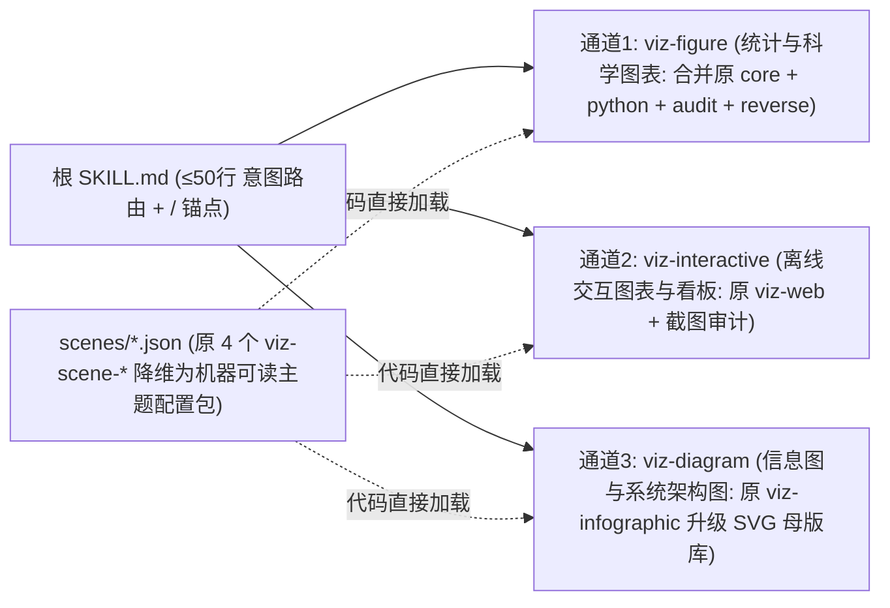

# 数据可视化 Skill 集群（`viz-suite`）深度审查与对标改进报告

> [!IMPORTANT]
> **核心结论速览**：当前 `viz-suite` 完成了很高的工程基础设施搭建（零外部网络依赖、CVD 色盲数学校验、PDF 字体嵌入检查、12 项黄金样本跑通），但**把“工程合规底线”误当成了“视觉与分析上限”**。出图效果不及预期的根本原因有二：**① 架构过碎 + “只准改 `PARAMS`”的刚性契约捆死了 Agent 对真实数据的版面适配能力**；**② 底层配方与信息图素材库属于“同质化合成脚本”，缺乏经过真实出版物验证的高密度母版、和谐色板与开源字体资产**。

---

## 一、现状病灶还原：为什么“工程验收 12/12 全绿”，实测效果却拉胯？

在审查代码与 Prompt 之前，我们先看工作区实测产物（[`test-run/`](file:///C:/Users/27190/Desktop/数据可视化/test-run/figure-manifest.json) 与 [`examples/golden-runs/`](file:///C:/Users/27190/Desktop/数据可视化/examples/golden-runs/end-to-end/contact.png)）暴露出的三个直接证据：

````carousel

<!-- slide -->

<!-- slide -->

<!-- slide -->

<!-- slide -->

````

### 1. 硬编码坐标撞车，而 `viz-audit` 对内部排版碰撞完全“失明”
在 [`test-run/viz-work/stacked_bar_total_line.py`](file:///C:/Users/27190/Desktop/数据可视化/test-run/viz-work/stacked_bar_total_line.py#L190-L202) 中，配方写死了画布绝对坐标 `fig.text(0.015, 0.902, SUBTITLE)` 与轴外右上图例 `bbox_to_anchor=(1.0, 1.005)` + `fig.subplots_adjust(top=0.80)`，同时 [`viz_style.py`](file:///C:/Users/27190/Desktop/数据可视化/skills/viz-python/scripts/viz_style.py#L897-L900) 严禁使用 `tight_layout` 或 `bbox_inches="tight"`。一旦填入真实的业务中文长副标题（*“三渠道堂食为基本盘、外卖贡献弹性；营收列无缺失，单位：万元”*），**副标题尾部直接与右上角图例文字重叠**（见滑块第 1 张）。同理，在 [`grouped_errorbar_bar.png`](file:///C:/Users/27190/Desktop/数据可视化/skills/viz-python/catalog/previews/grouped_errorbar_bar.png) 预览图中，*“总体均值 3.51”* 标签直接压在了第一组柱子的误差棒横帽上。

然而 [`audit_export.py`](file:///C:/Users/27190/Desktop/数据可视化/skills/viz-audit/scripts/audit_export.py#L152-L232) 只检查外围像素包围盒白边（`>30%` 或 `<0.2%`）、DPI、字体嵌入和外链，**没有任何文本包围盒（Text BBox）或图元碰撞检测**，因此依然给出 `blocking: 0` 的满分通过信号，误导 Agent 以为成图完美。

### 2. 多技能串行仪式过重，导致多图任务半途力竭
在 [`test-run/figure-manifest.json`](file:///C:/Users/27190/Desktop/数据可视化/test-run/figure-manifest.json#L1-L32) 中，Agent 原本规划了 `fig-01`、`fig-02`、`fig-03` 三张套图，但最终 `test-run/outputs/` **只产出了第 1 张图就中断了**。原因在于单张图被强制要求执行：`profile_data.py` → `detect_fonts.py` → `get_recipe.py` → 看预览图 → 改 `PARAMS` → 渲染 → `check_recipe_fidelity.py` → `audit_export.py` → 四象限裁切看图复核。9 步重型流水线乘以 3 张图，迅速耗尽上下文预算与执行耐心。

### 3. 全局一刀切参数导致严重的“工程塑料感 / 千图一面”
- **静态统计图**：[`viz_style.py`](file:///C:/Users/27190/Desktop/数据可视化/skills/viz-python/scripts/viz_style.py#L99-L108) 的 `bar_kwargs()` 全局默认 `fill_alpha=0.18`（把主色冲淡成近乎透明的粉白底色 + 1pt 硬描边），且几乎所有配方都共享同一套左上角粗黑内嵌标题 + 底部灰字注记 + `okabe_ito` 蓝橙粉配色（对比滑块第 2 张与第 3 张）。
- **结构化信息图**：[`render_infographic.py`](file:///C:/Users/27190/Desktop/数据可视化/skills/viz-infographic/scripts/render_infographic.py#L175-L186) 用极简的几何公式（如椭圆角度均分 `radial_positions`）拼装方框与连线。在 12 种布局集锦（滑块第 4 张）中，所有海报上方 35%~40% 面积都被一模一样的巨型标题栏霸占，而下方的 `mindmap`、`hierarchy-tree`、`cycle`、`quadrant` 只是几个小方框漂浮在大片空白背景中，缺乏真实商业咨询图或顶会架构图的视觉张力。

---

## 二、Skill 集群结构与架构评估

### 1. 拓扑对比：10 个平级碎片 Skill vs. 模范“薄路由 + 双通道”



### 2. 结构层面的四大硬伤

1. **宿主挂载失配与上下文稀释（Over-Fragmentation）**
   在 Claude Code、Antigravity、Codex 等真实宿主中，Skill 是按每个子文件夹下 `SKILL.md` 的 YAML `description` 独立语义召回的，**仓库根目录的 [`AGENT.md`](file:///C:/Users/27190/Desktop/数据可视化/AGENT.md) 在作为插件分发时并不会自动注入系统提示词**。拆成 10 个平级 Skill 后会出现两种极端：
   - **漏召回**：用户说“把这份销售表画成汇报图”，宿主只激活了 `viz-scene-story` 或 `viz-python`，漏掉了 `viz-core` 和 `viz-audit`；
   - **过载召回**：一次激活 `viz-core` + `viz-python` + `viz-scene-bi` + `viz-audit` 4 个完整 `SKILL.md`（合计近 600 行、大量重复规训），瞬间挤占工作记忆，导致指令遵循率下降。

2. **四个 `viz-scene-*` 是“伪 Skill”，且与运行时代码脱节（Unhooked Presets）**
   查看 [`viz-scene-academic/SKILL.md`](file:///C:/Users/27190/Desktop/数据可视化/skills/viz-scene-academic/SKILL.md) 等 4 个场景技能，它们没有任何专属脚本或模板，声明“只覆盖 12 槽位”。更致命的是：**配置与代码断联**——[`tokens.json`](file:///C:/Users/27190/Desktop/数据可视化/skills/viz-core/assets/tokens.json#L29-L35) 虽然写了 `"palette_by_scene"`，但 [`viz_style.py`](file:///C:/Users/27190/Desktop/数据可视化/skills/viz-python/scripts/viz_style.py#L239-L285) 的 `resolve_theme()` **压根没有接收 `scene` 参数，也从未读取 `palette_by_scene` 或 `scene-delta.md`**！所有场景差异全靠大模型阅读 Markdown 表格后人肉去改 Python 参数。
   > 例如 [`viz-scene-academic/scene-delta.md`](file:///C:/Users/27190/Desktop/数据可视化/skills/viz-scene-academic/scene-delta.md#L10) 规定“图内不放大标题（`TITLE=""`）”，但如果 Agent 听从 `viz-python` 只把 `PARAMS` 里的 `TITLE` 设为空字符串，配方底部的 `fig.subplots_adjust(top=0.80)` 依然死死保留顶部 20% 空白，直接触发白边告警！

3. **相对路径假设脆弱，跨工作区即崩**
   各 `SKILL.md` 中的命令混用了两套完全冲突的工作目录假设：
   - [`AGENT.md`](file:///C:/Users/27190/Desktop/数据可视化/AGENT.md#L64-L90) 假设 CWD 在技能仓库根目录（`uv run skills/viz-core/scripts/...`）；
   - [`viz-python/SKILL.md`](file:///C:/Users/27190/Desktop/数据可视化/skills/viz-python/SKILL.md#L15) 假设 CWD 在 `skills/viz-python/` 内（`uv run scripts/get_recipe.py`）；
   - [`viz-infographic/SKILL.md`](file:///C:/Users/27190/Desktop/数据可视化/skills/viz-infographic/SKILL.md#L91) 甚至写了跨目录相对引用 `uv run ../viz-web/scripts/screenshot_html.py`。
   当用户在自己的业务目录（如 `D:\my-paper\`）调用全局安装的 Skill 时，这些相对路径会全部报 `FileNotFoundError`。反观 `vivid-illustration-skill` 在 [`SKILL.md`](file:///C:/Users/27190/Desktop/数据可视化/参考/vivid-illustration-skill/SKILL.md#L27) 和 [`host-adapter.md`](file:///C:/Users/27190/Desktop/数据可视化/参考/vivid-illustration-skill/host-adapter.md#L3) 中严格定义了 `<SKILL>`、`<RES>`、`<WORKSPACE>` 三个显式路径锚点，并通过 `bootstrap.py` 固化 `.vivid/runtime.json`。

4. **遗留半成品文档未清理**
   [`skills/viz-core/references/decision-tree.md`](file:///C:/Users/27190/Desktop/数据可视化/skills/viz-core/references/decision-tree.md#L82-L89) 第五节至今仍写着 *“当前 Stage 1 已落地黄金样板（其余配方在 Stage 2 按同一标准扩充）”*，仅列出 2 个配方，与 `viz-python` 实际的 28 个配方脱节，容易误导先读 `viz-core` 的 Agent 以为只有 2 套配方可用。

---

## 三、Prompt 质量与约束机制评估

> [!WARNING]
> **最大的反模式：把“保真”异化为“只准填空 `PARAMS` + AST 计数警察”**。这直接剥夺了大模型处理真实异构数据的核心优势，把智能体降格成了死板的正则替换脚本。

### 1. “只改 `PARAMS`”契约与 `check_recipe_fidelity.py` 的刚性死锁
- [`viz-python/SKILL.md`](file:///C:/Users/27190/Desktop/数据可视化/skills/viz-python/SKILL.md#L28-L54) 强令 Agent **“只改顶部 `PARAMS` 区”**，并通过 [`check_recipe_fidelity.py`](file:///C:/Users/27190/Desktop/数据可视化/skills/viz-python/scripts/check_recipe_fidelity.py#L96-L157) 统计源文件的 AST 函数调用次数（`LAYER_CALLS`）与样式字典键（`STYLE_KEYS`）——只要删掉任何一个绘图调用或减少 40% 样式键，直接判 `blocking` 失败。
- **为什么实战必翻车？** 真实世界的数据绝不会刚好长成合成 Demo 的形状：
  - 在咖啡店实测中，用户要求“按各城市上半年营收合计降序排列”，但 [`stacked_bar_total_line.py`](file:///C:/Users/27190/Desktop/数据可视化/test-run/viz-work/stacked_bar_total_line.py#L72-L76) 的 `SORT_X = True` 只是按城市名字母/自然序排列（`natural_key`），**根本不支持按汇总数值降序**！如果不改下方数据处理代码，X 轴顺序就是错的；如果改了代码，又怕触发保真门禁。
  - 若配方包含“训练集/测试集双色散点 + 均值辅助线”，而用户的真实 CSV 不分训练测试集，在 `check_recipe_fidelity.py` 的高压下，Agent **不敢删除多余的 `scatter` 图层**，只能被迫生造伪分组或硬凑无意义图层。

### 2. Prompt 信息密度与宿主兼容性问题
- **高频重复淹没重点**：同一套 JSON 返回协议（`status / outputs / rows_used / ...`）、同一套统计诚实红线（零基线、饼图 ≤6 类、禁双 Y 轴、禁伪造 p 值）在 `AGENT.md` 和 6 个子 `SKILL.md` 中反复粘贴，每个 `SKILL.md` 长达 130~155 行，把真正关键的视觉审美与版式权衡挤到了角落。
- **硬编码特定宿主工具名 `ViewImage`**：在 `AGENT.md`、`viz-python`、`viz-audit`、`viz-infographic` 中共出现十余次硬编码的 `调用 ViewImage 查看`。但在不同 Agent 运行环境中，看图工具分别叫 `read_file`、`Read`、`view_file` 等，硬编码不存在的工具名会让模型产生工具调用幻觉或困惑。
- **一刀切教条违背专业惯例**：[`AGENT.md`](file:///C:/Users/27190/Desktop/数据可视化/AGENT.md#L140) 规定 *“严禁双 Y 轴”*、*“严禁 3D 图表”*。但帕累托图（甚至你们自己的 `pareto_cumulative.py`！）、量价叠加图、水文气象温雨图天然需要双 Y 轴；响应面优化、地形高程、三维帕累托前沿天然需要真三维表达。

---

## 四、深度对标模范 `vivid-illustration-skill`：六大核心代差

仔细研读 [`参考/vivid-illustration-skill`](file:///C:/Users/27190/Desktop/数据可视化/参考/vivid-illustration-skill/SKILL.md)（包含其源码包、148 套图表母版库、196 套顶会架构资产及 [`AGENT-QUALITY-REPORT.md`](file:///C:/Users/27190/Desktop/数据可视化/参考/vivid-illustration-skill/workbench/docs/AGENT-QUALITY-REPORT.md)）后，可以清晰看到工业级标杆 Skill 的设计逻辑：

| 评估维度 | 当前 `viz-suite` | 模范 `vivid-illustration-skill` | 代差本质 |
| :--- | :--- | :--- | :--- |
| **入口与路由架构** | 10 个平级 Skill（各 ~140 行）+ 外部 `AGENT.md`（223 行） | **31 行极薄根 `SKILL.md`** + **2 个 57 行自闭环通道** + 15~59 行按需片段 | Vivid 把上下文全部留给当前任务，零冗余规训 |
| **宿主解耦能力** | 硬编码 `ViewImage`；CWD 相对路径混乱 | 统一 `<SKILL>`/`<RES>`/`<WORKSPACE>` 锚点；[`host-adapter.md`](file:///C:/Users/27190/Desktop/数据可视化/参考/vivid-illustration-skill/host-adapter.md) 抽象宿主看图与子代理能力 | 真正跨 Claude/Codex/Cursor/AGY 即插即用 |
| **模板复用契约** | **死锁 `PARAMS` 填空**，禁止动下半部结构代码 | **拷贝 `render.py` 源码级适配**：允许重写数据管道、扩缩画布与网格、删无数据支撑的条件图层 | 从“死板填表”升级为“保风味的工程改写” |
| **AST 保真脚本定位** | [`check_recipe_fidelity.py`](file:///C:/Users/27190/Desktop/数据可视化/skills/viz-python/scripts/check_recipe_fidelity.py) 作 **阻断门禁（Blocking）** | [`recipe_style_review.py`](file:///C:/Users/27190/Desktop/数据可视化/参考/vivid-illustration-skill/original/resources/assets/shared-scripts/recipe_style_review.py) 明确声明 **仅作只读线索（Review Hints），绝不判挂** | 区分“合理的业务结构适配”与“偷懒删微质感” |
| **成图几何审计** | 只查外围白边、DPI、字体嵌入，漏检文字撞车 | 具备 `geometry-probe.js`、`check_architecture_connections.py` 查线穿框、断连、遮挡，外加强制看图审校策略 | 查真正的**版面几何冲突**，而非只查文件元数据 |
| **微质感与审美设计** | 全局统一 `alpha=0.18` 浅底描边 + 固定左顶黑标题 | **按图种精调微质感**：如 12 层 `alpha=0.025` 羽化置信带、渐变山脊填充、内嵌贡献环图、柔和自然色板 | 每一张底稿本身就是发表级艺术品，而非统一宏函数套壳 |
| **统计图资产规模** | **28 套**合成脚本（缺普通折线/普通散点/山脊/ROC 等基础盘）；预览 PNG 单张 200~700KB | **148 套**六大领域全覆盖母版 + **3 套多面板旗舰复合模板**；选型缩略图压缩为 30~70KB JPG | 覆盖率差 5 倍，且 Vivid 极大节省多模态选型 Token |
| **架构/信息图资产** | 纯 Python 算坐标拼简单方框 + 100 个基础线性小图标 | **196 套 OSDI/ASPLOS/NSDI 顶会真实论文 SVG 母版** + **981 个拆解语义部件** + 原生可编辑 PPTX 导出 | 复杂架构/信息图靠“高水准母版重组”，而非手写简单几何排布 |

### 值得重点借鉴的 3 个精妙设计细节

1. **精炼而锋利的保真准则（[`template-fidelity.md`](file:///C:/Users/27190/Desktop/数据可视化/参考/vivid-illustration-skill/template-fidelity.md#L35-L59)）**
   Vivid 用不到 60 行就把“什么该锁、什么该改”讲得极其透彻：
   - **必须保留（风味灵魂）**：多面板主副图组合关系、同轴互补图层（如柱+误差+散点、多层渐变带）、框线/网格/圆角/白边散点等微质感；
   - **鼓励适配（数据实情）**：分类变多或标签变长时主动加大 `figsize` / 调整面板比例 / 旋转或换行标签；真实数据没有对应字段（如无 train/test 切分、无阈值基线）时**干净删掉该条件图层，绝不生造数据凑模板**。
2. **上游规划与下游实况的闭环对账（[`upstream-planning.md`](file:///C:/Users/27190/Desktop/数据可视化/参考/vivid-illustration-skill/original/upstream-planning.md#L1-L40)）**
   多图任务先写 `FIGURE_PLAN.json` 分配角色（避免满篇柱状图），且允许下游画图发现真实数据分布与预期不符时，走 `reconcile` 修订计划，而不是硬着头皮画错图种。
3. **理性务实的专业绘图观（[`drawing-guide.md`](file:///C:/Users/27190/Desktop/数据可视化/参考/vivid-illustration-skill/original/drawing-guide.md#L1-L35)）**
   不搞教条式一刀切：明确区分“廉价伪 3D 柱/饼（禁）”与“真三维空间场/曲面/帕累托前沿（准）”，区分“偷懒乱凑双轴（禁）”与“经典帕累托/双量纲耦合双轴（准，但主次轴颜色须与序列绑定编码）”。

---

## 五、改进路线图与高规范素材引入方案

针对你的核心问题——**“应该向哪些方向改进、是否需要引入更多更规范的素材？”**

回答非常明确：**必须引入更多、更规范的素材！** 目前效果平庸，**约 40% 卡在架构碎裂与 `PARAMS` 刚性锁死，另外 60% 直接受限于底层母版、色板、矢量部件和字体素材的质量上限**（巧妇难为无米之炊，底稿本身如果只是 `alpha=0.18` 的素朴单图，Agent 再怎么调参也调不出顶刊和经济学人的质感）。

建议按以下 **三大架构/Prompt 改造方向** 与 **五大规范素材引入工程** 推进：

### （一）架构与 Prompt 改造方向

#### 1. 拓扑大瘦身：从 `10 Skills + AGENT.md` 收敛为 `1 薄路由 + 3 核心通道`
将对外暴露的 Skill 收敛为结构自闭环的精简体系，彻底消除漏召回和上下文爆炸：



- **把 4 个 `viz-scene-*` 退化为 JSON/YAML 预设文件**（如 `assets/scenes/{academic,bi,story,geo}.json`）：直接在 [`viz_style.py`](file:///C:/Users/27190/Desktop/数据可视化/skills/viz-python/scripts/viz_style.py) 中实现 `vs.bootstrap(scene="academic")`，自动切换色板、字号档位、框线风格、是否启用图内大标题，以及对应的顶底留白（当 `in_canvas_title=false` 时自动收回顶部 20% 空白！）。
- **重写精简 `SKILL.md`**：每个入口文件严格控制在 **50~70 行以内**；删除所有跨文件复制粘贴的 CLI 帮助文档与 JSON 字段说明（Agent 运行 `--help` 或看脚本末尾输出即可获知）；将硬编码的 `ViewImage` 统一替换为宿主无关描述（*“使用当前宿主的图像查看工具检视导出 PNG”*）。

#### 2. 解除“`PARAMS` 填空死锁”，升级为“结构分区模板 + 提示型审查”
- 将 Python 配方的代码结构明确划分为三段注释区：
  1. `# [1. DATA PIPELINE]`（**自由改写区**）：读取真实 CSV/JSON、分组聚合、按业务语义排序、处理缺失值；
  2. `# [2. CANVAS & LAYOUT]`（**弹性适配区**）：根据分类数量和 `max_label_units` 动态计算 `figsize`、面板比例与图例避让位置；
  3. `# [3. VISUAL ENCODING & MICRO-AESTHETICS]`（**风味保护区**）：保留母版精调的渐变层、描边对比、散点白边与焦点高亮逻辑。
- 改造 [`check_recipe_fidelity.py`](file:///C:/Users/27190/Desktop/数据可视化/skills/viz-python/scripts/check_recipe_fidelity.py)：取消 AST 计数差别的 `blocking` 拦截，改为输出 **Review Hints（审查线索）**，只对真正的低级退化（如退回默认丑配色、丢失高 DPI 矢量设置、未设 `unicode_minus`）发警告。

#### 3. 为 `viz-audit` 补上真正的“版面几何与文字碰撞检测”
- **Matplotlib 渲染期自检（成本最低、最准）**：在 [`viz_style.py`](file:///C:/Users/27190/Desktop/数据可视化/skills/viz-python/scripts/viz_style.py) 的 `export()` 保存前，调用 `fig.canvas.get_renderer()` 提取所有 `Text`、`Legend`、`Title` 的屏幕像素包围盒（`get_window_extent(renderer)`），两两检测矩形交集（IoU > 0 即报具体哪两个文本重叠，例如 `"副标题 与 图例 发生像素重叠"`！），并修正标题/图例布局方式（标题与图例分置不同水平带，或采用动态流式堆叠计算 `y` 坐标，而非写死 `0.902` 和 `1.005`）。
- **SVG / HTML 几何探针**：参考 Vivid 的 `geometry-probe.js` 与 `check_architecture_connections.py`，在导出 SVG/HTML 时自动检测文字溢出容器（`scrollWidth > clientWidth`）、连线穿过文本框、节点重叠等硬伤。

---

### （二）必须引入的五大类高规范素材清单

> [!TIP]
> **素材建设黄金法则**：宁可精挑细选 60 套**视觉惊艳、带真实复杂细节的出版级母版**，也不要用统一脚手架批量生成 200 套长相雷同的玩具脚本。

#### 素材包 1：分层级统计图母版库（从 28 套扩充至 75~100 套 + 旗舰复合母版）
当前 [`selection-index.jsonl`](file:///C:/Users/27190/Desktop/数据可视化/skills/viz-python/catalog/selection-index.jsonl) 存在严重的“中间空心化”——有 Bland-Altman 和校准曲线，却没有最基础的多序列折线图（不带三层置信带的普通业务折线）、普通散点气泡图、山脊图（Ridgeline）、标准直方+核密度图、混淆矩阵、ROC/PR 曲线、瀑布/桥接图的高级变体、事件研究（Event Study / 平行趋势）、分位数回归、泰勒图、等高线/响应面等。
- **具体引入动作**：
  1. **补齐基础高频母版（约 20 套）**：单/多焦点折线（直接尾端标注免图例）、分组/堆叠横向条形（带右侧差值 Δ 胶囊标注）、气泡象限矩阵、山脊分布图、双轴帕累托与量价耦合图。
  2. **引入“多面板复合旗舰母版”（约 10~15 套，对标 Vivid `templates/`）**：例如 *“主图回归散点 + 双侧边际分布 + 组间显著性括号”*、*“SHAP 蜂群 + 均值贡献条 + 特征簇占比内嵌环图”*、*“左侧森林图效应量 + 右侧对齐数值汇总表（Table-Plot Fusion）”*、*“上方时间趋势主图 + 下方同轴同比增速柱状副图”*。这些复合布局是大模型最难临场手写对齐、一旦命中母版效果最惊艳的杀手锏。
  3. **标准化母版目录规格**：每个母版包含 `render.py` + `card.md`（写明适用数据结构、必保视觉特征、可裁剪条件层）+ **压缩版 `thumb.jpg`（宽 800px，体积 ≤60KB）**，替换目前动辄 400KB+ 的预览 PNG，将多模态选型 Token 消耗降低 80%。

#### 素材包 2：出版级和谐色板与“图种专属微质感”资产（打破 `alpha=0.18` 同质化）
当前 [`palettes.json`](file:///C:/Users/27190/Desktop/数据可视化/skills/viz-core/assets/palettes.json) 过度追求 CVD 数学色差最大化 + 全局 `alpha=0.18` 冲淡，导致画面寡淡生硬。
- **具体引入动作**：
  1. **扩充经过出版验证的经典色板**：引入顶刊学术色板（Nature `NPG`、Lancet、NEJM、JCO、Science `AAAS` 风格谐色）、经典商业媒体色板（Economist 蓝红灰、FT 暖羊皮纸色调、McKinsey 深海蓝阶）以及类似 Vivid 的低饱和自然双色/多色渐变板（如 `olive-apricot`、`coral-teal`、`ocean-breeze`），同时保留 `safe_k` 与 CVD 元数据供无障碍场景筛选，但**不要让所有场景默认回落到同一套 `okabe_ito`**。
  2. **废除全局单一 `fill_alpha=0.18`**：在 `viz_style.py` 中提供 3~4 种填充质感预设供不同母版选用——① **实色微亮填充**（85%~90% 饱和柔和实色 + 无框或极细白边，适合现代商业柱图/环图/堆叠图）；② **多层羽化渐变带**（10~12 层低透明度递减叠涂，适合置信带、密度山脊与面积折线）；③ **半透明轮廓填充**（`alpha=0.25~0.35` + 深色实边，仅用于箱线图、小提琴、重叠分布对比）。

#### 素材包 3：真实矢量 SVG 信息图与系统架构母版库（重塑 `viz-infographic`）
纯靠 Python 代码算百分比坐标画圆角矩形（当前 `render_infographic.py`），永远画不出精致的流程图、系统架构图与商业信息图。
- **具体引入动作**：
  1. 参考 Vivid 的 `architecture/source-assets/` 思路，收集并清洗 **30~50 套高质量 CC-BY / 自研标准矢量 SVG 母版**，覆盖商业分析与学术汇报高频版式：麦肯锡式金字塔拆解、端到端数据流水线、双环飞轮闭环、泳道协同架构、竞争格局四象限、多层技术栈框图、价值链漏斗等。
  2. 每套母版标准化拆解为：`template.svg`（带语义 `id` 分组）+ `slots.json`（定义标题槽、模块卡片槽、字数上限、可复制单元）+ `parts/`（高质感箭头、角标、立体层叠卡片、大数字 KPI 徽章等可复用 SVG 组件）+ `preview.jpg`。

#### 素材包 4：开源可商用内嵌字体包（消除跨机排版漂移与缺字重问题）
当前仓库零内置字体，依赖系统自带字体（甚至在 [`viz_style.py`](file:///C:/Users/27190/Desktop/数据可视化/skills/viz-python/scripts/viz_style.py#L129-L138) 里专门写了 `_BenignFontWeightFilter` 去屏蔽 `SimHei` 缺失粗体的报错！没有真粗体，图表的层级对比瞬间垮掉）。
- **具体引入动作**：
  在共享资产目录内置一套轻量、OFL/Apache 宽松开源协议的字体包（或提供一键按需拉取缓存脚本 `ensure_fonts.py`）：
  - **中文无衬线多字重**：`MiSans` 或 `Noto Sans SC`（至少含 `Regular 400`、`Medium 500`、`Bold 700` 三个真实字重）；
  - **中文衬线（叙事/社论风）**：`Noto Serif SC`（`Regular` / `Bold`）；
  - **西文与数字搭配**：`Inter` / `Arimo`（无衬线 UI 与轴刻度，支持 `tabular-nums` 等宽数字）、`Tinos`（对应 Times 学术衬线）、`JetBrains Mono` / `Inconsolata`（代码与指标标签）。
  在 Matplotlib 与无头浏览器截图中直接通过 `fontManager.addfont()` / `@font-face` 本地注册，实现 100% 跨平台像素级一致。

#### 素材包 5：合规地理底图资产与“真实脏业务数据”回归基准集
- **地理底图补全**：当前 `viz-scene-geo` 因不带任何底图，导致黄金测试 `08-geo-choropleth` 只能画 3×4 的假方格冒充地图。应引入：① 世界自然地球低精度合规边界（Natural Earth 110m/50m CC0 GeoJSON）供全球/洲际分析测试；② 中国及分省**方块/蜂窝示意网格地图（Tile Grid / Hexbin Cartogram JSON）**——既完全规避敏感测绘边界合规风险，又在商业汇报中极具现代数据新闻美感；同时在文档中明确用户自带标准审图号 GeoJSON 的接入规范。
- **真实脏数据 Benchmark**：在 `examples/` 中补充 5~8 份含**超长中文分类名、极端离群值、缺失值、不均衡组数（如 15 个省份、9 个细分品类）**的真实业务表。只有能扛住长文本与脏数据而不发生标题撞图例、X 轴挤成一团的母版，才允许进入正式目录。

---

### （三）建议落地优先级（Roadmap）

1. **阶段 P0（1~2 天，立竿见影止血）**：
   - 修复所有配方的标题/副标题/图例坐标流式避让逻辑，并在 [`viz_style.py`](file:///C:/Users/27190/Desktop/数据可视化/skills/viz-python/scripts/viz_style.py) 的 `export()` 中加入 **Renderer 文本包围盒碰撞自检**（彻底消灭 `test-run` 中的文字重叠）；
   - 将 [`check_recipe_fidelity.py`](file:///C:/Users/27190/Desktop/数据可视化/skills/viz-python/scripts/check_recipe_fidelity.py) 降级为非阻断提示，修改 `viz-python/SKILL.md` 允许结构化适配数据管道与画布尺寸；
   - 让 [`viz_style.py`](file:///C:/Users/27190/Desktop/数据可视化/skills/viz-python/scripts/viz_style.py) 真正读取场景配置（`scene="academic|bi|story|geo"`），打通色板与无标题留白联动。
2. **阶段 P1（3~5 天，架构与上下文重构）**：
   - 合并收敛 10 个 Skill 为 **1 个极薄根 `SKILL.md` + 3 个自闭环通道**，把 4 个 `viz-scene-*` 内化为 JSON 场景预设；
   - 统一 `<SKILL>` / `<WORKSPACE>` 路径锚点，移除 `ViewImage` 硬编码，补全 [`decision-tree.md`](file:///C:/Users/27190/Desktop/数据可视化/skills/viz-core/references/decision-tree.md)，压缩选型缩略图为轻量 JPG。
3. **阶段 P2（1~2 周，高规范素材与审美跃迁）**：
   - 内置开源多字重字体包，打破全局 `alpha=0.18`，引入顶刊/商业媒体色板；
   - 扩充 30+ 高频基础与多面板复合旗舰统计母版，并为信息图/架构图引入真实高质量 SVG 矢量母版库。

---

## 六、专项优化：解决数据图表“结构简单、空洞简陋”的四个层面方向

当前生成的图表显得**“结构简单、空洞简陋”**，核心是因为系统误把涂尔干/塔夫特的“高数据墨水比（去杂乱）”执行成了**“低信息密度（少内容）”**——删掉了冗余网格和边框后，既没有补充深层统计信号，也没有升级版面组合结构，还用全局极淡透明度把视觉重心洗平了。

结合现有代码与模范 [`vivid-illustration-skill`](file:///C:/Users/27190/Desktop/数据可视化/参考/vivid-illustration-skill/SKILL.md) 的源码实现，建议从以下 **四个层面** 系统性优化：

---

### 一、数据与信息层：从“一次浅聚合直出”升级为“三层信号必配”

**当前病根**：[`profile_data.py`](file:///C:/Users/27190/Desktop/数据可视化/skills/viz-core/scripts/profile_data.py#L6-L16) 只扫字段类型，Agent 拿到 CSV 后往往只做一次最简单的 `groupby` 就灌进单图，缺乏二次衍生计算；甚至在 [`grouped_errorbar_bar.py`](file:///C:/Users/27190/Desktop/数据可视化/skills/viz-python/recipes/grouped_errorbar_bar.py#L313-L333) 中，一旦分组系列 `k > 1` 就直接跳过了所有数值标注分支，画面只剩几根空柱子和一条虚线。

**优化做法**：在 Prompt 与配方数据管道中要求每张图至少编码 **“主量级 + 相对关系 + 基准/归因锚点”** 三层信息：
1. **单指标升级为复合双标签**：借鉴 [`plot_shap_composites.py`](file:///C:/Users/27190/Desktop/数据可视化/参考/vivid-illustration-skill/templates/shap-composites/plot_shap_composites.py#L274-L276)，条形或节点末端不再只标单一数字，而是同时给出 **`绝对值 + 结构占比%`**（如 `18.4% (0.92)`）或 **`均值 | 同比 Δ+12.4%`**。
2. **分组对比图的“冠军靶向标注”**：借鉴 [`basic.grouped_bar/render.py`](file:///C:/Users/27190/Desktop/数据可视化/参考/vivid-illustration-skill/catalog/sources/basic.grouped_bar/render.py#L39-L47)，多系列并列时不要全关标签，而是自动计算每组极值（`is_best`），用带白底圆角衬垫的彩色粗体标出 **`★ 92.1`**，其余普通柱用轻量小字，既饱满又有层次。
3. **默认叠加分布与参考语境**：趋势/相关图默认补充局部非参数平滑趋势线（如 [`smooth_trend()`](file:///C:/Users/27190/Desktop/数据可视化/参考/vivid-illustration-skill/templates/shap-composites/plot_shap_composites.py#L113-L131)）、分位数包络带（P25–P75 浅色带）、达标阈值区（`axhspan`）或关键拐点事件气泡，让图表自己“把分析结论讲出来”。

---

### 二、空间结构层：用 4 种“高密度复合构图”取代“单轴平铺”

**当前病根**：90% 配方只是单个 `ax` 平铺，且顶部留出 20%（`top=0.80`）、底部留出 16%~26%（[`shap_beeswarm_bars.py`](file:///C:/Users/27190/Desktop/数据可视化/skills/viz-python/recipes/shap_beeswarm_bars.py#L199)）放标题和粗框色条，真正画数据的区域不足画布 55%，图内大片自然负空间完全闲置。

**优化做法**：重点补充并优先路由到 **主副耦合的复合母版（Composite Templates）**：
1. **负空间内嵌子视图（Dead-Space Inset）**：排序条形图、帕累托图、衰减曲线的右下方天然有一块三角空白。参考 [`plot_shap_composites.py`](file:///C:/Users/27190/Desktop/数据可视化/参考/vivid-illustration-skill/templates/shap-composites/plot_shap_composites.py#L282-L308)，用 `get_window_extent` 动态测出下方短柱标签右边界，在空白处直接嵌入一个**双层分组贡献环图、总体分布小提琴或局部放大图（Zoom-in）**，空间利用率翻倍且零遮挡。
2. **“全局总览 + 局部机理”双联面板（Overview + Small Multiples）**：参考 [`plot_dependence()`](file:///C:/Users/27190/Desktop/数据可视化/参考/vivid-illustration-skill/templates/shap-composites/plot_shap_composites.py#L180-L248)，左面板 `(a)` 展示全局排名/汇总对比，右面板 `(b)` 用 `GridSpec` 排列 `2×2` 或 `3×2` 核心维度的趋势/切片子图，一图兼顾宏观格局与微观非线性特征。
3. **图右拼接“共享轴对齐微表（Table-Plot Fusion）”**：在横向对比条形图、森林图、漏斗图右侧紧贴拼入无框对齐数值列（展示 `样本量 n`、`涨跌幅色块胶囊`、`迷你占比条`），这是顶级期刊（Lancet/NEJM）和麦肯锡报告最常用的“抗单薄神器”。
4. **同轴异构图层叠合（In-Axis Layering）**：通过 `twiny()` 和分层 `zorder`，在同一坐标系叠合“背景语义色带 + 均值汇总条（底衬） + 原始观测散点/蜂群（前景）”（见 [`plot_shap_composites.py`](file:///C:/Users/27190/Desktop/数据可视化/参考/vivid-illustration-skill/templates/shap-composites/plot_shap_composites.py#L194-L207)），不再让单个图只画一种几何图元。

---

### 三、视觉微质感层：废除全局 `alpha=0.18` 洗白与平均主义

**当前病根**：[`viz_style.py`](file:///C:/Users/27190/Desktop/数据可视化/skills/viz-python/scripts/viz_style.py#L99-L108) 的 `bar_kwargs()` 全局硬设 `fill_alpha=0.18`，导致所有柱体/箱体像褪了色的空心线框；且所有序列粗细、深浅完全一致，没有视觉焦点。

**优化做法**：在 [`viz_style.py`](file:///C:/Users/27190/Desktop/数据可视化/skills/viz-python/scripts/viz_style.py) 中建立**主次分化的多档微质感预设**：
- **拉开主角与配角权重（Focal vs. Context）**：指定焦点序列使用 60%~85% 显色浓度的柔和混白填充（如 `_lighten(color, 0.35)`）+ `1.5pt` 深色边 + `+0.02` 偏移的极淡微投影（`alpha=0.08`，见 [`basic.grouped_bar/render.py`](file:///C:/Users/27190/Desktop/数据可视化/参考/vivid-illustration-skill/catalog/sources/basic.grouped_bar/render.py#L31-L36)）；非重点背景对比序列主动降为浅灰蓝细边。
- **组内层级同色系渐变**：当数据具备“大类 → 子项”二级结构时，按大类分配主色，大类内部按数值排名做同色系明度阶梯过渡（见 [`plot_shap_composites.py`](file:///C:/Users/27190/Desktop/数据可视化/参考/vivid-illustration-skill/templates/shap-composites/plot_shap_composites.py#L263-L269)），不增加杂乱色相却大幅提升结构精致度。
- **羽化渐变替代单层硬色块**：置信区间、面积折线与山脊图改用 10~12 层 `alpha=0.025` 递减叠涂的羽化色带，配合 `0.03` 极淡底衬稳住坐标系空间感。
- **收回画布无效留白**：压缩图内标题高度占比（≤12%，学术场景直接去图内大标题并将 `top` 提至 `0.94`），把 75%+ 的画布面积留给核心数据区。

---

### 四、信息图与 Web 图表层：把“空文字框”升级为“复合数据微组件”

1. **改造 `viz-infographic`（[`render_infographic.py`](file:///C:/Users/27190/Desktop/数据可视化/skills/viz-infographic/scripts/render_infographic.py)）**：
   - 将顶部巨型标题栏高度砍半（从占画布 35%~40% 压至 ≤18%）；
   - 扩充卡片 JSON 槽位，支持渲染**卡片内嵌微组件**：右上角 `delta_badge`（如 `+24%` 胶囊）、卡片底部 `mini_progress`（迷你进度/占比条）、多级芯片标签 `tags`，以及把孤立节点包裹起来的**外层泳道/阶段底框（Zone Containers）**，终结“几个白框飘在空白页”的简陋感；复杂架构图直接引入真实 SVG 矢量母版库。
2. **改造 `viz-web`（[`line.html`](file:///C:/Users/27190/Desktop/数据可视化/skills/viz-web/templates/echarts/line.html) 等模板）**：
   - 将单图 HTML 升级为**“微看板卡片”结构**：默认包含 **顶部 3~4 格核心 KPI 摘要带（总量 / 均值 / 极值 / 同比） + 主图内置 `markArea`（重点区间底色）与 `markPoint`（峰谷自动气泡） + 右侧或底部构成明细副图**，打开网页即具备完整商业分析报告的饱满度。
