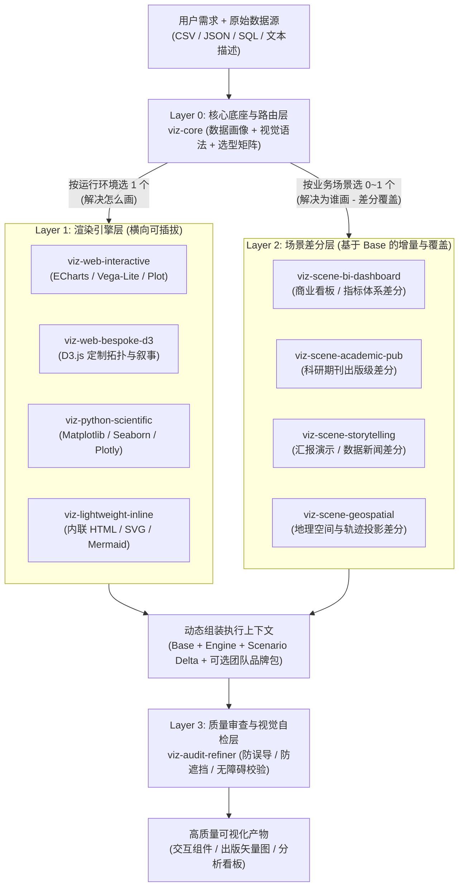
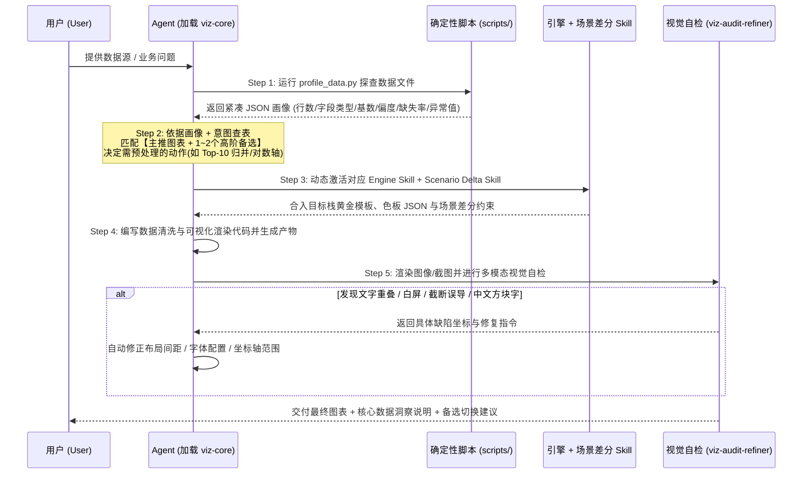

# 数据可视化多 Skill 模块化架构与开发全景规划

> **文档定位**：面向 AI Agent（兼容 Antigravity、Claude Code、Codex、Gemini CLI 等主流 Agent Skills 规范）的数据可视化能力体系架构蓝图。  
> **核心目标**：通过**“核心底座 + 渲染引擎插件 + 场景差分包 + 视觉质检闭环”**的四层模块化架构，解决单一巨型 Skill 上下文爆炸、审美与规范冲突、以及只会画“柱线饼三件套”的痛点，实现**跨平台普适性**与**分场景的丰富图表表达**。

---

## 目录

1. [为什么需要“多 Skill 模块化组装与差分”？](#1-为什么需要多-skill-模块化组装与差分)
2. [前期资料收集全景清单（收什么、去哪收、怎么转化）](#2-前期资料收集全景清单收什么去哪收怎么转化)
3. [开源标杆 Skill 项目、可复用素材库与社区经验拆解](#3-开源标杆-skill-项目可复用素材库与社区经验拆解)
4. [保证“丰富可视化选择”的三维选型体系](#4-保证丰富可视化选择的三维选型体系)
5. [多 Skill 模块化架构划分（4 层 10 模块矩阵）](#5-多-skill-模块化架构划分4-层-10-模块矩阵)
6. [“模块化组装”与“场景差分（Delta）”核心机制设计](#6-模块化组装与场景差分delta核心机制设计)
7. [文件目录结构设计（宏观套装与微观单 Skill 规范）](#7-文件目录结构设计宏观套装与微观单-skill-规范)
8. [标准执行工作流与确定性脚本设计](#8-标准执行工作流与确定性脚本设计)
9. [跨平台普适性与宿主环境适配策略](#9-跨平台普适性与宿主环境适配策略)
10. [核心模板示例（可直接复用）](#10-核心模板示例可直接复用)
11. [分阶段开发路线图与防坑指南](#11-分阶段开发路线图与防坑指南)

---

## 1. 为什么需要“多 Skill 模块化组装与差分”？

在开发数据可视化 Skill 时，如果将所有图表知识、前端库语法、Python 绘图代码、商业看板排版和科研论文规范塞进**单个巨型 Skill**，会不可避免地遇到三大瓶颈：

1. **上下文稀释与 Token 浪费（Context Dilution）**：同时加载 D3.js、ECharts、Matplotlib、ggplot2 与地理空间规范会消耗数万 Token，导致模型注意力分散，关键细节指令遵循率大幅下降。
2. **场景规范互斥（Constraint Conflict）**：
   - **科研出版场景**要求：纯白背景、无交互、7–8pt 紧凑字号、高数据墨水比、强制标注误差棒与显著性 $p$ 值、输出 300/600 DPI 矢量 PDF/SVG。
   - **商业高管大屏/SaaS 看板**要求：响应式栅格、支持深浅主题切换、KPI 指标卡先行、Hover 十字准星联动与下钻筛选、阈值红黄绿告警。
   - 单一 Skill 无法同时给出了互斥的美学与工程指令，最终只能退化为平庸的默认样式。
3. **图表选型单一化（Chart Monotony）**：大模型在缺乏结构化选型引导时，90% 的概率会退回柱状图、折线图和饼图，忽略更精准的高阶图表（如用**云雨图**呈现偏态分布、用**哑铃图/坡度图**呈现前后对比、用**瀑布图**呈现财务增减归因、用**UpSet 图**替代超过 3 集合的韦恩图）。

### 架构解法：正交拆解 + 渐进式披露 + 差分覆盖（Base + Delta）

利用 Agent Skills 的**渐进式披露（Progressive Disclosure）**机制（平时仅驻留几十词的 `name` 与 `description`，命中时才按需加载正文与 `references/`），我们将可视化能力正交拆解为四个维度：



---

## 2. 前期资料收集全景清单（收什么、去哪收、怎么转化）

> [!IMPORTANT]
> **资料收集的核心原则**：切忌把几百页的原版书籍或完整 API 文档直接扔进 Skill 目录！所有收集到的资料都必须经过**结构化蒸馏（Distillation）**，转化为 Agent 极易检索的**决策表（Markdown Table）**、**机器可读配置（JSON/YAML）**或**黄金代码片段（Golden Snippets）**。

### 2.1 理论与选型分类学资料（决定“画什么图最专业”）

| 资料类别 | 推荐权威来源 | 需要提取的核心内容 | 转化为 Skill 内的资产形式 |
| :--- | :--- | :--- | :--- |
| **分析意图分类表** | **Financial Times *Visual Vocabulary***（金融时报视觉词汇表） | 9 大数据关系类别（偏差、相关性、排名、分布、时间变化、局部与整体、量级、空间、流向）下的 70+ 种图表映射关系 | `viz-core/references/intent-to-chart-matrix.md` |
| **数据形态决策树与禁忌** | **From Data to Viz** (`data-to-viz.com`, Yan Holtz) | 基于变量类型（数值型、分类型、时间、网络、地理）及样本量级的选型路径；每种图表的常见误用（Caveats） | `viz-core/references/data-shape-decision-tree.md` |
| **视觉编码有效性排序** | Tamara Munzner *Visualization Analysis and Design* | 视觉通道精确度优先级（对齐位置 > 长度 > 角度/斜率 > 面积 > 体积/亮度/饱和度 > 色相/形状） | 写入 `viz-core/SKILL.md` 核心编码准则（≤30 行） |
| **统计真实性与去噪准则** | Edward Tufte（数据墨水比）、Alberto Cairo *How Charts Lie* | 柱状图零基线铁律、折线图非零基线标注规范、双 Y 轴禁用/替代方案、小多图（Small Multiples）替代杂乱意面图（Spaghetti Plot） | `viz-audit-refiner/references/statistical-integrity-rules.md` |

### 2.2 色彩科学、排版与无障碍规范（决定“好不好看、高不高级”）

| 资料类别 | 推荐权威来源 | 需要提取的核心内容 | 转化为 Skill 内的资产形式 |
| :--- | :--- | :--- | :--- |
| **科学配色标准库** | **ColorBrewer 2.0**、**Okabe-Ito**（色盲安全黄金标准）、**Viridis / Cividis** | 严格区分三类色板：<br>1. **定性分类（Qualitative）**：≤8 类高区分度色板 + 超出归为“其他”灰色规则<br>2. **顺序渐变（Sequential）**：单色/多色感知均匀色阶<br>3. **发散对称（Diverging）**：以 0 或均值为中性锚点的双极色阶 | `viz-core/resources/palettes.json`（提供经过验证的 HEX 数组，严禁模型临场编造 `#FF0000` 等刺眼纯色） |
| **知名设计系统图表规范** | **AntV 设计语言**、**IBM Carbon Charts**、**Observable Plot**、*The Economist* / *NYT* 图表风格指南 | 标题层级字号比、图例摆放位置（顶部左对齐优于右侧挤压画布）、网格线弱化透明度（10%~15% 透明度虚线或仅保留水平线）、数字格式化规范（千分位、单位缩写 `K/M/B/万/亿`、小数位对齐） | `viz-core/references/typography-and-layout.md` |
| **无障碍与对比度标准** | **WCAG 2.1 AA / APCA**、Coblis 色盲模拟规范 | 文本对比度 ≥ 4.5:1，图形几何块对比度 ≥ 3:1；**双重编码原则**（不单靠红绿区分涨跌，叠加箭头 `↑/↓`、正负号或线型虚实）；深色模式（Dark Mode）下降低色块饱和度防眩光规则 | `viz-audit-refiner/references/a11y-checklist.md` |

### 2.3 渲染引擎现代 API 与防坑资料（解决大模型训练权重滞后问题）

大模型最容易犯的错误是混用旧版废弃 API 或出现环境兼容性故障。需针对每个目标引擎收集**“最新稳定版速查 + 废弃 API 黑名单 + 中文/字体/响应式脚手架”**：

| 技术栈方向 | 需收集整理的关键资料点 | 重点解决的高频痛点 |
| :--- | :--- | :--- |
| **Web 交互图表**<br>(ECharts 5/6, Vega-Lite v5, Observable Plot, Chart.js v4) | - ECharts `dataset` 数据集声明式映射、`universalTransition`、自适应 `ResizeObserver` 销毁与防抖<br>- Vega-Lite v5 复合图层（`layer`）、分面（`facet`）与交互选择器（`params`）Schema | 防止容器宽高为 `0px` 白屏、窗口缩放变形、Tooltip 溢出视口、百万级数据未开启 `large: true` / Canvas 降采样导致浏览器卡死 |
| **Web 高定制可视化**<br>(D3.js v7 + 原生 SVG/Canvas) | - D3 v7 模块化语法（`selection.join()` 替代旧版 `enter().append()`、`d3.pointer(event)` 替代已移除的 `d3.mouse`）<br>- 桑基图 `d3-sankey`、力导向 `d3-force`、层级树 `d3-hierarchy` 最小可运行骨架 | 彻底杜绝 D3 v3/v4 与 v7 语法混写报错；解决 SVG `viewBox` 自适应与文本标签碰撞裁剪 |
| **Python 科学与数据分析**<br>(Matplotlib 3.8+, Seaborn 0.13+, Plotly 5+, Altair 5+) | - Seaborn 0.13+ 新 API（用 `histplot`/`displot` 替代已废弃的 `distplot`；`errorbar=('ci', 95)` 替代旧版 `ci=95`）<br>- 跨平台中文字体回退链（Windows `Microsoft YaHei/SimHei`、macOS `PingFang SC/Arial Unicode MS`、Linux `Noto Sans CJK SC`）及 `axes.unicode_minus = False` | 根治 Python 画图**中文显示方块 `□□□`**、负号丢失、图例被 `savefig` 裁切（强制 `bbox_inches='tight'`）等顽疾 |
| **轻量文档与宿主内联**<br>(Mermaid v10/v11, 宿主 HTML Widget) | - Mermaid 支持的合法图种语法边界与特殊字符引号转义规则<br>- 宿主沙箱 CSP（内容安全策略）限制清单、语义化 CSS 变量（如 `--background`、`--foreground`）与离线/内联渲染方案 | 防止外部 CDN 被拦截导致白屏、深浅色主题切换时出现黑底黑字不可读 |

### 2.4 垂直领域规范资料（支撑场景差分包）

1. **商业经营与 BI 规范**：收集 **IBCS（国际商业沟通标准）** 语义记号（如实心黑/深灰表示实际值 Actual、空心框表示预算 Plan、斜线填充表示预测 Forecast）、SaaS 核心指标可视化范式（Cohort 留存热力表、漏斗转化率标注、北极星指标拆解树、Stephen Few 子弹图）。
2. **学术期刊投稿指南**：收集 *Nature*、*Science*、*IEEE*、*Cell* 官方 Author Guidelines 中的 Figure 规范（单栏 85–89 mm、1.5 栏 120–136 mm、双栏 175–183 mm；无衬线字体 Arial/Helvetica 6–8 pt；线条粗细 0.5–1.5 pt；子图编号 `a, b, c` 大小写与字重规范；严禁使用 Rainbow/Jet 伪彩色图）。
3. **地理空间合规与投影指南**：收集 GeoJSON / TopoJSON 规范、常见地图投影适用场景（等积投影 Albers/Equal Earth 用于面积/密度对比，Web Mercator 仅用于局部导航）、WGS-84 与 GCJ-02/BD-09 坐标系偏移识别说明、分级统计地图（Choropleth）的数据分箱法（自然断点 Jenks、分位数 Quantile、等间距 Equal Interval 选型标准）。
4. **评测基准测试集（Benchmark Datasets）**：准备 15–20 份覆盖真实极端情况的小样本测试集（含 `NaN` 缺失值、跨越 5 个数量级的幂律长尾数据、超过 40 个类别的脏分类字段、多时区不规则采样时间序列、超长中文标签），用于自动化回归测试各个 Skill。

---

## 3. 开源标杆 Skill 项目、可复用素材库与社区经验拆解

站在开源生态肩膀上开发，能大幅缩短试错周期。以下精选了当前 GitHub 上最具代表性的 **7 大数据可视化/信息图 Agent Skill 标杆项目** 与 **6 大高价值开源资产库**，明确标注了**授权协议边界**、**可学习的架构精髓**以及**可直接提取复用的部分**。

> [!CAUTION]
> **开源合规红线区分**：务必区分 **“学习架构思想并自主重实现”** 与 **“直接提取复用源码/配置”**。对于采用 `MIT / Apache-2.0 / BSD / CC0` 的项目，可直接提取样式表、色值数组、脚本骨架并保留版权声明；对于明确声明 **Non-Commercial（仅限个人非商用）** 的项目（如 `vivid-illustration-skill`），**严禁复制其私有源码或配方文件**，仅借鉴其公开的路由与工程设计范式。

### 3.1 七大标杆开源 Agent Skill 项目深度拆解

| 项目名称与链接 | 开源协议 | 核心定位 | 值得学习 / 复用的关键设计点 | 对应融入本规划的模块 |
| :--- | :--- | :--- | :--- | :--- |
| **[yjz211/vivid-illustration-skill](https://github.com/yjz211/vivid-illustration-skill)** | ⚠️ **仅限个人非商用**<br>*(只学架构，不抄源码)* | 科研与数学建模绘图总入口（含 145 个数据图配方、3 套复合模板及 SVG/PPT 架构图双通道） | 1. **按表达本质而非文件扩展名分派**：根入口极度克制，严格区分“量值证据（走数据图通道）”与“对象关系（走架构图通道）”，未选中通道绝不预加载。<br>2. **源码底稿保真机制（Template Fidelity）**：不让模型凭记忆手写复杂图表，而是通过 `get_recipe.py` 将精调底稿拷入工作区，仅替换数据与标签映射，并用源码 diff 防止模型破坏原版字号层级、透明度与间距。<br>3. **整套图集对账契约 (`FIGURE_MANIFEST`)**：多图任务共享同一套字体回退链（如英文 Arial + 中文无衬线）与配色方案，确保整篇报告视觉高度统一。<br>4. **尺寸预计算（Size Preflight）**：绘图前按组别数与标签长度动态扩展画布，从源头防裁切。 | `viz-core`（多图全局台账）、`viz-python-scientific`（黄金配方拉取机制）、`viz-audit-refiner`（尺寸预检） |
| **[openai/plugins (`build-web-data-visualization`)](https://github.com/openai/plugins)** | 官方开源插件集 | Web 数据可视化编排器 + 6 个窄领域专精子 Skill（策略批判、React/Next.js、滚动叙事、统计不确定性、拓扑图、PDF报告） | 1. **渲染器升级阶梯（Renderer Escalation Ladder）**：强制按 `声明式语法 (Vega-Lite/Plot) → D3/SVG → Canvas2D → WebGL/Deck.gl` 逐级递进，无分析价值严禁滥用 3D、粒子或装饰性背景。<br>2. **移动端并列一等公民（Mobile as Sibling State）**：将桌面宽屏与手机竖屏视为同等重要的交付状态，要求核心数值**无需 Hover 即可直接读取**。<br>3. **色彩角色账本（Color-Role Ledger）**：严格划分“中性上下文色 + 主焦点色 + 比较辅助色 + 选中/告警状态色”，并专门设置反“AI 廉价光效背景”质检关。 | `viz-core`（渲染器阶梯与色彩账本）、`viz-web-interactive`（响应式无 Hover 降级）、`viz-web-bespoke-d3`（滚动叙事） |
| **[antvis/chart-visualization-skills](https://github.com/antvis/chart-visualization-skills)**<br>+ **[antvis/Infographic](https://github.com/antvis/Infographic)**<br>+ **[antvis/mcp-server-chart](https://github.com/antvis/mcp-server-chart)** | **MIT** *(可自由复用)* | 蚂蚁集团 AntV 团队出品：涵盖智能图表选型、G2 v5 统计图、G6 v5 关系网络、X6 流程图及 50+ 模板声明式信息图 DSL | 1. **版本迁移负向护栏（`__constraints__`）**：专门整理大模型高频写错的旧版废弃 API 黑名单（如 G2/G6 v4 混入 v5），实测将大模型代码一次运行准确率从 **80.5% 提升至 98.2%**。<br>2. **Token 预算混合检索 CLI**：当参考文档极多时，提供 `retrieve <query> --maxTokens 4000` 按需检索片段而非全量硬塞。<br>3. **声明式信息图 DSL (`antvis/Infographic`)**：处理文本转高颜值结构化信息图（时间轴、对比卡、金字塔）时，让模型生成紧凑 DSL 交由引擎渲染，远比裸写几百行 SVG 坐标稳定。 | `viz-web-interactive`（废弃 API 护栏与按需检索）、`viz-lightweight-inline`（集成声明式信息图 DSL） |
| **[JimLiu/baoyu-skills (`baoyu-infographic`)](https://github.com/JimLiu/baoyu-skills)**<br>+ **[JimLiu/baoyu-design](https://github.com/JimLiu/baoyu-design)** | **MIT / MIT-0** *(可自由复用)* | 高人气效率与视觉设计技能包（21 种信息图布局 × 22 种视觉风格；本地自包含 HTML 看板与演示原型生成） | 1. **正交二维组合矩阵 `Layout × Style`**：将 `layouts/*.md`（信息结构骨架，如 Bento 网格、密集模块、对比列）与 `styles/*.md`（审美皮肤，如社论报刊风、企业科技风、Notion 极简风）彻底解耦，用 $M + N$ 个小文件组合出 $M \times N$ 种丰富视觉效果。<br>2. **零侵入用户扩展协议 `EXTEND.md`**：自动按优先级扫描项目级与用户级 `EXTEND.md` 加载自定义品牌色板与默认偏好，升级官方 Skill 时零 Git 冲突。<br>3. **跨宿主工具探测与回退链**：自动适配 Codex、Claude Code、Cursor 等不同运行时的交互提问与生成后端。 | **直接采纳为全局差分扩展标准**（`EXTEND.md`）及 `viz-scene-storytelling` 的 `Layout × Style` 拆解法 |
| **[K-Dense-AI/claude-scientific-skills (`scientific-visualization`)](https://github.com/K-Dense-AI/claude-scientific-skills)** | **MIT** *(可自由复用)* | 面向生命科学与理工科的出版级图表构建与审计 Skill | 1. **通用统计诚信原则与具体期刊参数解耦**：强制区分缺失值（Missing）、真实零值（Zero）、删失值（Censored）与剔除值；要求显式标注误差区间定义（SD/SEM/95% CI）与独立重复样本量 $n$。<br>2. **零网络依赖本地交付审计**：利用轻量 Python 脚本（Pillow / pypdf）静态检查输出 PDF/PNG 的物理栏宽、真实 DPI 与边缘裁切。 | `viz-scene-academic-pub`（统计诚信守则与期刊规范解耦）、`viz-audit-refiner`（导出文件物理体检） |
| **[anthropics/knowledge-work-plugins (`data-visualization`)](https://github.com/anthropics/knowledge-work-plugins)**<br>+ **[anthropics/skills (`frontend-design`)](https://github.com/anthropics/skills)** | 官方开源参考 | Anthropic 官方数据可视化与反平庸前端设计指南 | 1. 极高信噪比的“数据关系 → 首选图 + 备选图 + 禁用条件”速查表，以及内置 `format_number`（货币/千分位/`K-M-B` 缩写）防丑工具函数。<br>2. `frontend-design` 的**反 AI 塑料感（Anti-AI-Slop）美学约束**：严禁千篇一律的紫蓝渐变毛玻璃卡片，强调网格秩序、字重对比与高信噪比留白。 | `viz-core`（数值格式化规范）、`viz-scene-bi-dashboard`（去塑料感现代商业看板排版） |
| **[chrisvoncsefalvay/claude-d3js-skill](https://github.com/chrisvoncsefalvay/claude-d3js-skill)**<br>+ **[benchflow-ai/skillsbench](https://github.com/benchflow-ai/skillsbench)** | 社区开源 | D3 专精技能包 & Agent Skills 确定性评测基准（含 `data-to-d3` 任务） | 1. D3 比例尺、坐标轴过渡与响应式 SVG 容器的独立拆分模式。<br>2. `SkillsBench` 提供了如何为可视化 Skill 编写自动化端到端测试题（DOM 节点断言 + 视觉回归）的标准范式。 | `viz-web-bespoke-d3` & Phase 4 自动化评测基准建设 |

---

### 3.2 可直接提取复用的六大高质量开源素材库（省去 80% 手工整理工作）

下面这些开源仓库均采用宽松开源协议，其核心资产经过全球数据科学社区长期打磨，非常适合**脚本化提取并转化为我们 Skill 内部的 `resources/` 与 `references/`**：

| 素材库名称与链接 | 协议 | 核心资产内容 | 如何提取并转化为我们的 Skill 内部资源 |
| :--- | :--- | :--- | :--- |
| **[garrettj403/SciencePlots](https://github.com/garrettj403/SciencePlots)** | `MIT` | 专为科研论文打造的 Matplotlib `.mplstyle` 样式表集合（含 `science`、`nature`、`ieee`、`grid`、`vibrant`、`muted` 及中日韩字体 `cjk-sc-font`） | 提取核心 `.mplstyle` 参数组合，放入 `viz-python-scientific/resources/` 与 `viz-scene-academic-pub/resources/`，让 Agent 一行 `plt.style.use(...)` 即可套用经过验证的字号、线宽与刻度朝向，彻底告别手写几十行零散 `rcParams`。 |
| **[Financial-Times/chart-doctor](https://github.com/Financial-Times/chart-doctor)**<br>*(内含 `Visual-Vocabulary`)* | 开源参考 | 金融时报官方维护的 9 大分析意图图表词典（自带官方简体中文海报、数据关系定义及 Vega-Lite / D3 示例） | 将其 9 大分类及选型判据结构化提炼为 `viz-core/references/chart-taxonomy-*.md` 的核心骨架，确保选型术语具备国际媒体与商业分析通用权威性。 |
| **[holtzy/data_to_viz](https://github.com/holtzy/data_to_viz)** & **[holtzy/The-Python-Graph-Gallery](https://github.com/holtzy/The-Python-Graph-Gallery)** | `MIT` | 完整“数据形态→图表”决策树、每种图表的常见误用陷阱（Caveats），以及数百个高阶 Python 图表最小可运行源码 | 从中精选 **25~30 个最难手写的高阶图表**（如云雨图 Raincloud、山脊图 Ridgeline、UpSet 集合交集图、弦图 Chord、桑基图 Sankey、环形条形图、边际分布散点图），标准化封装为 `viz-python-scientific/recipes/` 下的**黄金源码底稿**。 |
| **[BlakeRMills/MetBrewer](https://github.com/BlakeRMills/MetBrewer)** & **[nanxstats/ggsci](https://github.com/nanxstats/ggsci)** | `CC0 1.0` / `GPL-3` | `MetBrewer` 提取自大都会艺术博物馆名画的高审美色板（自带色盲安全标记，`CC0` 无版权限制）；`ggsci` 整理了 Nature/Science/Lancet/NEJM/JAMA 顶刊经典色值 | 提取经过色盲校验的定性、顺序、发散色板 HEX 数组，按场景分类汇总进 `viz-core/resources/palettes.json`（如 `academic_npg`、`editorial_hokusai`、`colorblind_okabe_ito`），供 Python 与 Web 引擎统一读取。 |
| **[vega/vega-lite](https://github.com/vega/vega-lite)**<br>*(Examples & JSON Schema)* | `BSD-3-Clause` | 官方声明式交互图形语法 Schema（v5）与涵盖分面、分层、刷选联动的标准 JSON 示例集 | 将 Vega-Lite JSON Schema 接入校验脚本，在 Agent 输出声明式图表前进行 100% 确定性的字段合法性校验，彻底消灭虚构配置项。 |
| **IBCS / Stephen Few 公开商业图表规范摘要** | 行业标准 | 预实对比视觉语义（实心黑=实际 Actual、空心框=预算 Plan、斜纹=预测 Forecast）与高密度子弹图结构 | 提炼为 `viz-scene-bi-dashboard/references/ibcs-and-saas-metrics.md`，赋予商业经营看板专业财务与管理咨询水准。 |

---

### 3.3 社区一线开发者实战经验精粹（六条黄金工程法则）

综合国内外社区在 Claude Code、Codex、Antigravity 上开发 SVG/图表/看板 Skill 的复盘总结，以下 **6 条实战经验**能直接决定 Skill 的成败：

1. **“底稿填空法”远胜“从零自由手搓”（Template Fidelity > Freehand Coding）**：
   大模型凭记忆手写复杂复合图（如带显著性括号与半小提琴抖动散点的云雨图、D3 桑基图）极易在坐标偏移上翻车。最佳实践是在 Skill 内预置经过人工精调的 `recipes/` 黄金脚本底稿，让 Agent 调用辅助脚本拉取底稿后**仅替换数据加载与字段名**。
2. **硬编码渲染规模阈值阶梯（Element Count Thresholds）**：
   必须在路由规则中写死数据量级分界线——图元数 `< 1,000` 优先使用零外部依赖的纯 SVG 或轻量声明式图表；`1,000 ~ 50,000` 强制切入 Canvas2D / ECharts `large` 模式并启用分箱聚合（Hexbin / LTTB 降采样）；`> 50,000` 才启用 WebGL（Deck.gl / Plotly WebGL）。
3. **强制前置“文本预算（Text Budgeting）”与“尺寸预计算”**：
   绝大多数 AI 丑图的根源不是配色，而是**文字写不下、X 轴标签互相踩踏、右侧图例把主绘图区挤成细条**。必须在绘图前根据 `分类数 × 最长标签字数` 计算空间预算：超宽自动转水平条形图或截断加悬浮提示，图例默认置顶左对齐，多分组子图按行数线性放大画布高度。
4. **全面推行语义化 CSS 变量与色彩角色账本（Tokenized Color Ledger）**：
   禁止在 HTML/SVG 图表组件不同角落散落硬编码 HEX 色值。统一在根容器定义 `--viz-focal`（焦点主色）、`--viz-context`（置灰背景序列）、`--viz-positive` / `--viz-negative`（涨跌语义色）、`--viz-grid`（弱网格色），即可零成本兼容深浅色主题切换与企业品牌换肤。
5. **维护精炼的“废弃 API 负向护栏表（Negative Guardrails）”**：
   与其摘抄几千行官方文档，不如针对每个库整理 15 条大模型最常写错的过时写法对照表（如禁用 `sns.distplot`、禁用 D3 `d3.mouse`、禁用 ECharts 旧版 `itemStyle.normal` 嵌套），用极少 Token 换取近乎 100% 的一次运行通过率。
6. **内置外置化 `EXTEND.md` 钩子实现无痛私有差分**：
   不在核心 Skill 文件里硬改个人或公司偏好，而是让 Skill 执行前自动检查工作区 `.viz-suite/<skill>/EXTEND.md` 或用户目录 `~/.viz-suite/<skill>/EXTEND.md`。一旦存在则作为最高优先级差分补丁合并，既保证核心技能包可随时更新，又支持千人千面的定制化。

---

## 4. 保证“丰富可视化选择”的三维选型体系

为了防止 Skill 只输出单调的基础图表，必须在核心底座 `viz-core` 中建立一套**“三级阶梯推荐机制（基础稳健款 → 进阶洞察款 → 专家高阶款）”**，要求 Agent 在面对复杂数据时，优先匹配信息密度更高、失真更小的图表，并在适当时向用户提供备选视角。

### 4.1 全场景图表丰富度映射表（核心知识库设计骨架）

| 分析意图 | 数据特征与规模条件 | 基础稳健款 (Baseline) | 进阶洞察款 (Enriched - 推荐优先考虑) | 专家/领域高阶款 (Specialized) | 明确禁用的反模式 (Anti-Patterns) |
| :--- | :--- | :--- | :--- | :--- | :--- |
| **1. 类别比较与排名** | 单指标，类别 ≤ 15 | 水平/垂直柱状图 | **棒棒糖图 (Lollipop)**（减少视觉沉重感）、**帕累托图**（叠加累积占比曲线） | **不等宽柱状图 (Marimekko)**（同时编码规模与指标率） | 类别 > 8 时使用垂直柱图且斜向歪脖子排布长标签（应改水平条形图） |
| **2. 成对前后/双状态对比** | 同一组对象在 2 个时间点或基准/实验组对比 | 分组簇状柱状图 | **哑铃图 (Dumbbell Plot)**（直观凸显差值间距）、**坡度图 (Slopegraph)**（凸显排名跃迁） | **发散正负条形图 (Diverging Bar)**、**子弹图 (Bullet Graph)**（目标达成度） | 拆成两个独立的饼图让读者肉眼来回比对角度 |
| **3. 时间序列与演化** | 连续时间轴，1~N 个序列 | 折线图、面积图 | **小多图分面折线 (Small Multiples)**（序列 > 5 条时防缠绕）、**日历热力图**（周期规律） | **流图 (Streamgraph)**、**地平线图 (Horizon Chart)**（超高密度监控）、**扇形预测区间图 (Fan Chart)** | > 6 条颜色相近折线交织成“意大利面图 (Spaghetti Plot)” |
| **4. 统计分布与不确定性** | 连续变量分布对比 | 直方图、传统箱线图 | **小提琴图 + 内嵌四分位**、**蜂群图 (Beeswarm)**（小样本 $n < 200$ 展示真实个体） | **云雨图 (Raincloud Plot = 半小提琴 + 箱线 + 抖动散点)**、**山脊图 (Ridgeline)**（多组分布随时间/层级推移） | 仅画均值柱状图加单侧误差棒（Bar-and-Errorbar 隐藏双峰分布与离群点！） |
| **5. 相关性与多变量联合** | 2~N 个连续变量 + 分类维度 | 散点图、气泡图 | **边缘分布联合散点图 (Joint Plot)**、**六边形分箱图 (Hexbin / 2D KDE)**（样本 $n > 5,000$ 防过绘遮挡） | **平行坐标图 (Parallel Coordinates)**、**散点矩阵 (SPLOM)**、**轮廓等高线叠加图** | 几万个散点不加透明度且不分箱，糊成一团实心色块 |
| **6. 局部与整体 / 层级结构** | 占比之和为 100% 或树状父子关系 | 环形图（仅限 ≤ 4 类且凸显主次） | **华夫饼图 (Waffle Chart)**（网格点数直观表达百分比）、**堆叠百分比条形图**（多组占比对比） | **矩形树图 (Treemap)**、**旭日图 (Sunburst)**、**Voronoi 树图** | **3D 爆炸饼图**、类别 > 5 的多切片饼图 |
| **7. 流向、转化与增减归因** | 阶段漏损、财务科目增减、多节点转移 | 阶梯漏斗图 | **瀑布桥图 (Waterfall / Bridge Chart)**（清晰拆解期初到期末的正负贡献项） | **桑基图 (Sankey Diagram)**（多级路径分流）、**弦图 (Chord)**（双向对称交互矩阵）、**冲积图 (Alluvial)** | 用普通柱状图表达正负抵消后的净变化过程 |
| **8. 集合交集与高维关系** | 多个集合重叠或复杂网络拓扑 | 韦恩图（仅限 2~3 个集合） | **UpSet 图**（4 个以上集合交集规模排序的绝对标准解法）、**热力邻接矩阵** | **力导向聚类图**、**弧线图 (Arc Diagram)**、**二分图 (Bipartite)** | 4~6 个集合硬画花生状扭曲韦恩图，数字拥挤无法比较大小 |
| **9. 空间地理与轨迹** | 行政区划、经纬度点、OD 起讫流 | 分级统计地图 (Choropleth) | **气泡/符号比例地图**（避免行政区面积大造成视觉夸大）、**变形地图 / 网格地图 (Tile Grid Map)** | **H3 六边形空间聚合图**、**3D 弧线迁徙流向图 (OD Flow)**、**等时圈图 (Isochrone)** | 在分级统计地图上直接给“人口总数/GDP总额”等绝对总量上色（必须先除以面积或人口归一化！） |

---

## 5. 多 Skill 模块化架构划分（4 层 10 模块矩阵）

为了兼顾**模块独立性**、**精准路由触发**与**零冗余维护**，推荐规划为一个统一的 Plugin 套装（如 `data-viz-suite`），内部划分为 **4 层共 10 个核心 Skill**（另支持零侵入的 `EXTEND.md` 外置品牌差分插槽）。

### 5.1 Skill 矩阵全景职责表

| 层级 | Skill 名称 (`name`) | 核心职责定位 | 正向触发条件 (`Use when...`) | 负向排他边界 (`Do NOT use when...`) |
| :--- | :--- | :--- | :--- | :--- |
| **Layer 0<br>核心路由与底座** | **`viz-core`** | 数据探查画像、分析意图识别、多候选图表选型、多图全局一致性台账（`FIGURE_MANIFEST`）、科学色板分配与防失真底线 | 用户请求对任何数据集/指标进行可视化、询问“该用什么图表”、或准备启动任何图表编码任务前作为前置底座 | 仅涉及纯流程图/UML代码架构图且无定量/定性统计数据时（直接交由 `viz-lightweight-inline`） |
| **Layer 1<br>渲染引擎层**<br>*(横向四选一)* | **`viz-web-interactive`** | 现代 Web 交互式图表组件开发（ECharts 5+ / Vega-Lite / Observable Plot / Recharts） | 目标产物为 Web 页面、React/Vue 组件、独立交互式 HTML 图表、需要缩放/Tooltip/图例筛选/大数据量 Canvas 渲染 | 需要完全非标几何编码或复杂物理力导向动画（转 `viz-web-bespoke-d3`）；需要出版级 PDF/LaTeX 插图（转 `viz-python-scientific`） |
| | **`viz-web-bespoke-d3`** | 基于 D3.js v7 + SVG/Canvas 的高自由度定制可视化与滚动叙事动效 | 标准图表库无法表达的非标视觉隐喻、复杂网络拓扑、桑基/弦图精细排版、艺术化数据叙事（Scrollytelling） | 常规柱线散点热力图或标准 BI 报表（禁止杀鸡用牛刀，优先用 `viz-web-interactive` 降低维护成本） |
| | **`viz-python-scientific`** | 基于 Python（Matplotlib / Seaborn / Plotly / Altair）的可复现分析绘图、黄金源码配方拉取与高分辨率矢量导出 | 用户在 Python/Jupyter 数据分析上下文、处理 CSV/Parquet 本地文件、需要统计回归/核密度计算与高分辨率矢量/位图输出 | 目标是嵌入前端工程框架生产环境组件时 |
| | **`viz-lightweight-inline`** | 零工程依赖的对话内联小组件、声明式信息图 DSL 与结构示意图（内联 HTML Card / SVG 直出 / AntV Infographic / Mermaid） | 用户希望在聊天窗口直接快速看图、将文本总结为结构化信息图、或在 Markdown 文档中嵌入轻量级图表 | 超过万行大规模数据集渲染或多页面复杂交互系统 |
| **Layer 2<br>场景差分层**<br>*(按需叠加 0~1 个)* | **`viz-scene-bi-dashboard`** | **[差分包]** 商业智能看板、运营监控大屏与多图联动布局设计 | 用户要求制作“Dashboard / 监控看板 / 经营驾驶舱 / 周月报多指标面板”，涉及 KPI 卡片、筛选器与多图排版 | 单一独立静态图生成 |
| | **`viz-scene-academic-pub`** | **[差分包]** 学术论文、期刊投稿与严谨统计制图规范 | 用户提及“论文插图、SCI/Nature/IEEE 格式、实验对比图、显著性检验标注、矢量 PDF/TIFF、DPI/栏宽要求” | 面向大众传播的娱乐化信息图或暗黑风商业大屏 |
| | **`viz-scene-storytelling`** | **[差分包]** 管理层汇报 PPT 配图、咨询报告（麦肯锡/经济学人风）与数据新闻叙事（支持 `Layout × Style` 二维组合） | 用户提及“向老板/客户汇报、PPT 插图、写分析报告、突出核心洞察结论、媒体发布配图” | 纯探索性数据分析（EDA）自用草图或实时监控面板 |
| | **`viz-scene-geospatial`** | **[差分包]** 地理信息（GIS）、区域统计地图、轨迹与空间网格可视化 | 数据包含经纬度、行政区划代码/名称、GeoJSON/Shapefile、路径迁徙或空间密度分布 | 普通二维笛卡尔坐标系图表 |
| **Layer 3<br>质检与重构层** | **`viz-audit-refiner`** | 图表代码/截图诊断、反模式纠偏、无障碍色盲检验与“丑图重绘升级” | 用户发来一张现有图表截图或旧代码要求“美化/优化/找问题/改得更专业”，或高要求任务交付前的最终视觉自检 | 从零开始的数据探查阶段（应在生成后或重构任务中介入） |
| **Layer 4<br>零侵入定制插槽**<br>*(外置扩展协议)* | **`.viz-suite/<skill>/EXTEND.md`**<br>*(或独立 `viz-brand-<org>`)* | **[企业/个人差分补丁]** 团队私有品牌色卡、字体规范、水印 Logo 与内部组件库映射（借鉴 `baoyu-skills` 无冲突扩展机制） | 在特定企业工作区或个人全局目录存在 `EXTEND.md` 时自动加载并覆盖默认色板与排版偏好 | 未配置私有扩展文件的外部默认场景 |

---

## 6. “模块化组装”与“场景差分（Delta）”核心机制设计

这是整个规划最关键的架构设计：**如何让多个 Skill 像乐高积木一样无缝拼装，同时通过“差分（Delta）”实现精细化控制而不产生指令冲突？**

### 6.1 优先级覆盖链（Precedence Chain）与 `EXTEND.md` 外置钩子

在 `viz-core` 及全局规则 `rules/AGENTS.md` 中明确定义**五级属性继承与覆盖协议**（类似面向对象中的基类与子类重写，或 CSS 层叠优先级）：

$$\text{最终生效规范} = \text{Base }(\texttt{viz-core}) \oplus \text{Engine }(\texttt{viz-engine-*}) \oplus \text{Delta }(\texttt{viz-scene-*}) \oplus \text{Extend }(\texttt{EXTEND.md}) \oplus \text{User Prompt}$$

- **冲突裁决铁律**：右侧层级永远覆盖左侧层级；同一层级内，场景差分包（Scenario Delta）拥有对视觉美学、排版结构与统计标注规则的最终解释权，渲染引擎包（Engine）仅负责将该规范翻译为对应技术栈的准确语法。
- **零侵入私有差分检索顺序**：每次执行前按优先级检查 `1. <workspace>/.viz-suite/EXTEND.md`（项目团队规范） → `2. ~/.viz-suite/EXTEND.md`（个人全局偏好），使团队定制与核心 Skill 仓库升级彻底解耦。
- **整套图集一致性台账（`FIGURE_MANIFEST.json`）**：当用户要求一次性为整篇论文、商业计划书或分析报告生成 3 张及以上系列图表时，`viz-core` 先在工作区临时目录创建 `FIGURE_MANIFEST.json`，锁定全局统一的色板名、字体栈、中英字段显示字典与图号序列，分发给各子图表执行，杜绝“第一张蓝紫风、第二张红绿风”的割裂感。

### 6.2 差分维度对照表（Base vs. 各场景 Delta 实操示例）

每个场景 Skill **绝不重复编写通用绘图常识**，而是严格按照以下 **8 个标准配置槽位（Configuration Slots）** 编写增量与覆盖指令（Delta Patch）：

| 配置槽位 (Slot) | `viz-core` (默认基线 Base) | `+ viz-scene-bi-dashboard` (商业看板差分) | `+ viz-scene-academic-pub` (科研出版差分) | `+ viz-scene-storytelling` (叙事汇报差分) |
| :--- | :--- | :--- | :--- | :--- |
| **1. 标题范式**<br>`title_style` | 描述性主标题 + 单位/时间范围副标题 | 模块短标题（如 `区域营收构成`）+ 顶部全局时间/维度状态栏 | **图内无大标题**（所有说明移至图注 Figure Caption），子图左上角标粗体 `a, b, c` | **结论先行式 Action Title**（如 `会员改版推动华东 Q3 复购率跃升 18%`） |
| **2. 画布与比例**<br>`canvas_aspect` | 16:10 或自适应容器，充足留白 | 12 列响应式 CSS Grid；顶部 KPI 摘要行 + 中部主视图 + 底部明细 | 严格物理尺寸：单栏 `89mm` / 双栏 `183mm`；高紧凑度排版 | 严格 `16:9`（适配 PPT 宽屏）或移动端竖屏 `4:5` 信息流卡片 |
| **3. 配色策略**<br>`color_strategy` | Okabe-Ito 定性色板 / Viridis 连续色阶（支持深浅自适应） | 语义状态色优先（达标绿/预警黄/异常红，且兼顾红绿色盲蓝橙替代方案）+ 品牌主色 | 强制色盲安全且**黑白打印可区分**（叠加点线形状/纹理填充 Hatching）；禁用荧光色 | **焦点高亮法（1 主色 + 全局冷灰 `#CBD5E1`）**：仅高亮核心论点数据系列，其余置灰降噪 |
| **4. 坐标轴与网格**<br>`axes_and_grid` | 保留淡灰色水平辅助网格线，隐藏顶部与右侧边框（Despine） | 虚线弱网格 + 关键目标阈值参考线（Target Line） | 经典 L 型实线坐标轴或全封闭框线（视学科惯例），刻度线朝外（Ticks Out），零多余网格 | 极简化：若已开启数据点直接标注（Direct Label），可弱化甚至移除坐标轴刻度，彻底隐藏图例 |
| **5. 数据标注**<br>`annotation` | 极值点自动防遮挡提示 | Hover 悬浮十字准星浮层（汇总多指标数值、同比 YoY / 环比 MoM） | 强制标注样本量 `$n=...$`、误差棒定义（SD / SEM / 95% CI）及显著性括号（`* p<0.05`） | 在关键拐点、异常峰值处直接插入带引线的叙事文本框（Callout Box 解释业务归因） |
| **6. 图表偏好偏移**<br>`chart_bias` | 均衡推荐 | 偏好：KPI 迷你趋势火花线（Sparkline）、子弹图、瀑布图、留存矩阵 | 偏好：云雨图、箱线抖动散点复合图、森林图、火山图、UpSet 图、ROC 曲线 | 偏好：坡度图、哑铃图、分组水平排名条形图、阶段高亮折线图 |
| **7. 交互粒度**<br>`interactivity` | 基础悬浮提示 | 全局跨图表联动过滤（Cross-filtering）、时间粒度切换（日/周/月）、明细导出 | **纯静态零交互**（所有信息必须在静态画面上 100% 自解释） | 轻交互或分步渐进披露（Stepper / 故事步进高亮切换） |
| **8. 交付格式**<br>`artifact_output` | 视引擎而定 | 自包含响应式 HTML/React 应用代码 | 可复现 Python/R 脚本 + 矢量 `.pdf` / `.svg` + `300~600 DPI .png` | 高清免抠透明底/白底 `.svg` / `.png` 或可直接嵌入演示的组件 |

### 6.3 典型组装配方示例（Recipes）

- **配方 A（产品经理看日常留存与转化漏斗）**：
  `viz-core` + `viz-web-interactive` + `viz-scene-bi-dashboard` → 输出一套带顶部核心指标卡（含环比涨跌胶囊标签）、ECharts 交互式漏斗图与留存热力表联动的响应式看板页面。
- **配方 B（博士生绘制实验组与对照组多指标分布论文图）**：
  `viz-core` + `viz-python-scientific` + `viz-scene-academic-pub` → 运行数据探查脚本后，拒绝普通柱状图，通过 `get_recipe.py` 拉取黄金底稿生成双栏 183mm 宽、Okabe-Ito/NPG 配色、带个体散点的**云雨图（Raincloud Plot）+ Mann-Whitney U 检验显著性标记**，同时输出 `.pdf` 矢量文件与完整可复现绘图代码。
- **配方 C（分析师准备季度战略复盘 PPT 核心页）**：
  `viz-core` + `viz-lightweight-inline`（或 `viz-web-interactive`）+ `viz-scene-storytelling` → 输出带麦肯锡式结论标题、仅高亮核心增长业务线为深蓝色而竞争对手全部置灰、右侧直接跟随系列名称（无独立图例框）并带拐点事件批注的高可读性坡度图/趋势图。

---

## 7. 文件目录结构设计（宏观套装与微观单 Skill 规范）

推荐采用 **Plugin 套装级封装**（同时支持直接将 `skills/` 子目录软链接或拷贝到任何支持 `.agents/skills/` 的环境中独立使用）。

```text
data-viz-suite/                              # 插件/技能包根目录（可置于 ~/.gemini/config/plugins/ 或项目 .agents/plugins/）
├── plugin.json                              # 插件清单（定义名称、描述、推荐启动 Prompt）
├── README.md                                # 面向人类开发者的维护说明与安装指南（Agent 不主动加载，省 Token）
├── rules/
│   └── AGENTS.md                            # 极简全局守则（≤1.5KB）：强制“先探查数据再选图”与路由纪律
│
└── skills/
    ├── viz-core/                            # 【Layer 0】核心底座与选型路由 Skill
    │   ├── SKILL.md                         # 核心工作流、五步法协议、EXTEND.md 检查与下游组装指令（≤200行）
    │   ├── scripts/
    │   │   ├── profile_data.py              # CLI 数据探查脚本：输出紧凑 JSON 画像 + 文本空间预算预警
    │   │   └── check_color_contrast.py      # CLI 色彩 WCAG 对比度与色盲欧氏距离校验工具
    │   ├── resources/
    │   │   └── palettes.json                # 汇总 Okabe-Ito / Viridis / MetBrewer / ggsci 的验证色板库
    │   └── references/                      # 按需读取的细分知识库（Agent 仅在需要时 read_file 对应单文件！）
    │       ├── chart-taxonomy-comparison.md # 比较、排名、局部与整体类图表选型细则（源自 FT Visual Vocabulary）
    │       ├── chart-taxonomy-time-dist.md  # 时间序列、统计分布与不确定性类图表选型细则
    │       ├── chart-taxonomy-flow-net.md   # 流向、层次、多维相关性与集合交集（含 UpSet/Sankey）细则
    │       └── data-transformation-prep.md  # 绘图前数据预处理法则（长宽表转换、高基数 Top-N 归并、对数变换判据）
    │
    ├── viz-web-interactive/                 # 【Layer 1】Web 交互式图表引擎 Skill
    │   ├── SKILL.md                         # 渲染器升级阶梯（Plot/Vega-Lite -> ECharts -> Canvas）、响应式总纲
    │   ├── scripts/
    │   │   └── validate_vegalite_schema.py  # 基于官方 JSON Schema 确定性校验声明式图表配置零幻觉
    │   ├── resources/
    │   │   ├── echarts-universal-theme.json # CSS 变量联动、去除冗余边框后的现代 ECharts 主题配置
    │   │   └── dashboard-shell.html         # 自适应深浅主题、移动端并列适配的 HTML 黄金骨架模板
    │   └── references/
    │       ├── echarts5-idioms.md           # ECharts 5/6 dataset 映射、双图联动、大数据降采样与废弃 API 黑名单
    │       ├── vega-lite-v5-patterns.md     # Vega-Lite 声明式分层、分面与交互参数速查
    │       └── observable-plot-recipes.md   # Observable Plot 快速探索性分析语法速查
    │
    ├── viz-web-bespoke-d3/                  # 【Layer 1】D3.js 高定制可视化引擎 Skill
    │   ├── SKILL.md                         # D3 v7 核心数据绑定范式（selection.join）、废弃 API 护栏、自适应容器
    │   └── references/
    │       ├── d3-sankey-chord-network.md   # 复杂拓扑、桑基图、弦图布局算法防遮挡参数调优
    │       └── d3-voronoi-labels.md         # 基于 Voronoi 泰森多边形的交互热区优化与防碰撞标签布局
    │
    ├── viz-python-scientific/               # 【Layer 1】Python 科学绘图引擎 Skill
    │   ├── SKILL.md                         # Matplotlib 面向对象接口（fig, ax）铁律、底稿拉取工作流、中文防乱码
    │   ├── scripts/
    │   │   ├── detect_cjk_fonts.py          # 自动扫描当前系统可用中英文字体并输出可用 rcParams 配置
    │   │   └── get_recipe.py                # 按图表 ID 将精调黄金底稿拷贝至工作区（底稿保真填空法）
    │   ├── recipes/                         # 精调可运行黄金源码底稿库（参考 Python Graph Gallery 自主标准化）
    │   │   ├── raincloud_comparison.py      # 云雨图（半小提琴 + 箱线 + 抖动散点 + 显著性预留位）
    │   │   ├── ridgeline_joyplot.py         # 多组山脊分布演化图
    │   │   ├── dumbbell_slope_pair.py       # 成对前后对比哑铃图 / 坡度图
    │   │   └── upset_intersections.py       # 多集合交集 UpSet 图
    │   ├── resources/
    │   │   └── base_clean.mplstyle          # 提炼自 SciencePlots 的清爽默认 Matplotlib 样式表
    │   └── references/
    │       ├── seaborn-v013-modern.md       # Seaborn 最新接口与废弃 API 黑名单（如禁用 distplot）
    │       └── plotly-altair-interactive.md # Python 端生成可交互 HTML 图表的轻量配方
    │
    ├── viz-lightweight-inline/              # 【Layer 1】轻量内联与文档可视化 Skill
    │   ├── SKILL.md                         # 宿主内联 HTML 卡片（<500px 视口约束）、原生 SVG、信息图 DSL 规范
    │   └── references/
    │       ├── inline-svg-microcharts.md    # 零外部依赖生成精致 SVG 柱线图/华夫饼图/火花线的坐标与文本预算模板
    │       ├── declarative-infographic.md   # 基于声明式 DSL（如 AntV Infographic）将文本转化为高密度信息图规范
    │       └── mermaid-safe-syntax.md       # Mermaid 支持图种白名单与特殊符号转义防崩指南
    │
    ├── viz-scene-bi-dashboard/              # 【Layer 2】商业看板场景差分 Skill
    │   ├── SKILL.md                         # 8 槽位 Delta 定义：金字塔信息层级、KPI 卡片规范、反 AI 塑料感美学
    │   └── references/
    │       └── ibcs-and-saas-metrics.md     # IBCS 预实对比视觉记号、留存矩阵、子弹图与帕累托归因面板规范
    │
    ├── viz-scene-academic-pub/              # 【Layer 2】科研论文出版级差分 Skill
    │   ├── SKILL.md                         # 8 槽位 Delta 定义：通用统计诚信守则 + 期刊物理栏宽/字号/DPI 规范
    │   ├── resources/
    │   │   └── journal_nature_ieee.mplstyle # 参考 SciencePlots 定制的 Nature/IEEE 单双栏精确物理尺寸覆盖样式表
    │   └── references/
    │       └── stats-reporting-standards.md # 缺失/删失数据标注、误差棒口径（SD vs SEM vs CI）及显著性符号标准
    │
    ├── viz-scene-storytelling/              # 【Layer 2】叙事汇报与演示差分 Skill
    │   ├── SKILL.md                         # 8 槽位 Delta 定义：Action Title、焦点高亮置灰法、Layout×Style 组合
    │   └── references/
    │       ├── layouts-catalog.md           # 叙事排版骨架库（左右对比、总分拆解、时间演进、核心大数突出）
    │       └── slide-readability-guide.md   # 投影仪/会议室远距观看字号下限、直接标注替代图例法则
    │
    ├── viz-scene-geospatial/                # 【Layer 2】地理空间场景差分 Skill
    │   ├── SKILL.md                         # 8 槽位 Delta 定义：投影选择、坐标系核验（WGS84/GCJ02）、面积偏差归一化铁律
    │   └── references/
    │       ├── web-maplibre-deckgl.md       # MapLibre GL JS + Deck.gl 大规模空间点/流/H3 网格渲染模板
    │       └── python-geopandas-maps.md     # GeoPandas 分级设色、比例尺指北针要素与多子图插图规范
    │
    └── viz-audit-refiner/                   # 【Layer 3】图表诊断与重绘质检 Skill
        ├── SKILL.md                         # 视觉自检五维评分卡（准确性、感知效率、排版零碰撞、色彩无障碍、场景契合度）
        ├── scripts/
        │   ├── capture_chart_preview.py     # 调用无头浏览器在桌面宽屏与手机竖屏双视口截图并捕获控制台报错
        │   └── inspect_figure_spec.py       # 轻量检查静态导出图片/PDF 的真实分辨率、DPI 与白边裁切情况
        └── references/
            └── makeover-before-after.md     # 10 个经典“丑图/误导图 → 专业级重绘”对比案例拆解库
```

---

## 8. 标准执行工作流与确定性脚本设计

优秀的 Skill 绝不能只靠自然语言提示词硬控大模型，而应当遵循 **“能用确定性脚本计算的事，绝不让大模型心算”** 的工程原则。建议在 `viz-core` 中固化以下标准五步闭环：



### 8.1 关键辅助脚本职责定义（建议用 Python 标准库 + 轻量依赖编写，通过 `uv run` 调用）

1. **`viz-core/scripts/profile_data.py`（数据画像与文本空间预算器 — 最核心脚本！）**
   - **为什么必须有**：直接让 Agent `read_file` 读取几万行 CSV 会撑爆上下文，而只看前 5 行 `head` 又会漏掉极端离群点、长尾偏态、类别总数或空值陷阱，导致选错图表！
   - **输入**：`--input data.csv` `--output profile.json`
   - **输出结构（控制在 100 行 JSON 内）**：
     - 全局行数、列数、时间跨度与采样频率（规则日频 vs 存在断档缺口）；
     - 数值列：最小值、最大值、均值、中位数、IQR、**偏度（Skewness，若 $>2$ 自动提示考虑对数坐标轴 `log scale` 或截断分面）**、零值与负值占比（决定能否用对数轴或面积/饼图）；
     - 分类列：**唯一值基数（Cardinality，若 $>12$ 自动触发 `Top-N + 其他归并` 或水平滚动条形图预警）**、最大标签字符长度（触发**文本预算预警**，决定坐标轴水平翻转或截断提示）；
     - 潜在层级关系检测（如 `省 -> 市` 一对多包含关系，自动提示支持矩形树图/旭日图/下钻）。

2. **`viz-python-scientific/scripts/get_recipe.py`（黄金底稿拉取器 — 借鉴底稿保真范式）**
   - 根据选定的高阶图表 ID（如 `--id raincloud_comparison --dest work/plot_exp1.py`），将 `recipes/` 目录下经过人工精调过字号、图层顺序、显著性标注间距的黄金源码拷入工作区，Agent 只需修改数据读取和字段映射，避免从零手写复杂复合图出错。

3. **`viz-python-scientific/scripts/detect_cjk_fonts.py`（跨平台中文字体探测器）**
   - 自动检测当前操作系统（Windows / macOS / Linux）中真实安装的可用中文字体与学术英文字体，直接返回验证可用的字体名称，彻底消灭“盲猜字体名导致乱码告警”的反复试错。

4. **`viz-audit-refiner/scripts/capture_chart_preview.py` & `inspect_figure_spec.py`（双视口截图与物理规格检验器）**
   - 对 HTML/SVG 图表分别在桌面宽屏（`1280×800`）与手机竖屏（`390×844`）无头渲染截图并捕获 `console.error`；对静态 PDF/PNG 检查真实 DPI、栏宽尺寸与白边裁切，交由多模态视觉能力完成闭环验收。

---

## 9. 跨平台普适性与宿主环境适配策略

为了确保这套 Skill 在不同 AI 编程工具与智能体平台中“一次开发，到处可用”，应在架构上实现**核心层平台无关 + 交付层宿主自适应**：

### 9.1 多平台安装路径兼容映射

由于各主流 Agent 工具均已收敛于开放的 `SKILL.md` 目录标准，核心 `skills/` 目录无需修改即可跨平台复用：

| 目标 Agent 平台 | 项目级安装路径（团队 Git 共享） | 全局级安装路径（本机所有项目通用） | 插件套装支持 |
| :--- | :--- | :--- | :--- |
| **Google Antigravity** | `.agents/skills/<skill-name>/` | `~/.gemini/config/skills/` 或 `~/.gemini/config/plugins/data-viz-suite/` | 原生支持 `plugin.json` + `rules/AGENTS.md` |
| **Claude Code** | `.claude/skills/<skill-name>/` | `~/.claude/skills/<skill-name>/` | 支持 `.claude-plugin/plugin.json` 及 `npx skills add` |
| **OpenAI Codex / 通用标准** | `.agents/skills/<skill-name>/` | `~/.agents/skills/<skill-name>/` | 通过目录发现直接加载 |
| **Gemini CLI** | `.gemini/skills/<skill-name>/` | `~/.gemini/skills/<skill-name>/` | 支持 `gemini-extension.json` |

> **工程建议**：在源码仓库维护一份权威 `skills/` 目录，编写一个 20 行的跨平台安装脚本（PowerShell `install.ps1` + Bash `install.sh`），利用软链接（Symlink / Junction）一键挂载到上述任意宿主目录，修改一处实时全局生效。

### 9.2 宿主环境渲染能力优雅降级（Graceful Degradation）

在 `viz-lightweight-inline` 与 `viz-web-interactive` 中内置**宿主环境探测分支**：
1. **当运行在支持内联 Generative UI / Artifact 沙箱的宿主（如 Antigravity）时**：
   - 自动优先遵守宿主的 CSP 白名单策略（例如避免被拦截的外部 CDN，改用宿主允许的样式库或内联 SVG/Canvas 引擎），读取宿主语义化 CSS 变量（如 `var(--card)`、`var(--foreground)`、`var(--border)`），对紧凑型图表（高度 `< 500px`）生成内嵌预览卡片，对大型多维看板生成独立侧边栏 Artifact。
2. **当运行在本地 IDE 工作区或纯 CLI 终端环境时**：
   - Web 项目：生成标准化的模块化组件文件（`.tsx` / `.vue` / 独立 `.html`），使用本地 `package.json` 已安装的图表依赖（自动先检查 `package.json` 已有库，优先复用现有依赖而非强行引入新包！）。
   - 数据分析环境：直接生成 `.py` 脚本并输出 `.svg` / `.png` / `.html` 文件落盘，给出可点击的本地文件链接。

---

## 10. 核心模板示例（可直接复用）

### 10.1 插件清单模板：`plugin.json`

```json
{
  "name": "data-viz-suite",
  "displayName": "Universal Data Visualization Suite",
  "version": "1.0.0",
  "description": "Modular data visualization skill suite covering chart taxonomy selection, interactive web charts, scientific publication figures, BI dashboards, storytelling reports, geospatial maps, and visual quality auditing.",
  "suggestedPrompts": [
    "探查这份数据并推荐最合适的 3 种可视化方案，生成交互式图表",
    "将这组实验数据绘制为符合 Nature 双栏排版规范的云雨图并标注显著性",
    "基于核心经营指标设计一套包含 KPI 卡、瀑布归因图与留存矩阵的分析看板"
  ]
}
```

### 10.2 核心底座模板：`skills/viz-core/SKILL.md`

```markdown
---
name: viz-core
description: >-
  Core data visualization router, data profiler, and chart selection engine.
  ALWAYS activate FIRST when the user asks to visualize data, plot charts, build
  dashboards, recommend chart types, or turn tables/CSV/JSON/metrics into visuals.
  Coordinates downstream rendering engine skills (viz-web-*, viz-python-*,
  viz-lightweight-*) and scenario delta skills (viz-scene-*). Do NOT use for
  non-data architecture/UML diagrams without quantitative or categorical data.
---

# Data Visualization Core Router & Grammar (`viz-core`)

## Mandatory 5-Step Protocol

1. **Profile Data & Check Extensions First (Never Plot Blind)**:
   - Check `<workspace>/.viz-suite/EXTEND.md` then `~/.viz-suite/EXTEND.md` for custom brand overrides.
   - If given a data file (`.csv`, `.xlsx`, `.parquet`, `.json`, `.tsv`), run:
     `uv run scripts/profile_data.py --input <path> --output <scratch>/data_profile.json`
   - Inspect cardinality, skewness, missing ratios, label text budget, and time gaps before choosing any chart.

2. **Map Intent & Offer Rich Choices**:
   - Identify primary analytical intent: *Comparison, Time/Trend, Distribution, Correlation, Part-to-Whole, Flow/Process, Set Intersection, or Geospatial*.
   - Consult the matching catalog in `./references/chart-taxonomy-*.md`.
   - Select **1 Primary Optimal Chart** + briefly note **1–2 Enriched Alternatives** when non-trivial (e.g., propose a *Raincloud Plot* over a plain bar chart for skewed distributions; *Dumbbell/Slopegraph* for before/after pairs; *UpSet Plot* for >3 set intersections).

3. **Assemble Modular Skills (Engine + Scenario Delta)**:
   - Activate **1 Rendering Engine Skill** matching the runtime/output (escalating only when scale/custom geometry requires it):
     - Web components / dashboards / interactive HTML -> `viz-web-interactive`
     - Custom non-standard SVG / complex network / scrollytelling -> `viz-web-bespoke-d3`
     - Python analysis / static vector export / statistical plots -> `viz-python-scientific`
     - Chat-inline compact widget / zero-dependency SVG / declarative infographic -> `viz-lightweight-inline`
   - Activate **0–1 Scenario Delta Skill** if context applies:
     - Executive KPI panels / monitoring -> `viz-scene-bi-dashboard`
     - Journal paper / thesis / strict stats -> `viz-scene-academic-pub`
     - Presentation slides / narrative report -> `viz-scene-storytelling`
     - Maps / coordinates / regions -> `viz-scene-geospatial`
   - **Precedence Rule**: `User Prompt > EXTEND.md > Scenario Delta > Engine Skill > viz-core Base`.

4. **Apply Universal Baseline Rules (Unless Overridden by Scenario Delta)**:
   - **Zero Baseline**: Bar/column/area charts MUST start quantitative axes at `0`. Line/dot plots may zoom to data range only with clear axis ticks.
   - **Color Discipline**: Load palettes strictly from `./resources/palettes.json` via a Color-Role Ledger (`focal`, `context`, `alert`). Default to `okabe_ito` for categorical data (≤8 categories; group tail into muted gray `Other`) and `viridis`/`cividis` for sequential scales.
   - **High Data-Ink Ratio**: Despine top/right borders, use subtle horizontal gridlines only, format numbers with units/separators, and prefer horizontal bars when category labels exceed 6 characters.

5. **Verify Output**:
   - Confirm zero silent data truncation, readable CJK/Latin typography, mobile/desktop legibility without hover-only traps, and zero overlapping labels. For complex deliverables or redesigns, run checks from `viz-audit-refiner`.
```

### 10.3 场景差分包编写范式模板：`skills/viz-scene-storytelling/SKILL.md`

```markdown
---
name: viz-scene-storytelling
description: >-
  Scenario delta skill for executive presentations, slide decks, consulting
  reports (McKinsey/Economist style), and data journalism storytelling. Use
  alongside viz-core and a rendering engine skill when the user wants charts
  for PPT slides, stakeholder briefings, narrative reports, or asks to highlight
  a specific insight/takeaway. Do NOT use for exploratory raw analysis or live
  operational monitoring dashboards.
---

# Scenario Delta: Executive Storytelling & Narrative Reports

> **Role**: Applies narrative visual hierarchy overrides on top of `viz-core`.

## Delta Overrides (Supersedes `viz-core` Baseline)

1. **`[OVERRIDE] title_style` -> Action Title Mandatory**:
   - Replace neutral descriptive titles (e.g., *"Q1–Q4 Regional Revenue"*) with a concise **Takeaway Action Title** stating the primary finding (e.g., *"East Region drove 72% of Q4 growth following enterprise tier launch"*).
   - Place metric definition, unit, and data source in a muted subtitle/footer.

2. **`[OVERRIDE] color_strategy` -> Strategic Highlight & Gray-Out**:
   - Override multi-color categorical palettes: assign **1 high-contrast accent color** ONLY to the focal series/bar supporting the Action Title, and render context/comparison series in neutral muted gray (`#94A3B8` / `#CBD5E1`).

3. **`[OVERRIDE] axes_and_grid` -> Direct Labeling Over Legends**:
   - Eliminate standalone legend boxes whenever series count ≤ 5. Place series names and terminal values directly at the end of lines or bars, colored to match the mark.

4. **`[EXTEND] annotation` -> Event & Anomaly Callouts**:
   - Add concise callout annotations (pointer line + 1-line text) directly onto inflection points, peaks, or structural breaks.

5. **`[OVERRIDE] canvas_aspect` -> Distance Readability**:
   - Default aspect ratio `16:9` for presentation slides; enforce minimum font floor equivalent to `14px` (`12pt`) so labels remain legible on projectors.
   - Details: see [slide-readability-guide.md](./references/slide-readability-guide.md).
```

### 10.4 零侵入团队品牌差分扩展模板：`.viz-suite/EXTEND.md`

```markdown
# Team Brand Visualization Overrides (EXTEND.md)

## Color Role Overrides
- focal_primary: "#0F62FE"
- focal_secondary: "#009D9A"
- context_muted: "#CBD5E1"
- alert_positive: "#198038"
- alert_negative: "#DA1E28"

## Typography & Watermark
- font_family_zh: "HarmonyOS Sans SC, PingFang SC, Microsoft YaHei"
- font_family_en: "Inter, Arial, sans-serif"
- footer_attribution: "数据来源：商业分析部数据仓库 | 内部资料"

## Stack Preferences
- preferred_web_library: "echarts"
- preferred_aspect_ratio: "16:9"
```

---

## 11. 分阶段开发路线图与防坑指南

### 11.1 四阶段渐进落地路线图（避免一次性铺摊子过大）


- **Phase 1：筑牢核心底座（MVP 最小可用闭环）**
  - 完成 `viz-core` 的开发：打磨 `profile_data.py` 数据探查与文本预算脚本、提取 `MetBrewer / Okabe-Ito / Viridis / ggsci` 构建 `palettes.json` 标准色板库、基于 `FT Visual Vocabulary` 蒸馏出 3 份精炼的图表选型参考表（`chart-taxonomy-*.md`）。
  - 先跑通 `viz-lightweight-inline`，验证“输入任意 CSV → 自动画像 → 给出专业图表选型建议 → 秒出无乱码清爽图表”的核心链路。
- **Phase 2：打通 Web 交互与 Python 科学双主力引擎 + 黄金底稿库**
  - 开发 `viz-web-interactive`（聚焦 ECharts 5+ 与 Vega-Lite Schema 校验及废弃 API 黑名单）和 `viz-python-scientific`（复用 `SciencePlots` 样式精髓、内置中文字体探测脚本、整理 20+ 个云雨图/山脊图/UpSet 图黄金底稿并通过 `get_recipe.py` 拉取）。
  - 测试两者与 `viz-core` 的协同路由是否精准、无抢触发。
- **Phase 3：上线场景差分层（释放模块化威力）**
  - 依次编写 `viz-scene-bi-dashboard`、`viz-scene-academic-pub`、`viz-scene-storytelling`（含 `Layout × Style` 二维目录）、`viz-scene-geospatial` 以及进阶定制引擎 `viz-web-bespoke-d3`，打通 `.viz-suite/EXTEND.md` 外置扩展机制。
  - 使用**同一份测试数据集**，分别输入“做成经营看板”、“画成 Nature 论文插图”、“做成汇报 PPT 页”三条指令，验证差分覆盖效果是否泾渭分明。
- **Phase 4：构建视觉质检闭环与自动化评测集**
  - 开发 `viz-audit-refiner` 与双视口无头截图验证脚本，参考 `SkillsBench` 建立包含 20 个脏数据/高基数/多语言测试用例的回归评测集（Eval Suite）。

### 11.2 开发多 Skill 体系的五大实战防坑清单

> [!WARNING]
> 以下五个问题是多 Skill 架构在实战中最容易翻车的隐患，请在编写时逐一核对：

1. **防触发词重叠抢路由（Trigger Overlap）**：
   - 每个 `SKILL.md` 的 YAML `description` 必须同时写清 **正向触发（`Use when...`）** 和 **排他边界（`Do NOT use when...`）**。例如 `viz-web-bespoke-d3` 必须明确声明“常规柱线饼图请勿触发本 Skill，交由 `viz-web-interactive`”，否则模型遇到简单折线图也可能手写 200 行脆弱的 D3 代码。
2. **严控主 `SKILL.md` 体积（≤ 250 行红线）**：
   - 主 `SKILL.md` 只放流程骨架、核心铁律与文件索引链接；所有具体图表的代码范例、API 参数表一律下沉到 `references/*.md` 或 `recipes/`。这样即使同时激活 3 个模块（`Base + Engine + Scene`），总注入上下文也仅在 2,000~3,500 Tokens 左右，推理极快且指令遵循度极高。
3. **脚本输出强制写文件而非刷屏终端（File-First Output）**：
   - `scripts/profile_data.py` 等辅助脚本应将结构化报告写入临时 JSON 文件，终端 `stdout` 仅打印简短摘要与输出路径，防止大表格统计信息污染对话历史。
4. **先探查工作区已有依赖再选库（Respect Workspace Dependencies）**：
   - 在 `viz-web-interactive` 与 `viz-python-scientific` 中写入明确规则：若当前工作区存在 `package.json` 或 `pyproject.toml`，优先检查项目已安装的图表库（例如项目已装 `recharts` 则不要强塞 `echarts`），只有在空白或独立交付场景下才使用默认推荐栈。
5. **色彩与数据变换的可解释性声明**：
   - 规定凡是进行了**对数坐标变换（Log Scale）**、**剔除极端离群点**、**非零起点缩放**或**长尾归并为“其他”**的操作，生成的图表副标题或图注中**必须自动附带一行显式说明**，确保可视化的科学诚实性。
