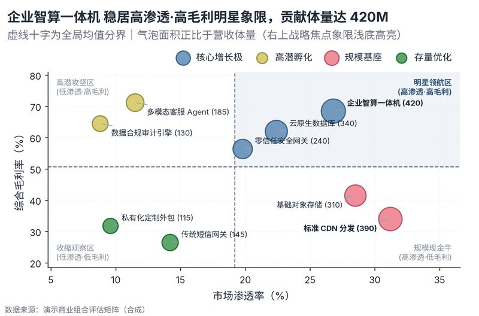

# 配方卡：战略气泡四象限矩阵（双均值十字 + 核心象限高亮）（`bubble_quadrant_matrix`）



## 一、何时用

- **数据形态**：1 实体/业务线维；2 个连续指标（X/Y）；1 体量指标（面积）。
- **分析意图**：战略矩阵、象限归类、体量与质量权衡。
- **设计特色**：波士顿/Gartner 战略四象限矩阵。以全盘均值建立动态十字分界，右上核心增长象限微底色高亮，四角带有战略语义水印；气泡面积按物理面积严格线性缩放，带防重叠引线标注。
- **不适用**：时间演进趋势；只有一个连续指标。

## 二、数据契约与参数

| 参数 | 角色 | 说明 |
| :--- | :--- | :--- |
| `NAME_COL` | 映射列/超参 | 名称列 |
| `X_COL` | 映射列/超参 | X轴列 |
| `Y_COL` | 映射列/超参 | Y轴列 |
| `SIZE_COL` | 映射列/超参 | 气泡大小列 |

## 三、源码保真要点（不得删改）

1. **三区弹性设计**：保持顶部 PARAMS 配置区、中间绘图逻辑与底部 JSON 协议输出隔离。
2. **零碰撞保真**：必须经由 `vs.save_figure()` 导出，确保 `layout_audit.collision_count == 0`。
3. **抗空洞微质感**：优先使用 `vs.select_palette()` 与实心饱满配色（`solid_vivid`），杜绝大片惨白与无意义孤立线条。

## 四、命令

```bash
uv run skills/viz-figure/scripts/get_recipe.py --id bubble_quadrant_matrix --dest ./viz-work
uv run skills/viz-figure/recipes/bubble_quadrant_matrix.py --json
```
