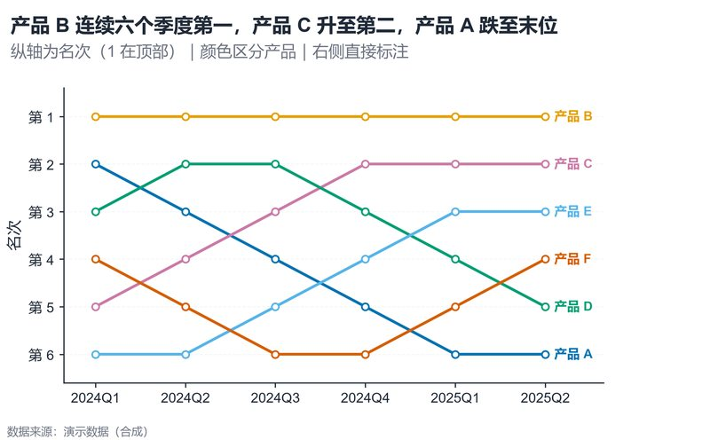

# 配方卡：多阶段名次凹凸轨迹图（`bump_rank_trajectory`）



## 何时用

- 数据：3 个以上阶段 + 每个阶段的对象名次。
- 意图：看长期排名轨迹、交叉与稳定性，适合季度/年度榜单复盘。
- 不适用：只有两期（用斜率图）、数值比排名更重要（用折线）。

## 数据契约

长表：`季度`、`产品`、`名次`。每个阶段名次应唯一；重复会警告但不阻断。
缺阶段的对象只连已有节点。

## PARAMS 槽位

| 参数 | 默认 | 说明 |
| :--- | :--- | :--- |
| `PERIOD_COL / NAME_COL / RANK_COL` | `季度 / 产品 / 名次` | 列映射 |
| `PERIOD_ORDER / NAME_ORDER` | `None` | 显式顺序 |
| `WIDTH_MM / ASPECT` | `165 / 0.62` | 6 阶段 × 6 对象 |

## 源码保真要点

1. **纵轴倒置**：1 在顶部；`ylim(n+0.6, 0.4)`。
2. **每个对象一色**：`series_color_map` 锁色；节点白心 + 同色边。
3. **右侧直接标注**：只标最后一个阶段的位置，避免图例。
4. **阶段名横排**：季度标签不旋转；拥挤时减少标签或缩短。
5. **水平虚线网格**：每个名次一条极浅线，帮助追踪。

## 误用

- 阶段过多/对象过多导致线团：对象 ≤8，阶段 ≤8。
- 把名次差当数值差：名次是序数，不是等距量。
- 遗漏阶段导致断线却不说明。

## 验收

- [ ] 每阶段名次唯一或有说明
- [ ] 线色与右侧标签一致
- [ ] 纵轴方向正确
- [ ] 图注说明排名口径与阶段

## 命令

```bash
uv run skills/viz-python/scripts/get_recipe.py --id bump_rank_trajectory --dest ./viz-work
uv run viz-work/bump_rank_trajectory.py --data data.csv --outdir outputs --json
```
