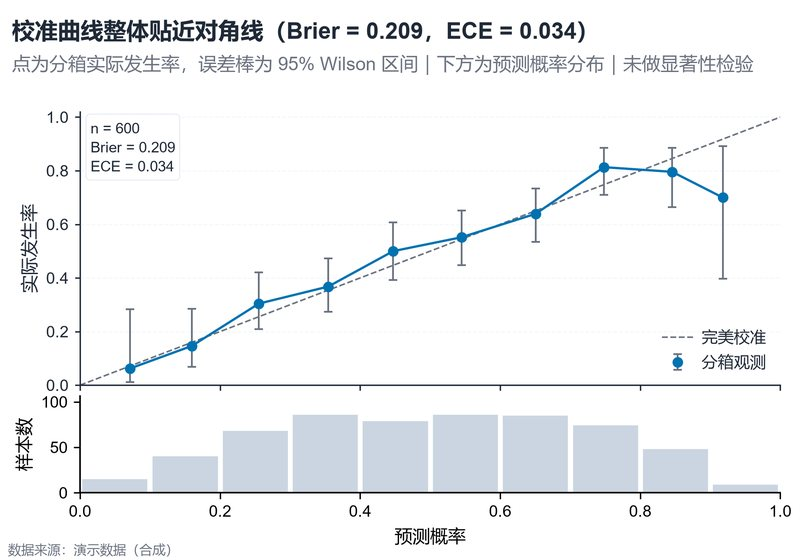

# 配方卡：概率校准曲线 + 预测分布直方图（`calibration_histogram`）



## 何时用

- 数据：预测概率 + 二分类实际结果（0/1）。
- 意图：检查预测概率是否可解释为真实发生率，并看预测分布是否偏斜。
- 不适用：多分类（需逐类 one-vs-rest）、只有标签没有概率。

## 数据契约

宽表：`预测概率`（0–1）、`实际结果`（0/1 或可阈值化）。越界概率剔除；按 10 个等宽箱分箱。

## PARAMS 槽位

| 参数 | 默认 | 说明 |
| :--- | :--- | :--- |
| `P_COL / Y_COL` | 预测概率/实际结果 | 列映射 |
| `BINS` | `10` | 等宽分箱数 |
| `WIDTH_MM / ASPECT` | `160 / 0.70` | 曲线 + 直方图 |

## 源码保真要点

1. **分箱观测率**：每箱 `obs = mean(y)`；空箱跳过并警告。
2. **Wilson 95% 区间**：优于正态近似，小样本不越界。
3. **对角线**：0–1 虚线为完美校准；曲线点+误差棒+连线。
4. **Brier/ECE**：Brier = mean((p−y)²)；ECE = Σ(n/N)·|obs−p|。
5. **共享 x 直方图**：下方按箱计数，柱宽 0.095；顶部隐藏 x 标签但不影响共享轴。
6. **图例位置**：右下空白区，不压曲线与对角线。

## 误用

- 用少样本箱直接断言校准好坏；看 Wilson 区间宽度。
- 把 ECE 当唯一指标；同时给 Brier 与分布。
- 分箱数过多导致每箱样本过少；10 箱为默认。

## 验收

- [ ] 箱内 n、obs、区间可复算
- [ ] Brier/ECE 与数据一致
- [ ] 直方图与曲线共用 x 轴
- [ ] 图注写明分箱与阈值化规则

## 命令

```bash
uv run skills/viz-python/scripts/get_recipe.py --id calibration_histogram --dest ./viz-work
uv run viz-work/calibration_histogram.py --data calib.csv --outdir outputs --json
```
