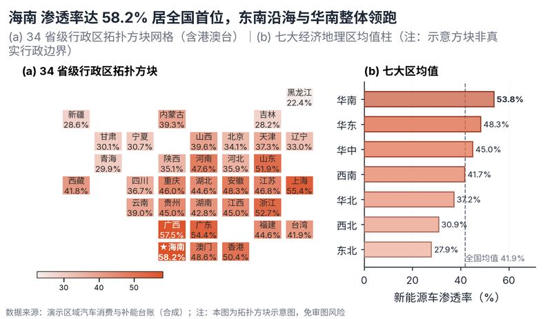

# 配方卡：中国 34 省级行政区拓扑方块网格示意地图（`china_grid_cartogram`）



## 一、何时用

- **数据形态**：省级行政区（名称/简称/全称）；1 区域指标（率/体量）。
- **分析意图**：全国省际分布、大区对比、免审图号合规发布。
- **设计特色**：纯合规免审图方案（Asset Pack 5）。左侧 (a) 为 9×8 抽象拓扑方块网格（含港澳台，缺失项显示灰色斜纹占位），右侧 (b) 为七大经济区均值与全国基准线，附合规免责声明图注。
- **不适用**：需要精确导航/边界测绘；市县级下钻。

## 二、数据契约与参数

| 参数 | 角色 | 说明 |
| :--- | :--- | :--- |
| `PROV_COL` | 映射列/超参 | 省份列 |
| `VALUE_COL` | 映射列/超参 | 数值列 |

## 三、源码保真要点（不得删改）

1. **三区弹性设计**：保持顶部 PARAMS 配置区、中间绘图逻辑与底部 JSON 协议输出隔离。
2. **零碰撞保真**：必须经由 `vs.save_figure()` 导出，确保 `layout_audit.collision_count == 0`。
3. **抗空洞微质感**：优先使用 `vs.select_palette()` 与实心饱满配色（`solid_vivid`），杜绝大片惨白与无意义孤立线条。

## 四、命令

```bash
uv run skills/viz-figure/scripts/get_recipe.py --id china_grid_cartogram --dest ./viz-work
uv run skills/viz-figure/recipes/china_grid_cartogram.py --json
```
