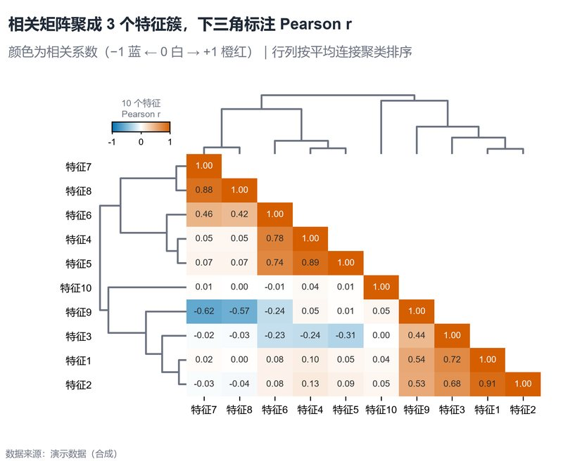

# 配方卡：下三角相关矩阵 + 双侧聚类树（`clustered_corr_dendro`）



## 何时用

- 数据：10–20 个数值特征、样本 ≥30。
- 意图：看变量相关结构、聚类成组、负相关与冗余特征。
- 不适用：特征 >20（标签/单元格过密）、非线性关系（用互信息/距离相关）。

## 数据契约

宽表：数值特征列（默认 `特征1..10`；不存在时自动取所有数值列）。成对缺失行剔除。

## PARAMS 槽位

| 参数 | 默认 | 说明 |
| :--- | :--- | :--- |
| `FEATURES` | 10 个示例特征 | 特征顺序（聚类后重排） |
| `LINKAGE_METHOD` | `average` | 层次聚类连接法 |
| `ANNOTATE_MAX` | `12` | 超过则关闭单元格数值 |
| `WIDTH_MM / ASPECT` | `165 / 0.82` | 树 + 矩阵 |

## 源码保真要点

1. **距离 = 1 − r**：转 condensed 后 average linkage；不要直接对相关系数聚类。
2. **行列同序**：同一个 `leaves_list` 重排，保证对称可读。
3. **下三角 + 对角线**：`np.triu(k=1)` 遮罩；单元格标 Pearson r。
4. **发散色阶**：−1 蓝、0 白、+1 橙红；中点锁定纯白。
5. **文字对比**：每个单元格用 `contrast_text` 自动黑白。
6. **对齐**：热图 `origin="upper"`，行树 `invert_yaxis()`，叶序与行标签一致。

## 误用

- 把相关当因果；本图只描述线性关联。
- 特征未标准化时对相关无影响（Pearson 本身无尺度），但缺失/异常值会影响。
- 聚类方法不同会改变顺序；图注写明 `average`。

## 验收

- [ ] 矩阵对称、下三角完整
- [ ] 行列顺序与树状图叶序一致
- [ ] 单元格文字对比度合格
- [ ] 图注写明样本量、缺失处理与聚类方法

## 命令

```bash
uv run skills/viz-python/scripts/get_recipe.py --id clustered_corr_dendro --dest ./viz-work
uv run viz-work/clustered_corr_dendro.py --data data.csv --outdir outputs --json
```
