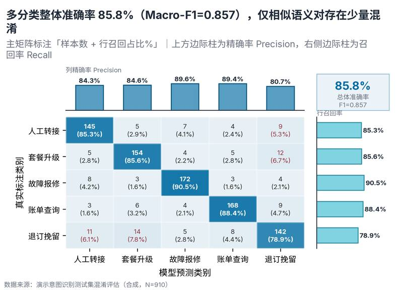

# 配方卡：混淆矩阵 + 行列精确率/召回率边际条复合图（`confusion_matrix_marginal`）



## 一、何时用

- **数据形态**：真实类别；预测类别；可选样本数。
- **分析意图**：分类误判诊断、精确率召回率分解、类别间易混淆对识别。
- **设计特色**：单元格同时标注「计数 + 行召回占比%」与 WCAG 自动黑白对比文字；上方集成列精确率边际柱，右侧集成行召回率横向边际柱，右上角悬挂综合准确率与 Macro-F1 KPI 卡片。
- **不适用**：连续回归预测；类别数 >12 未合并。

## 二、数据契约与参数

| 参数 | 角色 | 说明 |
| :--- | :--- | :--- |
| `TRUE_COL` | 映射列/超参 | 真实类别列 |
| `PRED_COL` | 映射列/超参 | 预测类别列 |
| `COUNT_COL` | 映射列/超参 | 样本数列 |

## 三、源码保真要点（不得删改）

1. **三区弹性设计**：保持顶部 PARAMS 配置区、中间绘图逻辑与底部 JSON 协议输出隔离。
2. **零碰撞保真**：必须经由 `vs.save_figure()` 导出，确保 `layout_audit.collision_count == 0`。
3. **抗空洞微质感**：优先使用 `vs.select_palette()` 与实心饱满配色（`solid_vivid`），杜绝大片惨白与无意义孤立线条。

## 四、命令

```bash
uv run skills/viz-figure/scripts/get_recipe.py --id confusion_matrix_marginal --dest ./viz-work
uv run skills/viz-figure/recipes/confusion_matrix_marginal.py --json
```
