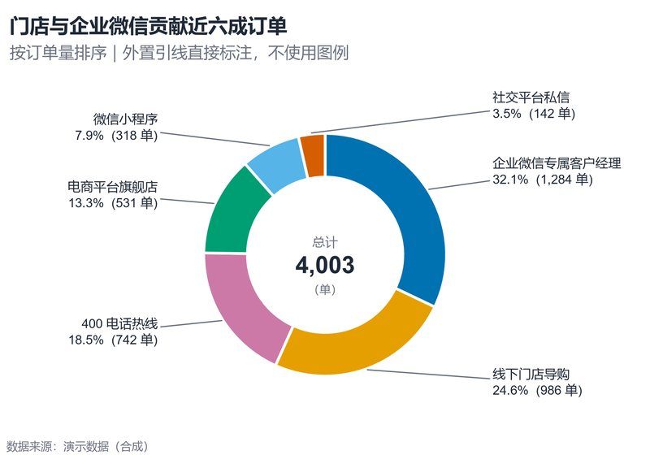

# 配方卡：外置引线圆环图（`donut_leader_labels`）



## 何时用

- 数据：1 个分类维（≤6 类）+ 1 个非负数值维，总和有意义。
- 意图：展示占比，且每类都值得直接读出名称、百分比与绝对值。
- 不适用：分类 >6（改排序条形图）、需要精确比较（条形图更好）。

## 数据契约

宽表：`渠道`、`订单量`。自动按数值降序；负值丢弃；分类 >6 直接报错。

## PARAMS 槽位

| 参数 | 默认 | 说明 |
| :--- | :--- | :--- |
| `CATEGORY_COL / VALUE_COL` | `渠道 / 订单量` | 列映射 |
| `VALUE_UNIT` | `单` | 中心总计与标签单位 |
| `MAX_CATEGORIES` | `6` | 超过则拒绝渲染 |
| `WIDTH_MM / ASPECT` | `150 / 0.70` | 圆环需偏方 |
| `TITLE / SUBTITLE` | 已填 | 副标题说明排序与引线 |

## 源码保真要点

1. **环宽 0.36 + 白色分隔线 1.8pt**：不要改成实心饼。
2. **外置引线**：左右两侧分别做 y 去重叠（min gap 0.135），标签不压扇区。
3. **标签三段信息**：名称、百分比、绝对值；百分比保留 1 位。
4. **中心总计**：主数字加粗，单位放在下方灰色小字。
5. **颜色**：`palette.pick(n)` 最大差异序；6 类不超过 safe_k（okabe_ito 为 7）。

## 误用

- 分类过多仍用圆环：小扇区角度不可辨。
- 使用 3D 或嵌套双环。
- 百分比与绝对值只给一个，读者无法核对。

## 验收

- [ ] 分类 ≤6，总和与中心一致
- [ ] 引线不交叉、标签不重叠
- [ ] 小扇区标签仍可读
- [ ] 排序明确（副标题说明）

## 命令

```bash
uv run skills/viz-python/scripts/get_recipe.py --id donut_leader_labels --dest ./viz-work
uv run viz-work/donut_leader_labels.py --data data.csv --outdir outputs --json
```
