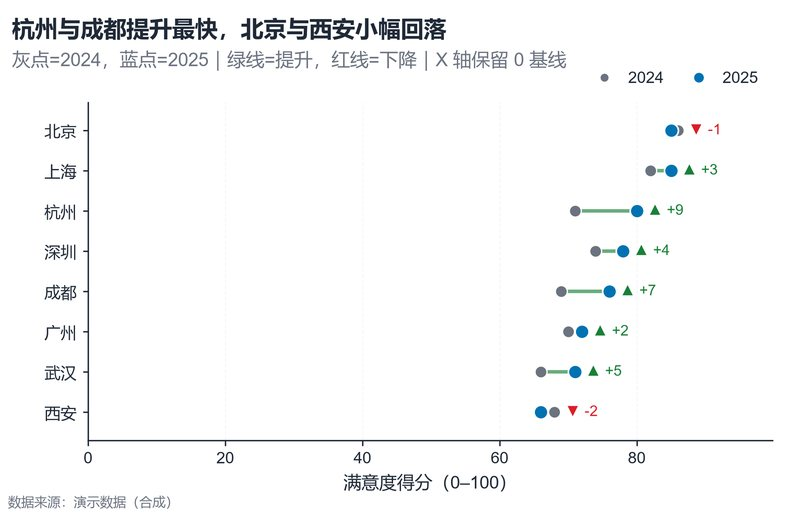

# 配方卡：前后对比哑铃图（`dumbbell_before_after`）



## 何时用

- 数据：1 个分类维 + 两个时点/条件（before/after）的配对数值。
- 意图：看每个对象的变化方向与幅度，并直接标注 Δ。
- 不适用：时间点 >2（改坡度/凹凸图）、分布比较（改小提琴）。

## 数据契约

宽表：`城市`、`2024`、`2025`。配对缺失则剔除；自动按 after 降序。

## PARAMS 槽位

| 参数 | 默认 | 说明 |
| :--- | :--- | :--- |
| `CATEGORY_COL / BEFORE_COL / AFTER_COL` | `城市 / 2024 / 2025` | 列映射 |
| `BEFORE_LABEL / AFTER_LABEL` | `2024 / 2025` | 图例与语义 |
| `WIDTH_MM / ASPECT` | `160 / 0.64` | 8 类以上需高度 |

## 源码保真要点

1. **零基线 X 轴**：`ensure_zero_baseline(ax, "x")`；哑铃图保留完整量纲。
2. **双点单线**：before 灰点（muted_text）、after 焦点蓝点，白边。
3. **方向双编码**：连接线绿=提升、红=下降；右侧 `▲/▼ + Δ` 文本同色。
4. **图例**：仅两点含义（before/after），不解释方向色（副标题解释）。
5. **排序**：按 after 降序；不要按 Δ 排序（会掩盖现状水平）。

## 误用

- 只画 after 或只画箭头，丢失起点。
- 用连接线颜色暗示显著性（这里只表示方向）。
- 截断 X 轴却不标注；本配方强制 0 基线。

## 验收

- [ ] before/after 配对可核对
- [ ] Δ 符号、方向色、箭头一致
- [ ] 零基线、标签不重叠
- [ ] 图注说明时点定义

## 命令

```bash
uv run skills/viz-python/scripts/get_recipe.py --id dumbbell_before_after --dest ./viz-work
uv run viz-work/dumbbell_before_after.py --data data.csv --outdir outputs --json
```
