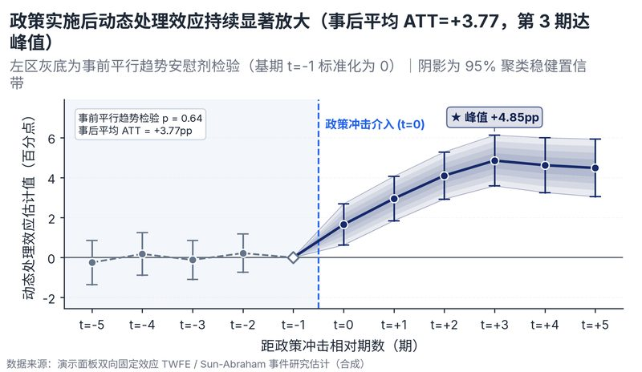

# 配方卡：事件研究 / 双重差分（DID）动态处理效应图（`event_study_did`）



## 一、何时用

- **数据形态**：相对期数 t；动态效应点估计；95% 置信区间上下限。
- **分析意图**：因果推断、平行趋势检验、政策冲击动态衰减/放大。
- **设计特色**：顶级经济学/因果推断顶刊规范图版。左区灰底清晰标明事前平行趋势安慰剂检验（基期 t=-1 归零菱形），政策冲击红虚线分割，事后效应配羽化置信带与峰值 ATT 标注。
- **不适用**：无因果对照；只有事前数据。

## 二、数据契约与参数

| 参数 | 角色 | 说明 |
| :--- | :--- | :--- |
| `REL_TIME_COL` | 映射列/超参 | 相对期数列 |
| `EST_COL` | 映射列/超参 | 效应估计列 |
| `LOW_COL` | 映射列/超参 | 下限95 |
| `HIGH_COL` | 映射列/超参 | 上限95 |

## 三、源码保真要点（不得删改）

1. **三区弹性设计**：保持顶部 PARAMS 配置区、中间绘图逻辑与底部 JSON 协议输出隔离。
2. **零碰撞保真**：必须经由 `vs.save_figure()` 导出，确保 `layout_audit.collision_count == 0`。
3. **抗空洞微质感**：优先使用 `vs.select_palette()` 与实心饱满配色（`solid_vivid`），杜绝大片惨白与无意义孤立线条。

## 四、命令

```bash
uv run skills/viz-figure/scripts/get_recipe.py --id event_study_did --dest ./viz-work
uv run skills/viz-figure/recipes/event_study_did.py --json
```
