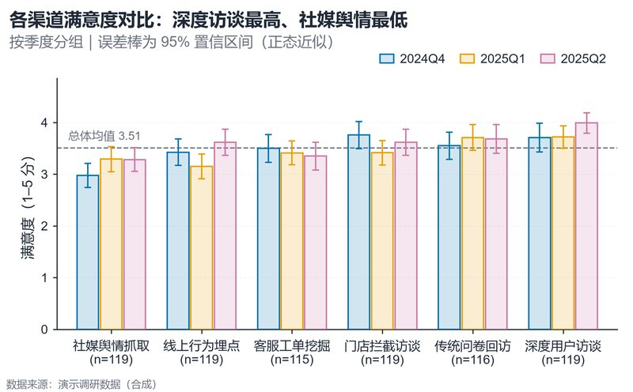

# 配方卡：分组误差棒柱图（`grouped_errorbar_bar`）



## 一、何时用

- **数据形态**：1 个分类维（渠道/地区/方法）+ 1 个数值维；可选 1 个系列维（季度/组别）。
- **分析意图**：比较分组均值，同时表达不确定性（95% CI / SD / SEM）。
- **推荐场景**：业务复盘、实验组对比、问卷分组均值、方法性能对比。
- **不适用**：连续时间趋势（改折线）、分布形状（改雨云图）、分类 >8 或系列 >6（改小多图或合并小类）。

## 二、数据契约

**长表（推荐）**：每行一个观测。

| 列名（示例） | 角色 | 说明 |
| :--- | :--- | :--- |
| `渠道` | 分类 | 自动检测超长标签并横排 |
| `季度` | 系列（可选） | 2–6 个系列 |
| `满意度` | 数值 | 原始观测，缺失值自动剔除并计数 |

**已聚合表**：提供 `mean` + `error` 两列，并将 `ERROR_COL` 指向误差列；此时脚本直接使用，不做二次聚合。

## 三、PARAMS 槽位

| 参数 | 默认 | 说明 |
| :--- | :--- | :--- |
| `DATA_PATH` | `None` | `None` → 内置演示数据；适配时填 CSV/XLSX |
| `GROUP_COL` / `SERIES_COL` / `VALUE_COL` | `渠道 / 季度 / 满意度` | 列名映射 |
| `AGG` | `mean_ci` | `mean_ci`、`mean_sd`、`mean_sem`、`mean`、`count` |
| `ERROR_COL` | `None` | 已聚合误差列 |
| `ORIENTATION` | `auto` | 长标签 → `horizontal` |
| `TITLE` / `SUBTITLE` | 已填 | 标题写事实，不写未经检验的因果 |
| `WIDTH_MM` / `ASPECT` / `CITE_MM` | `160 / 0.62 / None` | 引用尺寸反推 |
| `SHOW_MEAN_LINE` / `ANNOTATE_N` | `True` | 总体均值虚线、分组 n |
| `SORT_GROUPS` | `True` | 按均值排序 |
| `PALETTE` / `LAYOUT` | `None` / `soft_grid` | 色板与版式族 |
| `OUTDIR` / `STEM` / `FORMATS` / `DPI` | `outputs / grouped_errorbar / pdf,png / 300,600` | 导出 |

## 四、源码保真要点（**不得删改**）

1. **浅填深边**：柱体必须用 `vs.bar_kwargs(color)`——RGBA 填充 alpha=0.18 + 同色实线描边 1.0pt。不要改成纯色块，也不要额外传 `alpha=1.0`（会覆盖填充透明度）。
2. **误差棒**：`errorbar(..., fmt="none", ecolor=color, elinewidth=1.0, capsize=2.4, capthick=1.0)`；误差定义必须写进副标题或图注。
3. **零基线**：横排 `ensure_zero_baseline(ax, "x")`、竖排 `"y"`；上限留 16% 余量。
4. **总体均值线**：按有效样本量加权，虚线 `#6B7280` 0.9pt，标签「总体均值 x.xx」。
5. **n 标注**：刻度第二行 `(n=...)`，样本量不同时必须逐组计算。
6. **图例**：多系列时图例位于坐标区上方右侧，无边框；单系列时尾端直接标注。
7. **长标签**：左外边距由 `max(display_units)` 计算，禁止 45° 旋转。
8. **版式**：`vs.apply_style(ax, LAYOUT)` 统一轴、刻度、网格；不要手写 spine 循环。

## 五、误用提示

- 误差棒不能表示「显著性」；需要显著性括号时先用上游统计得到 p 值/CI，再调用 `vs.sig_bracket`。
- 分类均值差异可能被组内分布掩盖；若分布明显偏态或双峰，改用 `raincloud_fusion`。
- 颜色只用于区分系列，不用于表达数值大小。

## 六、验收清单

- [ ] 中文无方块；最长标签未被截断
- [ ] Y/X 轴从 0 开始
- [ ] n 与误差定义可见
- [ ] 系列数 ≤ 色板容量且 ≤ `palette.safe_k`，颜色取自 `palette.pick(n)`
- [ ] PDF 字体已嵌入，PNG 宽度符合 `WIDTH_MM`
- [ ] `check_recipe_fidelity.py` 判定 `pass` 或已解释 `review` 项

## 七、命令

```bash
uv run skills/viz-python/scripts/get_recipe.py --id grouped_errorbar_bar --dest ./viz-work
uv run viz-work/grouped_errorbar_bar.py --data ../../examples/fixtures/xxx.csv --outdir outputs --json
uv run skills/viz-python/scripts/check_recipe_fidelity.py \
  --base skills/viz-python/recipes/grouped_errorbar_bar.py \
  --adapted viz-work/grouped_errorbar_bar.py --json
```
