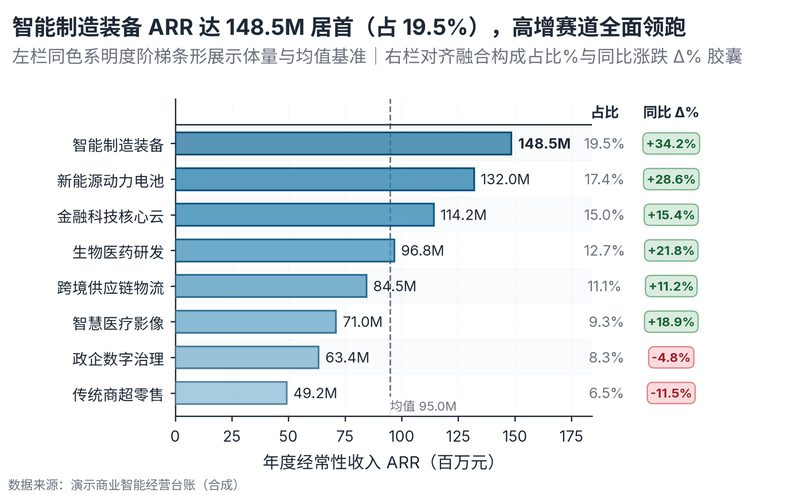

# 配方卡：横向对比条形 + 占比与涨跌 Δ% 胶囊微表融合（`hbar_delta_capsule`）



## 一、何时用

- **数据形态**：1 分类维（5-14）；1 体量数值维；可选 1 涨跌/增速列。
- **分析意图**：体量排序、结构占比、增速归因、Table-Plot。
- **设计特色**：麦肯锡/经济学人式 Table-Plot Fusion 表图融合。左栏明度阶梯条形展示体量与总体均值基准，右栏严格对齐融合构成占比%与同比/环比涨跌 Δ% 红绿温和胶囊微表。
- **不适用**：连续时间趋势；多层级树状流向。

## 二、数据契约与参数

| 参数 | 角色 | 说明 |
| :--- | :--- | :--- |
| `CATEGORY_COL` | 映射列/超参 | 分类列 |
| `VALUE_COL` | 映射列/超参 | 数值列 |
| `DELTA_COL` | 映射列/超参 | 涨跌列 |

## 三、源码保真要点（不得删改）

1. **三区弹性设计**：保持顶部 PARAMS 配置区、中间绘图逻辑与底部 JSON 协议输出隔离。
2. **零碰撞保真**：必须经由 `vs.save_figure()` 导出，确保 `layout_audit.collision_count == 0`。
3. **抗空洞微质感**：优先使用 `vs.select_palette()` 与实心饱满配色（`solid_vivid`），杜绝大片惨白与无意义孤立线条。

## 四、命令

```bash
uv run skills/viz-figure/scripts/get_recipe.py --id hbar_delta_capsule --dest ./viz-work
uv run skills/viz-figure/recipes/hbar_delta_capsule.py --json
```
