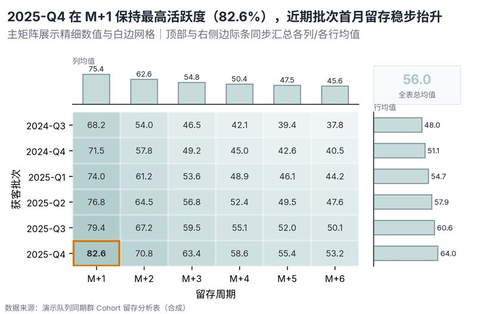

# 配方卡：双分类业务热力矩阵 + 顶/右均值边际条复合图（`heatmap_annotated_grid`）



## 一、何时用

- **数据形态**：行分类维；列分类维；连续数值维。
- **分析意图**：双维度交叉、同期群 Cohort 分析、峰值定位与边缘均值对比。
- **设计特色**：消除传统热力图只看色块看不清数值与边界的缺陷。单元格内嵌精细数值与自动对比字色，白边网格清晰分割，上方与右侧边际条同步汇总各列/各行均值，右上角角标标明全表总均值。
- **不适用**：高基数稀疏长表；点数据散点分布。

## 二、数据契约与参数

| 参数 | 角色 | 说明 |
| :--- | :--- | :--- |
| `ROW_COL` | 映射列/超参 | 行分类列 |
| `COL_COL` | 映射列/超参 | 列分类列 |
| `VALUE_COL` | 映射列/超参 | 数值列 |

## 三、源码保真要点（不得删改）

1. **三区弹性设计**：保持顶部 PARAMS 配置区、中间绘图逻辑与底部 JSON 协议输出隔离。
2. **零碰撞保真**：必须经由 `vs.save_figure()` 导出，确保 `layout_audit.collision_count == 0`。
3. **抗空洞微质感**：优先使用 `vs.select_palette()` 与实心饱满配色（`solid_vivid`），杜绝大片惨白与无意义孤立线条。

## 四、命令

```bash
uv run skills/viz-figure/scripts/get_recipe.py --id heatmap_annotated_grid --dest ./viz-work
uv run skills/viz-figure/recipes/heatmap_annotated_grid.py --json
```
