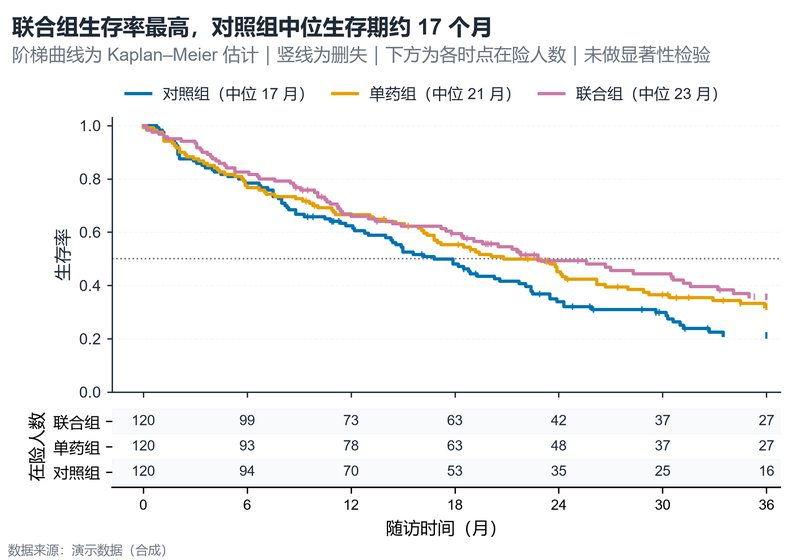

# 配方卡：Kaplan–Meier 生存曲线 + 在险人数表（`km_survival_risk_table`）



## 何时用

- 数据：生存时间、事件指示（1=事件，0=删失）、组别。
- 意图：比较组间生存曲线，并在下方展示各时点在险人数。
- 不适用：竞争风险（需累积发生函数）、时间依赖协变量（需 Cox）。

## 数据契约

长表：`随访月`、`事件`、`组别`。时间 ≥0；事件取 0/1；缺失行剔除。
`RISK_TIMES` 指定在险人数的时间点（应落在随访范围内）。

## PARAMS 槽位

| 参数 | 默认 | 说明 |
| :--- | :--- | :--- |
| `TIME_COL / EVENT_COL / GROUP_COL` | 随访月/事件/组别 | 列映射 |
| `RISK_TIMES` | 0,6,…,36 | 在险表列 |
| `WIDTH_MM / ASPECT` | `165 / 0.70` | 主图 + 表 |

## 源码保真要点

1. **KM 估计**：按事件时间计算 `S *= 1 − d/n`；`step(where="post")`。
2. **删失标记**：在删失时间的当前生存率画 `|`；不要连接成线。
3. **在险人数**：`count(time ≥ t)`，与主图共享 x 轴；斑马纹行。
4. **中位数**：首次 `S≤0.5` 的时间；写入图例标签，不另起文字块。
5. **0.5 参考线**：点线灰色，帮助读中位生存期。
6. **X 轴留白**：左边界略小于 0，避免 t=0 的在险数字与组标签重叠。

## 误用

- 用 Kaplan–Meier 曲线推断显著性；本配方不做 log-rank 检验。
- 删失标记省略，读者无法判断随访充分性。
- 在险人数与主图 x 轴不对齐。

## 验收

- [ ] 曲线在事件时间下降、删失处不打折
- [ ] 在险人数与主图对齐
- [ ] 中位数与曲线一致
- [ ] 图注写明删失规则与随访截止

## 命令

```bash
uv run skills/viz-python/scripts/get_recipe.py --id km_survival_risk_table --dest ./viz-work
uv run viz-work/km_survival_risk_table.py --data survival.csv --outdir outputs --json
```
