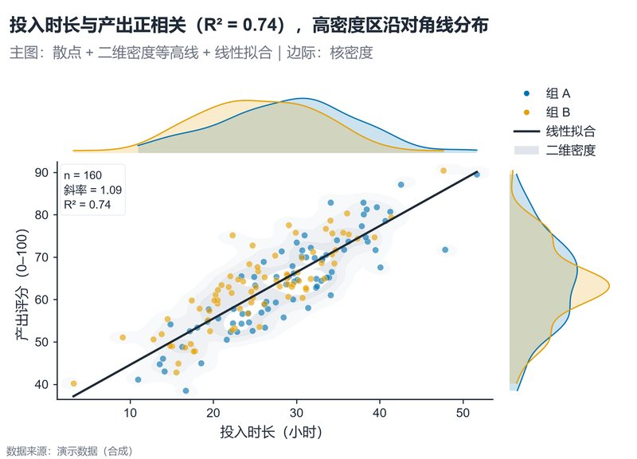

# 配方卡：散点回归 + 二维密度 + 双边际核密度（`marginal_scatter_kde`）



## 何时用

- 数据：两个连续变量 + 可选分组。
- 意图：看相关趋势、点云密度与各自边缘分布。
- 不适用：非线性关系用 LOESS/分段拟合；分类变量用箱线/小提琴。

## 数据契约

宽表：`投入时长`、`产出评分`、可选 `组别`。缺失行剔除；n<5 报错。

## PARAMS 槽位

| 参数 | 默认 | 说明 |
| :--- | :--- | :--- |
| `X_COL / Y_COL / GROUP_COL` | 投入时长/产出评分/组别 | 列映射 |
| `TITLE` | 模板 | 用 `{r2}/{slope}` 动态填充 |
| `WIDTH_MM / ASPECT` | `165 / 0.72` | 主图 + 双边际 |

## 源码保真要点

1. **共享轴 GridSpec**：主图 4.2、边际 1.08；`sharex/sharey` 保证对齐。
2. **二维密度**：2D 直方 + 高斯平滑，分位阈值 contourf，alpha 0.28。
3. **回归线**：全样本 OLS；信息框给斜率、R²、n，不写 p 值。
4. **边际 KDE**：按组着色填充 + 轮廓；顶部/右侧轴 `set_axis_off`。
5. **边际留白**：`set_ylim(0, max*1.12)` / `set_xlim(0, max*1.12)`，防止峰值贴边。
6. **图例**：放在右上空白面板，不在数据区。

## 误用

- 用回归线暗示因果；标题/图注写“相关/拟合”。
- 点云过密仍逐点绘制：>5,000 点需降采样或只用密度。
- 边际密度与主轴比例不一致（必须 sharex/sharey）。

## 验收

- [ ] 主图与边际轴严格对齐
- [ ] 密度峰值不被裁切
- [ ] R²/斜率与数据可复算
- [ ] 图注说明拟合方法与分组

## 命令

```bash
uv run skills/viz-python/scripts/get_recipe.py --id marginal_scatter_kde --dest ./viz-work
uv run viz-work/marginal_scatter_kde.py --data data.csv --outdir outputs --json
```
