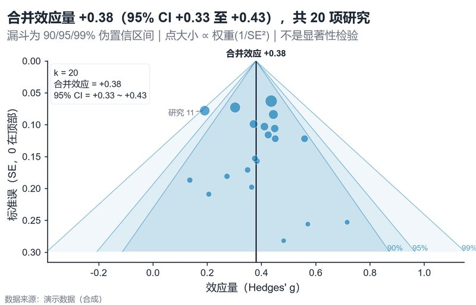

# 配方卡：Meta 分析三层置信漏斗（`meta_funnel`）



## 何时用

- 数据：多项研究的效应量与标准误（SE）。
- 意图：展示合并效应、95% CI 与发表偏倚漏斗（90/95/99% 伪置信区间）。
- 不适用：研究数 <3、效应量口径不一致（需先统一）。

## 数据契约

长表：`研究`、`效应量`、`标准误`（SE>0）。脚本按 1/SE² 计算权重与固定效应合并值。

## PARAMS 槽位

| 参数 | 默认 | 说明 |
| :--- | :--- | :--- |
| `STUDY_COL / EFFECT_COL / SE_COL` | `研究 / 效应量 / 标准误` | 列映射 |
| `LABEL_OUTLIERS` | `True` | 标注残差最大的 3 项（|残差|/SE>2） |
| `WIDTH_MM / ASPECT` | `160 / 0.64` | 漏斗形状 |
| `TITLE` | 模板 | 用 `{pooled}/{ci_low}/{ci_high}/{k}` 动态填充 |

## 源码保真要点

1. **三层漏斗**：99% 最浅、90% 最深；宽→窄顺序绘制，中心叠加更深。
2. **纵轴倒置**：SE=0 在顶部；`ylim(max_se*1.12, 0)`。
3. **点大小 ∝ 权重**：`1/SE²` 归一化；不要用面积编码额外变量。
4. **合并线**：垂直实线 + 顶部标签；漏斗以合并值为中心。
5. **轮廓标签**：在漏斗底部右侧标 90%/95%/99%，与副标题一致。
6. **离群研究**：只标 2–3 项，白底引线，避免遮挡。

## 误用

- 把漏斗不对称直接断言发表偏倚（需 Egger 等检验，且本配方不计算 p）。
- 点大小使用 SE 本身而非权重。
- 不说明固定/随机效应模型；本配方为固定效应加权。

## 验收

- [ ] 合并值/CI 与输入权重可复算
- [ ] 三层漏斗与副标题一致
- [ ] 离群标签不遮挡
- [ ] 图注写明模型与效应量口径

## 命令

```bash
uv run skills/viz-python/scripts/get_recipe.py --id meta_funnel --dest ./viz-work
uv run viz-work/meta_funnel.py --data data.csv --outdir outputs --json
```
