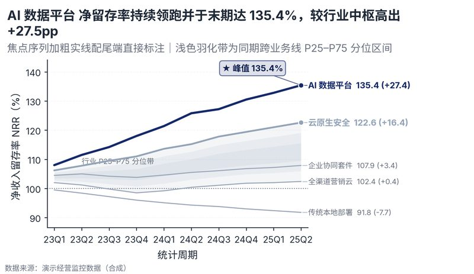

# 配方卡：多序列焦点折线 + 尾端直接标注 + 分位参考带（`multi_line_direct_label`）



## 一、何时用

- **数据形态**：1 时间/有序阶段；2-8 系列；1 连续数值维。
- **分析意图**：趋势比较、焦点聚焦、历史分位参照。
- **设计特色**：以加粗彩色凸显焦点序列，其余归为中性冷灰背景；右端通过一维贪心斥力算法实现零重叠直接标注，叠加同期跨序列 P25–P75 羽化分位参考带与峰值语义胶囊。
- **不适用**：无序离散分类；纯截面比较。

## 二、数据契约与参数

| 参数 | 角色 | 说明 |
| :--- | :--- | :--- |
| `X_COL` | 映射列/超参 | 时间列 |
| `SERIES_COL` | 映射列/超参 | 系列列 |
| `VALUE_COL` | 映射列/超参 | 数值列 |
| `FOCAL_SERIES` | 映射列/超参 | 焦点系列列表 |

## 三、源码保真要点（不得删改）

1. **三区弹性设计**：保持顶部 PARAMS 配置区、中间绘图逻辑与底部 JSON 协议输出隔离。
2. **零碰撞保真**：必须经由 `vs.save_figure()` 导出，确保 `layout_audit.collision_count == 0`。
3. **抗空洞微质感**：优先使用 `vs.select_palette()` 与实心饱满配色（`solid_vivid`），杜绝大片惨白与无意义孤立线条。

## 四、命令

```bash
uv run skills/viz-figure/scripts/get_recipe.py --id multi_line_direct_label --dest ./viz-work
uv run skills/viz-figure/recipes/multi_line_direct_label.py --json
```
