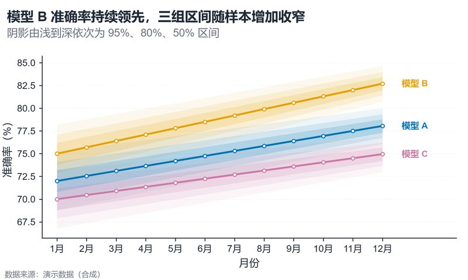

# 配方卡：多序列嵌套置信带折线图（`nested_ci_bands_line`）



## 何时用

- 数据：时间/有序阶段 + 1–5 个系列 + 每期均值与至少一层区间。
- 意图：趋势 + 不确定性（50% / 80% / 95% 三层）。
- 不适用：系列 >5（改高亮+置灰）、只有点估计（改普通折线）。

## 数据契约

长表：`月份`、`模型`、`均值`，以及可选的 `low_50/high_50`、`low_80/high_80`、`low_95/high_95`。
缺少某层区间时自动跳过该层；至少要有均值列。

## PARAMS 槽位

| 参数 | 默认 | 说明 |
| :--- | :--- | :--- |
| `X_COL / SERIES_COL / MEAN_COL` | `月份 / 模型 / 均值` | 列映射 |
| `BAND_COLS` | 三层列名元组 | 由宽到窄 |
| `BAND_ALPHAS` | `0.07 / 0.11 / 0.16` | 由浅到深 |
| `DIRECT_LABELS` | `True` | 尾端直接标注（≤5 系列） |
| `TITLE / SUBTITLE` | 已填 | 写事实 |

## 源码保真要点

1. **先铺宽带，再铺窄带**：外层循环 band、内层循环 series，避免跨系列串色。
2. **多层透明度**：95% 最浅、50% 最深；不要改成同一 alpha。
3. **纵轴覆盖区间**：`ylim` 必须包含所有 band 的上下界，不能只按均值定范围。
4. **直接标注**：尾端标签按 y 去重叠，颜色与系列一致；>5 系列才退回图例。
5. **线 + 白心节点**：线宽 1.8pt，节点 3.4pt，白填充 + 同色边。

## 误用

- 用误差带重叠推断显著性；三层区间不是显著性检验。
- 只按均值设置 y 轴导致带宽被裁切。
- 5 条以上系列仍用直接标注，标签互相压住。

## 验收

- [ ] 所有区间完整显示、无裁切
- [ ] 宽→窄透明度层次可辨
- [ ] 尾端标签不重叠
- [ ] 图注写明区间定义与 n

## 命令

```bash
uv run skills/viz-python/scripts/get_recipe.py --id nested_ci_bands_line --dest ./viz-work
uv run viz-work/nested_ci_bands_line.py --data data.csv --outdir outputs --json
```
