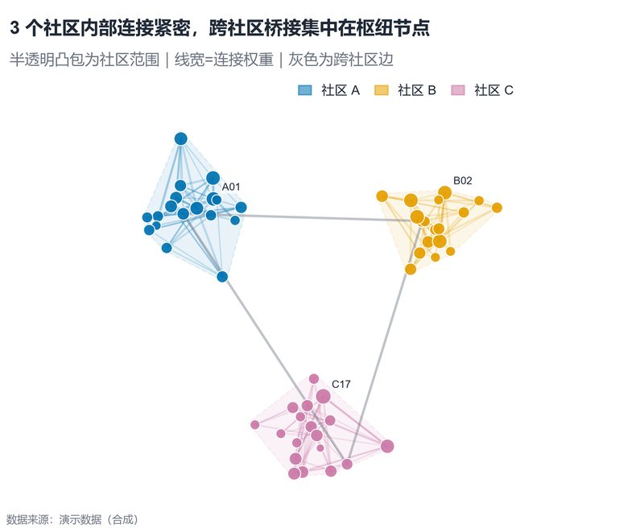

# 配方卡：社区网络 + 半透明凸包（`network_hull`）



## 何时用

- 数据：节点-边网络，节点带社区标签；可选坐标。
- 意图：展示社区内部紧密度、跨社区桥接与枢纽节点。
- 不适用：边 >200 且无聚合（会糊）、有向加权网络（需箭头/边权说明）。

## 数据契约

两个文件：`--nodes nodes.csv`（`节点,社区[,x,y]`）与 `--edges edges.csv`（`source,target,weight`）。
缺少 x/y 时自动用力导向布局；边端点不在节点表中会自动补为“未分组”。

## PARAMS 槽位

| 参数 | 默认 | 说明 |
| :--- | :--- | :--- |
| `NODE_ID_COL / GROUP_COL` | `节点 / 社区` | 节点列 |
| `SOURCE_COL / TARGET_COL / WEIGHT_COL` | source/target/weight | 边列 |
| `LABELS_PER_GROUP` | `1` | 每组标 1 个枢纽 |
| `FORCE_ITERATIONS` | `160` | 力导向迭代 |
| `WIDTH_MM / ASPECT` | `160 / 0.82` | 网络需近方形 |

## 源码保真要点

1. **社区凸包在下层**：monotone chain + 围绕质心扩 1.10，填充 alpha 0.09 + 虚线边。
2. **组内/跨组边**：组内用组色 alpha 0.20，跨组用灰 alpha 0.42；线宽随权重。
3. **节点大小 ∝ 加权度**：度数按权重求和，不要把边数当度数。
4. **只标每组一个枢纽**：避免标签互相压住；需要更多标签时改 `LABELS_PER_GROUP`。
5. **紧致坐标范围**：按实际坐标 ±8% 留白，不用固定 0–1，减少空白。
6. **禁止有向箭头**：本配方面向无向社区图；有向图需另建模板。

## 误用

- 力导向布局每次运行不同：固定随机种子；CSV 提供坐标可完全复现。
- 用凸包暗示社区边界是客观事实；它只是视觉分组。
- 跨组边过粗盖住节点；线宽上限需控制。

## 验收

- [ ] 节点/边数与输入一致
- [ ] 凸包不切过节点
- [ ] 枢纽标签可读且不重叠
- [ ] 布局可复现（种子/坐标）

## 命令

```bash
uv run skills/viz-python/scripts/get_recipe.py --id network_hull --dest ./viz-work
uv run viz-work/network_hull.py --nodes nodes.csv --edges edges.csv --outdir outputs --json
```
