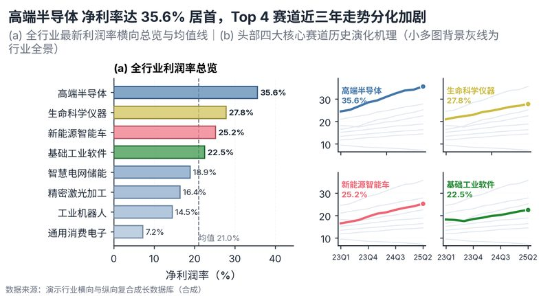

# 配方卡：全局总览 + 局部机理分面小多图（`overview_small_multiples`）



## 一、何时用

- **数据形态**：1 分类维（6-15）；1 时间序列维；1 核心监控指标。
- **分析意图**：全局横向排序、头部赛道历史轨迹深入、Overview + Small Multiples。
- **设计特色**：解决数据图表单薄空洞的旗舰构型（Pattern A）。左侧 (a) 为全行业最新水平横向降序条形与均值线，右侧 (b) 为 Top 4 核心赛道的 2×2 分面小多图，各分面均以全行业背景灰线作同尺度对照。
- **不适用**：只有单期无历史数据；类别数 <4。

## 二、数据契约与参数

| 参数 | 角色 | 说明 |
| :--- | :--- | :--- |
| `CATEGORY_COL` | 映射列/超参 | 分类列 |
| `TIME_COL` | 映射列/超参 | 时间列 |
| `VALUE_COL` | 映射列/超参 | 数值列 |

## 三、源码保真要点（不得删改）

1. **三区弹性设计**：保持顶部 PARAMS 配置区、中间绘图逻辑与底部 JSON 协议输出隔离。
2. **零碰撞保真**：必须经由 `vs.save_figure()` 导出，确保 `layout_audit.collision_count == 0`。
3. **抗空洞微质感**：优先使用 `vs.select_palette()` 与实心饱满配色（`solid_vivid`），杜绝大片惨白与无意义孤立线条。

## 四、命令

```bash
uv run skills/viz-figure/scripts/get_recipe.py --id overview_small_multiples --dest ./viz-work
uv run skills/viz-figure/recipes/overview_small_multiples.py --json
```
