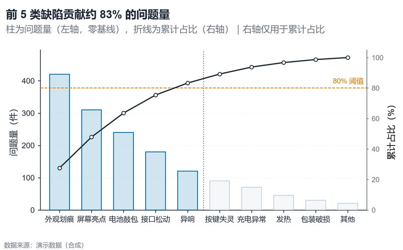

# 配方卡：帕累托降序柱 + 累计占比曲线（`pareto_cumulative`）



## 何时用

- 数据：1 个分类维 + 1 个非负数值维。
- 意图：识别贡献 80% 的“关键少数”，并展示累计占比。
- 不适用：分类之间不可排序、数值为比率不能求和。

## 数据契约

宽表：`缺陷类型`、`问题量`。自动降序；负值/缺失剔除。`THRESHOLD` 默认 80%。

## PARAMS 槽位

| 参数 | 默认 | 说明 |
| :--- | :--- | :--- |
| `CATEGORY_COL / VALUE_COL` | 缺陷类型/问题量 | 列映射 |
| `THRESHOLD` | `80.0` | 关键少数阈值 |
| `WIDTH_MM / ASPECT` | `165 / 0.62` | 10 类以内 |

## 源码保真要点

1. **左轴零基线**：柱从 0 起；上限留 18%。
2. **右轴只放累计占比**：0–100%，双轴是帕累托的标准例外，副标题必须声明。
3. **关键少数着色**：前 cutoff 根 focal，其余 context；cutoff 用虚线标出。
4. **累计曲线**：深色 1.4pt，白心节点；80% 阈值用 alert 虚线 + 标签。
5. **标题动态**：`前 {cutoff} 类缺陷贡献约 {cut_pct:.0f}%`。
6. **图例省略**：左右轴标题 + 副标题已经说明编码，避免遮挡曲线。

## 误用

- 用帕累托图比较组间总量（柱高不可直接相加比较）。
- 分类太少/太均匀，帕累托无意义。
- 右轴刻度与左轴任意缩放制造夸大；本配方固定 0–105%。

## 验收

- [ ] 累计占比与柱高可复算
- [ ] 80% 阈值与 cutoff 一致
- [ ] 双轴含义在副标题中说明
- [ ] 分类标签不重叠

## 命令

```bash
uv run skills/viz-python/scripts/get_recipe.py --id pareto_cumulative --dest ./viz-work
uv run viz-work/pareto_cumulative.py --data defects.csv --outdir outputs --json
```
