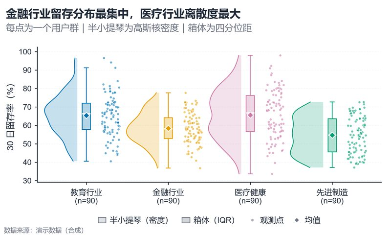

# 配方卡：雨云图（`raincloud_fusion`）



## 一、何时用

- **数据形态**：1 个分类维 + 每个分组 ≥20 条原始观测；数值可连续/近似连续。
- **分析意图**：同时展示**分布形状**（半小提琴）、**集中趋势与离散度**（箱体）、**原始观测**（散点）。
- **推荐场景**：留存率/评分/时延/生物测量的分组分布比较；审稿人要求展示原始数据时。
- **不适用**：只有均值与误差的汇总表（改误差棒图）、时间序列（改折线）、分组 >8（改箱线或小多图）。

## 二、数据契约

长表：每行一个观测。

| 列名（示例） | 角色 |
| :--- | :--- |
| `行业` | 分组，2–6 组 |
| `30日留存率` | 数值，允许缺失 |

脚本按组计算 n、均值、中位数、SD、Q1/Q3、Min/Max，并输出 `*_summary.csv`。

## 三、PARAMS 槽位

| 参数 | 默认 | 说明 |
| :--- | :--- | :--- |
| `DATA_PATH` | `None` | 演示数据 / CSV / XLSX |
| `GROUP_COL` / `VALUE_COL` | `行业 / 30日留存率` | 列名映射 |
| `GROUP_ORDER` | `None` | 显式分组顺序 |
| `CLOUD_WIDTH` | `0.40` | 半小提琴最大宽度（分类轴单位） |
| `POINT_OFFSET` / `JITTER_WIDTH` | `0.30 / 0.11` | 散点列位置与抖动 |
| `SHOW_MEAN` | `True` | 均值菱形 |
| `SIG_PAIRS` | `[]` | `[{"a": "教育行业", "b": "金融行业", "label": "*"}]` |
| `TITLE` / `SUBTITLE` | 已填 | 标题描述事实；不写未检验结论 |
| `WIDTH_MM` / `ASPECT` | `160 / 0.60` | 物理尺寸 |

## 四、源码保真要点（**不得删改**）

1. **半小提琴**：`fill_betweenx` 填充 alpha=0.22 + 同色 0.9pt 轮廓；密度用 Silverman 带宽的高斯核，**cut=0**（严格落在实测范围内）。
2. **窄箱体**：`widths=0.10`，填充 alpha=0.30、同色描边、**白色中位线 1.4pt**、隐藏离群点（原始点已单独展示）。
3. **雨点**：抖动宽度 0.11、点径 8、alpha=0.55、**白色细边 0.3pt**；不要用大实心点糊住分布。
4. **均值菱形**：同色填充 + 白色描边 0.8pt，与中位线形成双重中心趋势参照。
5. **图例**：位于坐标区下方居中，使用中性灰而非分组色，说明图层而非分组。
6. **三层信息不可合并**：删掉散点会失去原始证据，删掉箱体会失去 IQR，删掉小提琴会失去形状。
7. **显著性**：`SIG_PAIRS` 的标签由调用方提供；脚本不计算 p 值，绝不伪造星号。

## 五、常见误用

- 每组 n < 20：核密度与四分位不稳定，脚本会警告；改用点图或汇总误差棒。
- 有界评分（1–5）且大量重复值：核密度会出现尖峰，改用箱线 + 抖动点。
- 把雨云图用于时间趋势：分类轴不表达时间间隔，会误导。

## 六、验收清单

- [ ] 半小提琴端点未被坐标轴裁平
- [ ] 箱体中位线清晰可见，散点未糊成色块
- [ ] 图例不遮挡任何数据
- [ ] n 标注在分组标签第二行
- [ ] 图注写明密度方法（高斯核）与边界处理（cut=0）
- [ ] 输出包含 `*_summary.csv`

## 七、命令

```bash
uv run skills/viz-python/scripts/get_recipe.py --id raincloud_fusion --dest ./viz-work
uv run viz-work/raincloud_fusion.py --data data/retention.csv --outdir outputs --json
```
