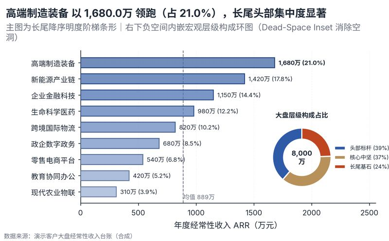

# 配方卡：长尾降序条形 + 负空间内嵌构成双层环图（`ranked_bar_inset_ring`）



## 一、何时用

- **数据形态**：1 细分分类维（8-14 项）；1 体量数值指标；可选 1 宏观分组/大类层级。
- **分析意图**：长尾降序、负空间利用、大类占比、Dead-Space Inset。
- **设计特色**：解决长尾降序图表右下角结构性大片留白空洞的旗舰构型（Pattern C）。主图条形标注绝对值与占比%，右下负空间内嵌精美卡片式大类构成双层环图与中心大盘 KPI，信息密度饱满且层次分明。
- **不适用**：项目少于 6 项；数值不可累加求占比。

## 二、数据契约与参数

| 参数 | 角色 | 说明 |
| :--- | :--- | :--- |
| `ITEM_COL` | 映射列/超参 | 细分项列 |
| `VALUE_COL` | 映射列/超参 | 数值列 |
| `MACRO_GROUP_COL` | 映射列/超参 | 大类列 |

## 三、源码保真要点（不得删改）

1. **三区弹性设计**：保持顶部 PARAMS 配置区、中间绘图逻辑与底部 JSON 协议输出隔离。
2. **零碰撞保真**：必须经由 `vs.save_figure()` 导出，确保 `layout_audit.collision_count == 0`。
3. **抗空洞微质感**：优先使用 `vs.select_palette()` 与实心饱满配色（`solid_vivid`），杜绝大片惨白与无意义孤立线条。

## 四、命令

```bash
uv run skills/viz-figure/scripts/get_recipe.py --id ranked_bar_inset_ring --dest ./viz-work
uv run skills/viz-figure/recipes/ranked_bar_inset_ring.py --json
```
