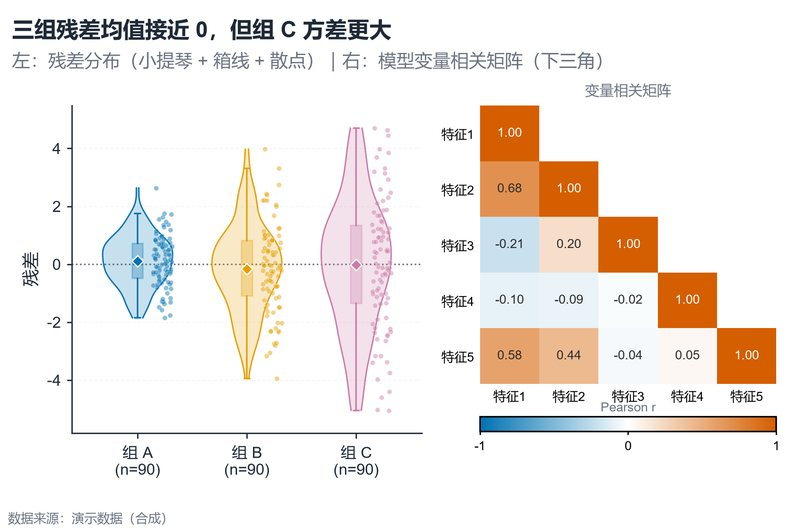

# 配方卡：残差分布小提琴 + 变量相关矩阵（`residual_violin_corr`）



## 何时用

- 数据：模型残差 + 组别 + 若干模型变量。
- 意图：同时检查残差是否零均值/等方差，以及变量间是否存在强共线。
- 不适用：残差与预测值/杠杆值的诊断（用残差-拟合图）、时间序列自相关（用 ACF）。

## 数据契约

宽表：`组别`、`残差` + 数值特征列（默认 `特征1..5`）。缺失行剔除。

## PARAMS 槽位

| 参数 | 默认 | 说明 |
| :--- | :--- | :--- |
| `GROUP_COL / RESIDUAL_COL` | 组别/残差 | 列映射 |
| `FEATURES` | 5 个示例特征 | 相关矩阵变量 |
| `WIDTH_MM / ASPECT` | `165 / 0.66` | 左分布 + 右矩阵 |

## 源码保真要点

1. **左面板**：全宽小提琴 alpha 0.22 + 轮廓；窄箱体白色中位线；散点置右 alpha 0.45。
2. **零线**：残差 0 点线；均值菱形白边。
3. **右面板**：5×5 下三角相关矩阵，发散色阶 −1 蓝/0 白/+1 橙红，单元格标 r。
4. **对齐**：相关矩阵行/列同一顺序；`origin="upper"` + `np.triu(k=1)` 遮罩。
5. **色条**：放在右面板下方，标题 Pearson r。
6. **颜色对比**：单元格文字用 `contrast_text`。

## 误用

- 用残差分布代替正式同方差检验；这里只做视觉诊断。
- 相关矩阵包含目标变量导致信息重复；只放模型变量。
- 小提琴 n<20 不稳定；本配方会警告。

## 验收

- [ ] 残差零线与组均值可读
- [ ] 相关矩阵下三角正确、对称
- [ ] 色条不压 x 标签
- [ ] 图注写明模型与变量集合

## 命令

```bash
uv run skills/viz-python/scripts/get_recipe.py --id residual_violin_corr --dest ./viz-work
uv run viz-work/residual_violin_corr.py --data residuals.csv --outdir outputs --json
```
