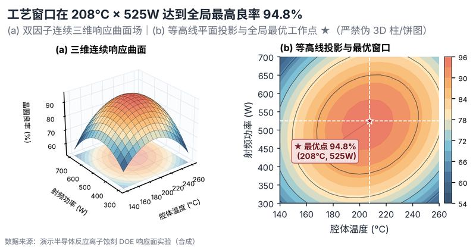

# 配方卡：真三维响应曲面空间场 + 等高线最优点投影双联图（`response_surface_3d_contour`）



## 一、何时用

- **数据形态**：两个连续控制变量（X/Y）；一个连续响应指标（Z）。
- **分析意图**：工艺窗口优化、DOE 实验响应面、连续空间极值定位。
- **设计特色**：严格遵守科学可视化边界：仅限真实连续双因子空间场 z=f(x,y)。左侧为半透明真三维响应曲面与底面投影，右侧为等高线平面投影并用 ★ 靶点直接标注全局最优工作点坐标。
- **不适用**：分类变量伪 3D；柱状图伪 3D；三维饼图。

## 二、数据契约与参数

| 参数 | 角色 | 说明 |
| :--- | :--- | :--- |
| `X_COL` | 映射列/超参 | 因子X列 |
| `Y_COL` | 映射列/超参 | 因子Y列 |
| `Z_COL` | 映射列/超参 | 响应Z列 |

## 三、源码保真要点（不得删改）

1. **三区弹性设计**：保持顶部 PARAMS 配置区、中间绘图逻辑与底部 JSON 协议输出隔离。
2. **零碰撞保真**：必须经由 `vs.save_figure()` 导出，确保 `layout_audit.collision_count == 0`。
3. **抗空洞微质感**：优先使用 `vs.select_palette()` 与实心饱满配色（`solid_vivid`），杜绝大片惨白与无意义孤立线条。

## 四、命令

```bash
uv run skills/viz-figure/scripts/get_recipe.py --id response_surface_3d_contour --dest ./viz-work
uv run skills/viz-figure/recipes/response_surface_3d_contour.py --json
```
