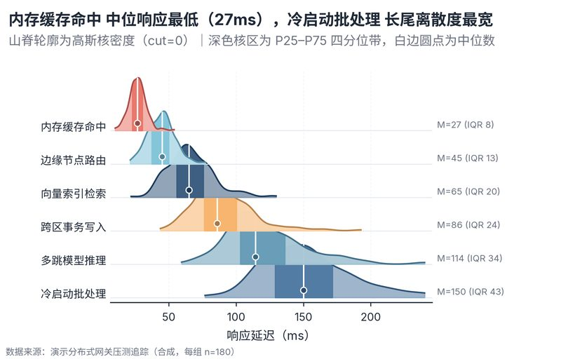

# 配方卡：多组山脊核密度分布图（羽化渐变 + IQR + 中位数锚点）（`ridgeline_density`）



## 一、何时用

- **数据形态**：1 分类维（3-10 组）；每组 ≥25 条连续观测。
- **分析意图**：分布形状对比、长尾/双峰识别、分位数锚定。
- **设计特色**：纵向半交叠山脊核密度图（Joyplot）。每组采用底层白遮罩防透 + 柔和羽化渐变 + P25–P75 核心区深色提亮 + 白边圆点中位数锚定，并于右侧标注中位数与 IQR。
- **不适用**：只有均值的汇总表；分组数 <3。

## 二、数据契约与参数

| 参数 | 角色 | 说明 |
| :--- | :--- | :--- |
| `GROUP_COL` | 映射列/超参 | 分组列 |
| `VALUE_COL` | 映射列/超参 | 数值列 |
| `OVERLAP` | 映射列/超参 | 纵向交叠系数 |

## 三、源码保真要点（不得删改）

1. **三区弹性设计**：保持顶部 PARAMS 配置区、中间绘图逻辑与底部 JSON 协议输出隔离。
2. **零碰撞保真**：必须经由 `vs.save_figure()` 导出，确保 `layout_audit.collision_count == 0`。
3. **抗空洞微质感**：优先使用 `vs.select_palette()` 与实心饱满配色（`solid_vivid`），杜绝大片惨白与无意义孤立线条。

## 四、命令

```bash
uv run skills/viz-figure/scripts/get_recipe.py --id ridgeline_density --dest ./viz-work
uv run skills/viz-figure/recipes/ridgeline_density.py --json
```
