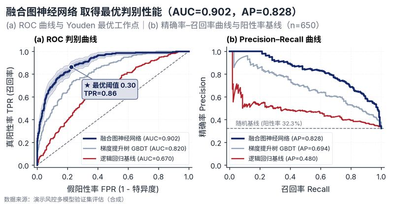

# 配方卡：ROC + Precision–Recall 分类器双联评估面板（`roc_pr_suite`）



## 一、何时用

- **数据形态**：1-5 个分类模型；二分类真实标签 0/1；预测概率 0-1。
- **分析意图**：模型判别能力、阈值权衡、不平衡分类评估。
- **设计特色**：机器学习二分类评估黄金双联图。(a) ROC 曲线配最优模型 Bootstrap 羽化置信带与 Youden-J ★ 靶点；(b) Precision–Recall 曲线配阳性率随机基线与内嵌指标表。
- **不适用**：回归模型；无真实标签。

## 二、数据契约与参数

| 参数 | 角色 | 说明 |
| :--- | :--- | :--- |
| `MODEL_COL` | 映射列/超参 | 模型列 |
| `Y_TRUE_COL` | 映射列/超参 | 真实标签列 |
| `SCORE_COL` | 映射列/超参 | 预测概率列 |

## 三、源码保真要点（不得删改）

1. **三区弹性设计**：保持顶部 PARAMS 配置区、中间绘图逻辑与底部 JSON 协议输出隔离。
2. **零碰撞保真**：必须经由 `vs.save_figure()` 导出，确保 `layout_audit.collision_count == 0`。
3. **抗空洞微质感**：优先使用 `vs.select_palette()` 与实心饱满配色（`solid_vivid`），杜绝大片惨白与无意义孤立线条。

## 四、命令

```bash
uv run skills/viz-figure/scripts/get_recipe.py --id roc_pr_suite --dest ./viz-work
uv run skills/viz-figure/recipes/roc_pr_suite.py --json
```
