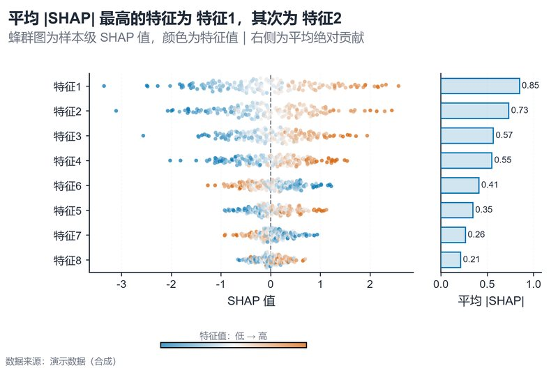

# 配方卡：SHAP 蜂群 + 平均贡献条（`shap_beeswarm_bars`）



## 何时用

- 数据：长表 `样本,特征,SHAP,特征值`（每个样本×特征一行）。
- 意图：展示每个特征的样本级贡献方向、离散度与平均绝对重要性。
- 不适用：没有 SHAP 值（用系数/置换重要性）、特征 >12（取前 N）。

## 数据契约

长表：`样本`、`特征`、`SHAP`、`特征值`。按平均 |SHAP| 取前 10 个特征；共享 y 轴。

## PARAMS 槽位

| 参数 | 默认 | 说明 |
| :--- | :--- | :--- |
| `SAMPLE_COL / FEATURE_COL / SHAP_COL / VALUE_COL` | 样本/特征/SHAP/特征值 | 列映射 |
| `TOP_N` | `10` | 展示特征数 |
| `WIDTH_MM / ASPECT` | `165 / 0.66` | 蜂群 + 贡献条 |

## 源码保真要点

1. **蜂群位移**：按 SHAP 值分 26 箱，每箱内对称偏移并**随机打乱**，避免对角条纹。
2. **颜色 = 特征值**：全局 2–98 分位归一化，蓝低→橙高；底部色条说明方向。
3. **零线**：SHAP=0 虚线；正值表示推高预测、负值拉低。
4. **右侧平均贡献**：`mean(|SHAP|)` 横条，浅填深边 + 数值标签。
5. **共享 y**：左右面板 `sharey`，特征按重要性降序，顶部最重要。
6. **色条位置**：放在布局调整之后，避免与 x 轴标题重叠。

## 误用

- 把 SHAP 值解释为因果效应；它只解释模型输出。
- 每个特征单独归一化颜色却共用一条色条；本配方用全局归一化。
- 特征过多导致蜂群不可读；取前 N 并声明。

## 验收

- [ ] 特征排序与平均 |SHAP| 一致
- [ ] 颜色方向与色条一致
- [ ] 色条不压 x 轴标题
- [ ] 图注写明模型与 SHAP 口径

## 命令

```bash
uv run skills/viz-python/scripts/get_recipe.py --id shap_beeswarm_bars --dest ./viz-work
uv run viz-work/shap_beeswarm_bars.py --data shap_long.csv --outdir outputs --json
```
