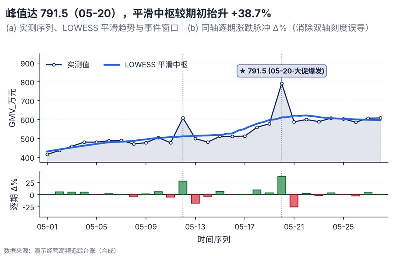

# 配方卡：趋势 + 环比/同比涨跌拆分双面板旗舰复合图（`trend_yoy_decomposed`）



## 一、何时用

- **数据形态**：连续时间/日期序列；一个核心业务规模指标；可选关键事件/大促标记。
- **分析意图**：趋势分解、动量冲击、关键事件归因、消除双轴误导。
- **设计特色**：解决数据图表单薄空洞的旗舰构型（Pattern B）。上方主图展示实测波动、LOWESS 平滑中枢趋势曲线、事件竖线与峰值徽章；下方同轴副图展示逐期红绿涨跌正负脉冲柱，彻底杜绝双轴误导。
- **不适用**：无时间维截面数据；多分类结构占比。

## 二、数据契约与参数

| 参数 | 角色 | 说明 |
| :--- | :--- | :--- |
| `X_COL` | 映射列/超参 | 时间列 |
| `VALUE_COL` | 映射列/超参 | 数值列 |
| `DELTA_COL` | 映射列/超参 | 涨跌列（可空） |
| `EVENT_COL` | 映射列/超参 | 事件列 |

## 三、源码保真要点（不得删改）

1. **三区弹性设计**：保持顶部 PARAMS 配置区、中间绘图逻辑与底部 JSON 协议输出隔离。
2. **零碰撞保真**：必须经由 `vs.save_figure()` 导出，确保 `layout_audit.collision_count == 0`。
3. **抗空洞微质感**：优先使用 `vs.select_palette()` 与实心饱满配色（`solid_vivid`），杜绝大片惨白与无意义孤立线条。

## 四、命令

```bash
uv run skills/viz-figure/scripts/get_recipe.py --id trend_yoy_decomposed --dest ./viz-work
uv run skills/viz-figure/recipes/trend_yoy_decomposed.py --json
```
