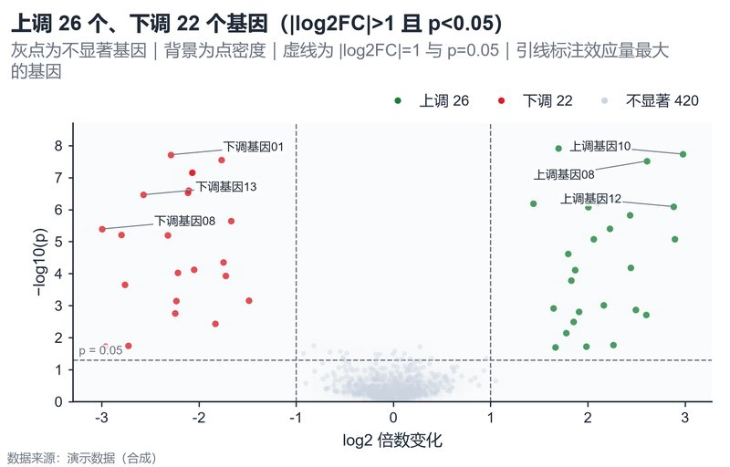

# 配方卡：差异倍数火山图（`volcano_fusion`）



## 何时用

- 数据：每个基因/特征的 log2 倍数变化 + p 值。
- 意图：同时看效应量（x）与统计显著性（y），区分上/下调与不显著。
- 不适用：只有 p 值没有效应量、p 值未经多重校正且未说明。

## 数据契约

宽表：`基因`、`log2FC`、`p值`。p≤0 会截断为 1e-300 并警告；p>1 丢弃。

## PARAMS 槽位

| 参数 | 默认 | 说明 |
| :--- | :--- | :--- |
| `GENE_COL / FC_COL / P_COL` | `基因 / log2FC / p值` | 列映射 |
| `FC_THRESHOLD / P_THRESHOLD` | `1.0 / 0.05` | 阈值线 |
| `LABEL_TOP_N` | `6` | 引线标注数量 |
| `WIDTH_MM / ASPECT` | `160 / 0.64` | 点云与标签 |

## 源码保真要点

1. **背景密度**：2D 直方 + 可分离高斯平滑，浅灰蓝 `pcolormesh` alpha 0.42。
2. **三类点**：上调用 positive、下调用 negative、不显著用 context；白边 0.3pt。
3. **阈值线**：`|log2FC|` 两条虚线 + p 阈值一条虚线；副标题解释，不额外放大标签。
4. **标签朝内**：负值标签放右侧、正值放左侧，避免贴边裁切；白底框 + 细引线。
5. **防碰撞**：标签 y 坐标按 0.06·span 步进、交替上下移动。
6. **图例**：上调/下调/不显著三项，位于坐标区上方。

## 误用

- 用未校正 p 值宣称发现；图注需写校正方法与阈值。
- 只标注最显著而不看效应量；本配方按 |FC|×−log10(p) 选标签。
- 把背景密度当作显著性区域。

## 验收

- [ ] 阈值线与计数一致
- [ ] 标签不裁切、不压点云
- [ ] 图注写明 p 值校正与倍数口径
- [ ] 不显著点仍可见

## 命令

```bash
uv run skills/viz-python/scripts/get_recipe.py --id volcano_fusion --dest ./viz-work
uv run viz-work/volcano_fusion.py --data data.csv --outdir outputs --json
```
