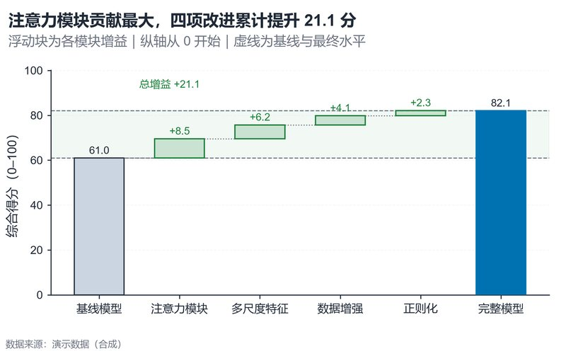

# 配方卡：消融阶梯瀑布 + 增益色带（`waterfall_ablation`）



## 何时用

- 数据：一个基线值 + 若干模块的增量（正/负），可累加到最终值。
- 意图：展示每个模块的贡献与累计增益，定位“最大贡献项”。
- 不适用：非累加关系（如比率）、增量之间有交互作用无法分解。

## 数据契约

长表：`模块`、`增益`。基线值由 `BASELINE_VALUE` 提供；最终值 = 基线 + Σ增益。
若增益来自消融（移除模块导致的下降），请用负值并修改标题。

## PARAMS 槽位

| 参数 | 默认 | 说明 |
| :--- | :--- | :--- |
| `STEP_COL / DELTA_COL` | `模块 / 增益` | 列映射 |
| `BASELINE_VALUE` | `61.0` | 基线得分 |
| `BASELINE_LABEL / FINAL_LABEL` | 基线/完整模型 | 两端标签 |
| `Y_LABEL` | 综合得分 | 量纲与范围 |
| `WIDTH_MM / ASPECT` | `160 / 0.62` | 5–7 个步骤 |

## 源码保真要点

1. **零基线**：基线柱与最终柱从 0 起；浮动块表示增量。
2. **浮动块**：`bottom=min(start,end)`，高度 `abs(delta)`；正增益绿、负增益红。
3. **阶梯连接**：虚线连接每个块的终点与下一块起点（不是只画块宽）。
4. **增益色带**：基线与最终水平之间浅绿 `axhspan`，并标注净增益。
5. **基线/最终虚线**：两条灰色虚线 + 数值标签；总增益文字不压数据。

## 误用

- 把非累加指标画成瀑布。
- 只画增量不画基线/最终总量，读者无法核对。
- 用瀑布掩盖模块间交互作用；图注需声明“按给定顺序分解”。

## 验收

- [ ] 基线 + Σ增量 = 最终值
- [ ] 阶梯连接连续、无断点
- [ ] 正负增益颜色/符号一致
- [ ] 图注说明分解顺序与口径

## 命令

```bash
uv run skills/viz-python/scripts/get_recipe.py --id waterfall_ablation --dest ./viz-work
uv run viz-work/waterfall_ablation.py --data data.csv --outdir outputs --json
```
