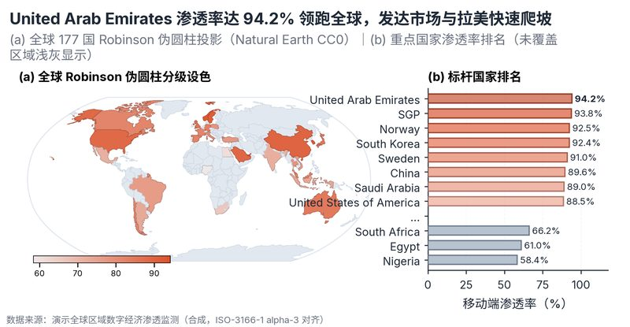

# 配方卡：全球 177 国 Robinson 伪圆柱投影分级设色地图（`world_choropleth_robinson`）



## 一、何时用

- **数据形态**：国家 ISO-3166-1 alpha-3 代码；1 国际对比指标。
- **分析意图**：全球市场格局、出海业务对比、国别渗透率。
- **设计特色**：基于 Natural Earth 110m CC0 矢量底图与 Arthur Robinson (1974) 伪圆柱投影。左侧 (a) 展示全球 177 国平滑分级设色，右侧 (b) 展示标杆国家 Top/Bottom 排名柱状图，未覆盖国家浅灰占位。
- **不适用**：国内省市分析；点坐标精确散点。

## 二、数据契约与参数

| 参数 | 角色 | 说明 |
| :--- | :--- | :--- |
| `ISO_COL` | 映射列/超参 | ISO3代码列 |
| `VALUE_COL` | 映射列/超参 | 数值列 |

## 三、源码保真要点（不得删改）

1. **三区弹性设计**：保持顶部 PARAMS 配置区、中间绘图逻辑与底部 JSON 协议输出隔离。
2. **零碰撞保真**：必须经由 `vs.save_figure()` 导出，确保 `layout_audit.collision_count == 0`。
3. **抗空洞微质感**：优先使用 `vs.select_palette()` 与实心饱满配色（`solid_vivid`），杜绝大片惨白与无意义孤立线条。

## 四、命令

```bash
uv run skills/viz-figure/scripts/get_recipe.py --id world_choropleth_robinson --dest ./viz-work
uv run skills/viz-figure/recipes/world_choropleth_robinson.py --json
```
