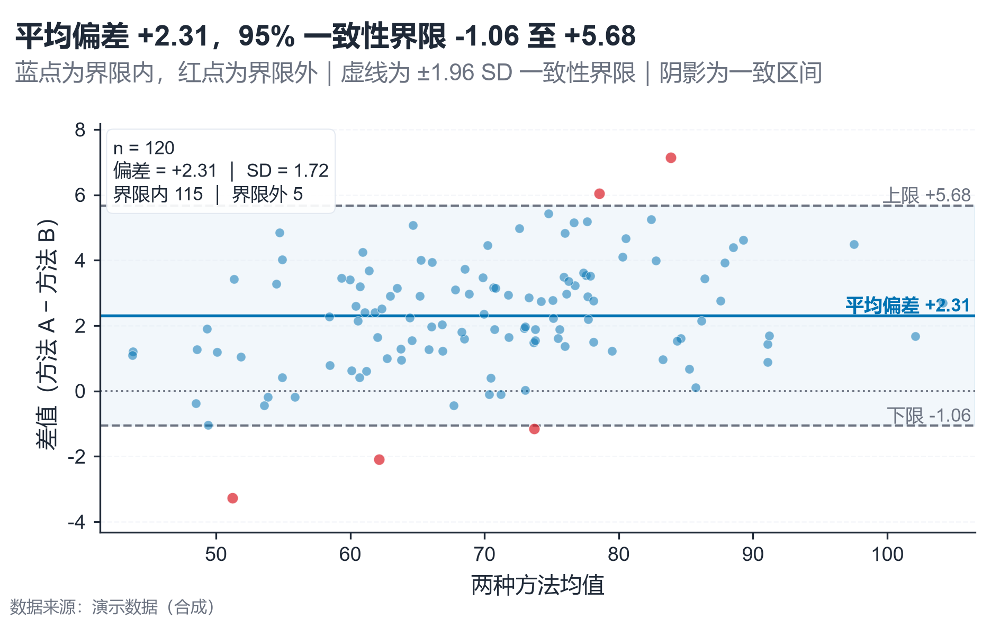

# 配方卡：Bland–Altman 一致性偏差图（`bland_altman`）



## 何时用

- 数据：两种测量/方法在同一批样本上的配对数值。
- 意图：评估一致性：平均偏差、95% 一致性界限、界限外样本。
- 不适用：只关心相关性（用散点/相关）、非配对数据。

## 数据契约

宽表：`方法A`、`方法B`（成对）。缺失配对剔除；n<30 会警告。

## PARAMS 槽位

| 参数 | 默认 | 说明 |
| :--- | :--- | :--- |
| `A_COL / B_COL` | `方法A / 方法B` | 配对列 |
| `A_LABEL / B_LABEL` | 方法 A/B | 差值方向定义 |
| `TITLE` | 模板 | 用 `{bias}/{loa_low}/{loa_high}` 动态填充 |
| `WIDTH_MM / ASPECT` | `160 / 0.62` | 散点云 |

## 源码保真要点

1. **差值方向固定**：`diff = A − B`；标题、轴标题、图注必须一致。
2. **偏差与 LoA**：bias = mean(diff)，LoA = bias ± 1.96·SD；线型实线/虚线区分。
3. **一致区间**：`axhspan(loa_low, loa_high)` alpha 0.05；零线点线。
4. **界限内/外双色**：蓝=界限内、红=界限外；信息框给出两类计数。
5. **信息框**：n、偏差、SD、界限内外计数；含 LoA 数值的右侧标签。

## 误用

- 用相关系数代替一致性；r 高不代表偏差小。
- 不写差值方向（A−B 还是 B−A）。
- 用 LoA 之外的点直接判定“错误”，需结合临床/业务阈值。

## 验收

- [ ] 差值方向、偏差符号一致
- [ ] LoA 与 SD 可复算
- [ ] 界限外点被单独着色/计数
- [ ] 图注写明方法与 n

## 命令

```bash
uv run skills/viz-python/scripts/get_recipe.py --id bland_altman --dest ./viz-work
uv run viz-work/bland_altman.py --data data.csv --outdir outputs --json
```
