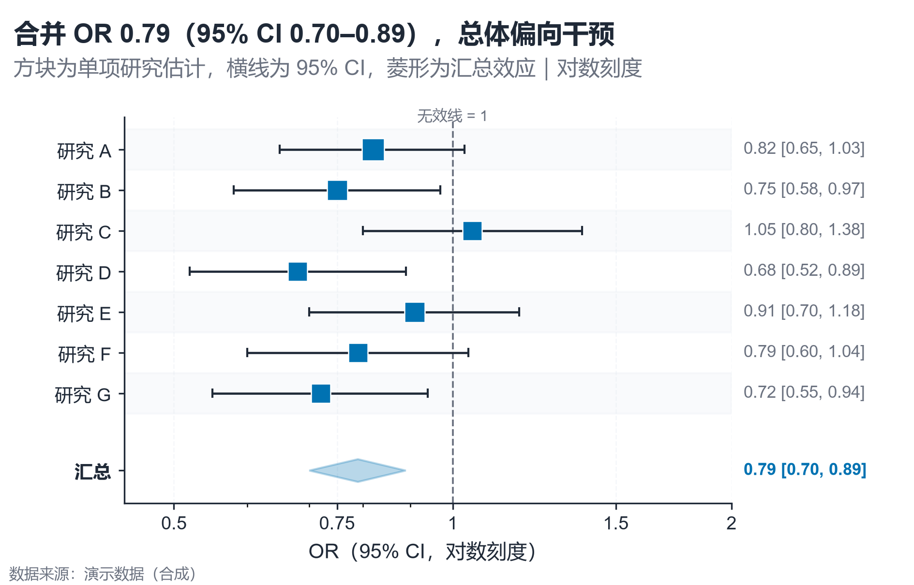

# 配方卡：多指标点区间 + 汇总菱形森林图（`forest_interval_diamond`）



## 何时用

- 数据：多项研究/指标的点估计 + 95% CI，可选汇总行。
- 意图：同时比较单项估计与合并效应，看是否跨过无效线。
- 不适用：只有点估计没有区间、CI 口径不一致。

## 数据契约

宽表：`研究`、`估计值`、`下限`、`上限`、`类型`（study/summary）、可选 `权重`。
汇总行的 `类型` 写 `summary/汇总/合并`，或标签含“汇总/合并”。无汇总行时只画单项。

## PARAMS 槽位

| 参数 | 默认 | 说明 |
| :--- | :--- | :--- |
| `EST_COL / LOW_COL / HIGH_COL` | 估计值/下限/上限 | 列映射 |
| `NULL_VALUE` | `1.0` | 无效线（OR=1） |
| `LOG_SCALE` | `True` | OR/HR 对数刻度 |
| `WIDTH_MM / ASPECT` | `160 / 0.64` | 标签与行数 |

## 源码保真要点

1. **对数横轴**：OR/HR 必须用对数刻度；无效线在 1。
2. **点区间**：横线 + 两端短竖线；方块大小按权重（由 CI 宽度推导或显式列）。
3. **汇总菱形**：低→估计→高→估计，alpha 0.28 + 同色描边；与单项分区分隔。
4. **右侧数值**：`est [low, high]` 用 `get_yaxis_transform` 放在坐标区外，不挤图。
5. **无效线标签**：放在顶部一行，不压底部轴。
6. **斑马纹**：交替浅色行带，便于横向追踪。

## 误用

- 在 OR 上使用线性轴，导致 0.5–2 区间被压缩。
- 汇总行由绘图脚本临时编造；必须由上游 Meta 分析提供。
- CI 跨过无效线却写“显著有效”。

## 验收

- [ ] 区间包含点估计、方向正确
- [ ] 对数刻度/无效线标签清晰
- [ ] 汇总行来源可追溯
- [ ] 右侧数值不被裁切

## 命令

```bash
uv run skills/viz-python/scripts/get_recipe.py --id forest_interval_diamond --dest ./viz-work
uv run viz-work/forest_interval_diamond.py --data data.csv --outdir outputs --json
```
