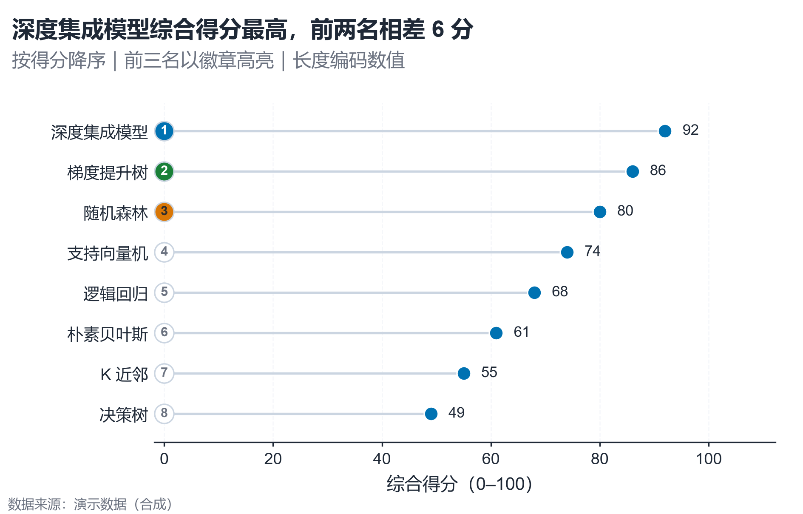

# 配方卡：排名徽章棒棒糖图（`lollipop_rank_badges`）



## 何时用

- 数据：1 个分类维（5–12 项）+ 1 个可排序数值维。
- 意图：排名 + 绝对值，强调前三名。
- 不适用：需要展示构成/占比（用条形/圆环）、时间趋势（用折线）。

## 数据契约

宽表：`方法`、`综合得分`。自动降序；负值会触发警告（向左延伸）。

## PARAMS 槽位

| 参数 | 默认 | 说明 |
| :--- | :--- | :--- |
| `CATEGORY_COL / VALUE_COL` | `方法 / 综合得分` | 列映射 |
| `TOP_N` | `3` | 徽章高亮数量 |
| `SHOW_VALUE` | `True` | 数值直接标注 |
| `WIDTH_MM / ASPECT` | `160 / 0.64` | 长标签需足够左边距 |

## 源码保真要点

1. **零基线横轴**：`ensure_zero_baseline(ax, "x")`；负值保留 0 线。
2. **浅色茎 + 焦点端点**：茎用 context 1.3pt，端点用 focal 62pt、白边。
3. **排名徽章**：x=0 处圆点内写名次；前三名用 focal/positive/alert 填充，其余白底灰字。
4. **徽章文字对比度**：用 `vs.contrast_text(badge_color)` 自动黑白。
5. **长标签左边距**：按 `display_units` 计算，禁止 45° 旋转。

## 误用

- 用徽章颜色编码数值（徽章只表示前三名）。
- 排名项过多仍竖排（>12 项改表或分面）。
- 数值标签与徽章重叠（徽章在 0 端，数值在终点端）。

## 验收

- [ ] 排序正确、零基线
- [ ] 徽章颜色对比度合格
- [ ] 长标签完整、不旋转
- [ ] 前三名与实际数值一致

## 命令

```bash
uv run skills/viz-python/scripts/get_recipe.py --id lollipop_rank_badges --dest ./viz-work
uv run viz-work/lollipop_rank_badges.py --data data.csv --outdir outputs --json
```
