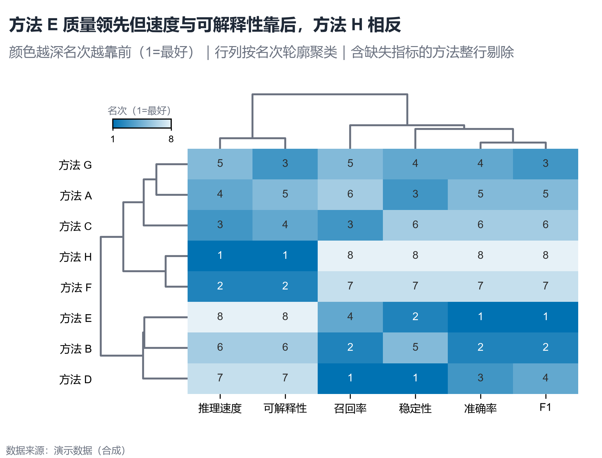

# 配方卡：多指标方法排名聚类热力图（`method_rank_heatmap`）



## 何时用

- 数据：多个方法 × 多个指标，指标方向明确（越高越好或越低越好）。
- 意图：把“方法 × 指标”转为名次矩阵，聚类后看能力簇与权衡。
- 不适用：指标量纲不可比较且无法排序、方法 <3、指标 <2。

## 数据契约

宽表：`方法` + 数值指标列（默认 `准确率/召回率/F1/推理速度/稳定性/可解释性`）。
`LOWER_IS_BETTER` 列出越小越好的指标；其余按降序排名。含缺失指标的方法整行剔除。

## PARAMS 槽位

| 参数 | 默认 | 说明 |
| :--- | :--- | :--- |
| `METHOD_COL / INDICATORS` | 方法 / 6 指标 | 列映射 |
| `LOWER_IS_BETTER` | `[]` | 反向指标列表 |
| `LINKAGE_METHOD` | `average` | 行列聚类方法 |
| `WIDTH_MM / ASPECT` | `165 / 0.76` | 矩阵 + 树 |

## 源码保真要点

1. **逐列排名**：`rank(ascending=not higher_better, method="min")`；并列取最小名次。
2. **行列分别聚类**：`pdist(rank_mat)` 与 `pdist(rank_mat.T)`，各自 `leaves_list`。
3. **倒序顺序色阶**：rank 1 最深；`sequential_cmap(...).reversed()`，vmin=1、vmax=n。
4. **单元格对比**：`contrast_text(cell)` 自动黑白。
5. **双侧树 + 对齐**：热图 `origin="lower"` 与原行序一致；行树不翻转（此处保持 bottom-to-top）。
6. **颜色条**：放在左上空白面板，标注“名次（1=最好）”。

## 误用

- 把原始值直接画成同色阶（不同量纲不可比）。
- 排名方向弄反（速度/时延尤其容易）。
- 缺失指标用 0 填充参与排名；本配方整行剔除。

## 验收

- [ ] 排名方向与 `LOWER_IS_BETTER` 一致
- [ ] 行列顺序与树状图一致
- [ ] 颜色深=名次好
- [ ] 图注写明方向与缺失处理

## 命令

```bash
uv run skills/viz-python/scripts/get_recipe.py --id method_rank_heatmap --dest ./viz-work
uv run viz-work/method_rank_heatmap.py --data data.csv --outdir outputs --json
```
