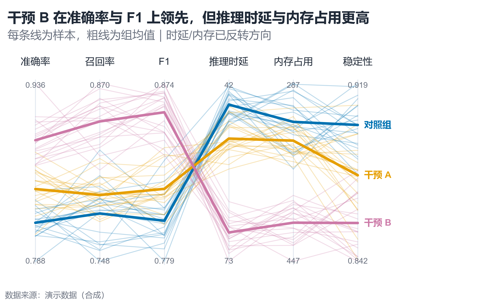

# 配方卡：多维平行坐标图（`parallel_coordinates`）



## 何时用

- 数据：1 个组别 + 4–8 个数值维度 + 多个样本。
- 意图：同时观察多个指标上的组间分离与权衡。
- 不适用：维度 >10（改小多图/相关矩阵）、样本 >500（改密度/均值带）。

## 数据契约

宽表：`组别` + 数值维度列（`准确率`、`召回率`、`F1`、`推理时延`、`内存占用`、`稳定性`）。
`LOWER_IS_BETTER` 中的维度会反转归一化，统一为“越高越好”。

## PARAMS 槽位

| 参数 | 默认 | 说明 |
| :--- | :--- | :--- |
| `CLASS_COL` | `组别` | 分组列 |
| `DIMENSIONS` | 6 个示例维度 | 显示顺序 |
| `LOWER_IS_BETTER` | 时延/内存 | 反转方向 |
| `WIDTH_MM / ASPECT` | `165 / 0.60` | 顶部留维度名空间 |

## 源码保真要点

1. **逐维 min-max 归一化**，反向维度 `z=1-z`；不要跨维度共用尺度。
2. **样本线** alpha 0.26、0.8pt；**组均值线** 2.4pt，zorder 更高。
3. **维度名在顶部**（top tick labels），与副标题保持 ≥12pt 间距；必要时降低 `top`。
4. **每轴显示原始 min/max**（反向轴交换上下值），让读者能还原量纲。
5. **右侧直接标注组名**，用 y 去重叠；不使用图例。

## 误用

- 把不同量纲的原始值直接画在同一 y 轴。
- 不说明反向维度，读者会把“低时延”读成“差”。
- 样本过多且不调 alpha，图形糊成色块。

## 验收

- [ ] 维度名与副标题不重叠
- [ ] 反向维度有明确说明
- [ ] 组均值线清晰、样本线不糊
- [ ] 右侧组名不重叠

## 命令

```bash
uv run skills/viz-python/scripts/get_recipe.py --id parallel_coordinates --dest ./viz-work
uv run viz-work/parallel_coordinates.py --data data.csv --outdir outputs --json
```
