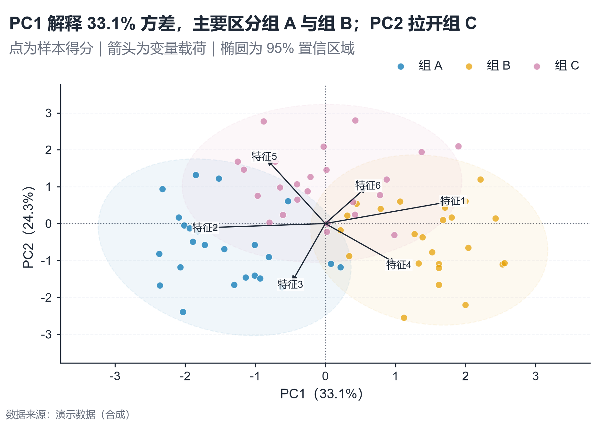

# 配方卡：PCA 样本得分与载荷双标图（`pca_biplot`）



## 何时用

- 数据：多样本 × 多数值特征，可选组别。
- 意图：看样本在低维空间的分离、离群点与变量载荷方向。
- 不适用：非线性流形（用 UMAP/t-SNE）、特征量纲不可标准化、样本 <10。

## 数据契约

宽表：`组别`（可选）+ 数值特征列（默认 `特征1..6`）。按列 z-score 标准化后做 SVD。

## PARAMS 槽位

| 参数 | 默认 | 说明 |
| :--- | :--- | :--- |
| `GROUP_COL` | `组别` | 可选分组 |
| `FEATURES` | 6 个示例特征 | 参与 PCA 的列 |
| `WIDTH_MM / ASPECT` | `160 / 0.70` | 双标图需偏方 |
| `TITLE / X_LABEL / Y_LABEL` | 模板 | 用 `{pc1}/{pc2}` 填充解释方差 |

## 源码保真要点

1. **标准化**：列 z-score；不要用未标准化数据。
2. **SVD + 符号固定**：每个主成分的最大绝对载荷设为正，保证可复现。
3. **得分点**：按组着色、白边、alpha 0.72；95% 置信椭圆（χ²=5.991）。
4. **载荷箭头**：缩放到 0.62×得分范围；箭头从原点出发，标签白底。
5. **轴标题**：`PC1 (xx.x%)` / `PC2 (xx.x%)` 动态填充。
6. **图例**：组别在坐标区上方；载荷由副标题说明。

## 误用

- 把 PC1/PC2 解释成原始变量；只能通过载荷方向辅助解读。
- 不标准化导致大方差特征主导。
- 箭头过长遮挡样本点；缩放系数不要超过 0.75。

## 验收

- [ ] 解释方差百分比与 SVD 一致
- [ ] 载荷方向与原始特征相关方向可核对
- [ ] 椭圆/图例不遮挡主要簇
- [ ] 图注说明标准化与样本量

## 命令

```bash
uv run skills/viz-python/scripts/get_recipe.py --id pca_biplot --dest ./viz-work
uv run viz-work/pca_biplot.py --data data.csv --outdir outputs --json
```
