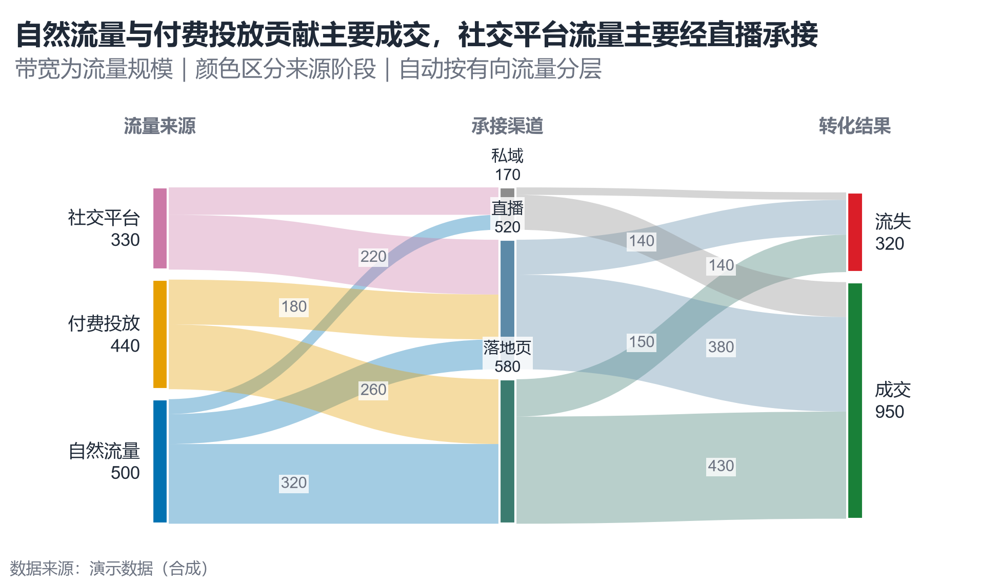

# 配方卡：流量分配桑基图（`sankey_flow`）



## 何时用

- 数据：有向流量表 `source,target,value`，可形成 2–4 层 DAG。
- 意图：看流量如何从来源经渠道分配到结果，定位主要通路与流失。
- 不适用：有环流量（需先拆解）、节点 >30（标签拥挤）、精确数值比较（用表）。

## 数据契约

边表：`source`、`target`、`value`（>0）。脚本自动做拓扑分层（最长路径），无需手填 stage。
列名不一致时修改 `SOURCE_COL`/`TARGET_COL`/`VALUE_COL`。

## PARAMS 槽位

| 参数 | 默认 | 说明 |
| :--- | :--- | :--- |
| `STAGE_NAMES` | 来源/渠道/结果 | 阶段标题，按层数截取 |
| `NODE_WIDTH / NODE_GAP` | `0.045 / 0.028` | 节点几何 |
| `FLOW_ALPHA` | `0.36` | 流量带透明度 |
| `MIN_FLOW_SHARE` | `0.10` | 低于此占比不标数值 |
| `WIDTH_MM / ASPECT` | `165 / 0.58` | 横向流程图 |

## 源码保真要点

1. **自定义贝塞尔带**：`Path` 的 CURVE4 控制点在两列中点，带宽 ∝ value。
2. **节点吞吐**：中间节点取 `max(in,out)`，流量偏移在节点内居中。
3. **阶段配色**：来源用分类色、中间用蓝灰、结果用绿/红；流量带按**来源节点**着色。
4. **层级间距**：节点块整体下移 6%（`top_limit=0.94`），给顶层标签与阶段标题留空间。
5. **流标签交错**：奇数/偶数条带用 38%/62% 位置错开，白底小字，避免叠字。
6. **有环检测**：Kahn 拓扑失败时报错，不静默画错。

## 误用

- 用面积/带宽直觉代替精确读数；关键流量需同时给数值。
- 节点/流量过多导致无法追踪；合并小流量为“其他”。
- 中间节点标签压在流量带上；使用白底框并留出顶部间距。

## 验收

- [ ] 每层节点顺序与流量守恒可核对
- [ ] 中间节点标签、阶段标题不重叠
- [ ] 小流量不标数值但仍可见
- [ ] 有环数据被拒绝并说明原因

## 命令

```bash
uv run skills/viz-python/scripts/get_recipe.py --id sankey_flow --dest ./viz-work
uv run viz-work/sankey_flow.py --data flows.csv --outdir outputs --json
```
