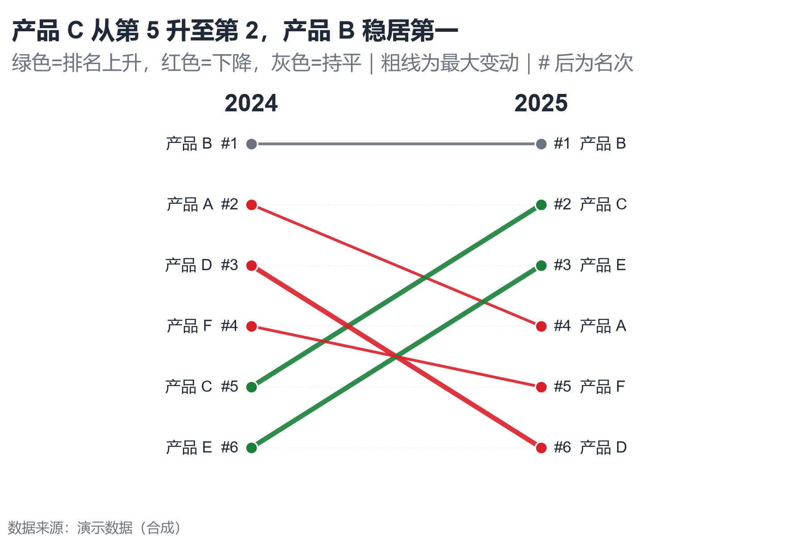

# 配方卡：两阶段排名斜率图（`slope_rank_change`）



## 何时用

- 数据：1 个对象维 + 两个阶段的**名次**（1=最好）。
- 意图：看排名上升/下降与交叉换位，强调最大变动。
- 不适用：阶段 >2（改 Bump 图）、只有数值没有排名（可先转排名）。

## 数据契约

宽表：`产品`、`2024排名`、`2025排名`；每个阶段名次应唯一（重复名次会警告）。
名次按整数处理；数值越小越靠前。

## PARAMS 槽位

| 参数 | 默认 | 说明 |
| :--- | :--- | :--- |
| `NAME_COL / BEFORE_COL / AFTER_COL` | `产品 / 2024排名 / 2025排名` | 列映射 |
| `BEFORE_LABEL / AFTER_LABEL` | `2024 / 2025` | 阶段标题 |
| `WIDTH_MM / ASPECT` | `150 / 0.68` | 两侧留标签空间 |

## 源码保真要点

1. **纵轴倒置**：名次 1 在顶部；`ylim(n+0.6, 0.4)`。
2. **方向色 + 粗线**：绿=上升、红=下降、灰=持平；最大变动线宽 2.6，其余 1.5。
3. **双侧标签**：左侧 `名称 #名次`，右侧 `#名次 名称`；文本不裁切。
4. **阶段标题**：顶部 `2024 / 2025`，字号大于数据标签。
5. **水平引导线**：每个名次一条极浅点线，x 仅覆盖两阶段之间。

## 误用

- 把名次当连续数值，忽略“1 最好”的方向。
- 用斜率图展示 5 个以上阶段（线会缠成毛线）。
- 只标对象名不标名次，读者无法确认换位。

## 验收

- [ ] 名次方向正确、唯一
- [ ] 左右标签完整
- [ ] 最大变动被突出
- [ ] 图注说明名次口径

## 命令

```bash
uv run skills/viz-python/scripts/get_recipe.py --id slope_rank_change --dest ./viz-work
uv run viz-work/slope_rank_change.py --data data.csv --outdir outputs --json
```
