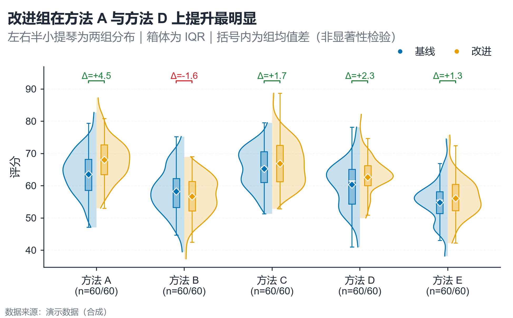

# 配方卡：对称小提琴 + 箱线 + 差值括号（`split_violin_box_sig`）



## 何时用

- 数据：1 个分类维（3–6 个方法）+ 恰好 2 个组别 + 每组 ≥20 条观测。
- 意图：比较两组分布形状、中位数、均值与差值。
- 不适用：组别 >2（改分组小提琴）、n<20（改点图）、只需均值（改误差棒图）。

## 数据契约

长表：`方法`、`组别`、`评分`；组别必须恰好 2 个。括号默认显示**组均值差**，不是 p 值。
若要显示显著性，传入 `DIFF_LABELS={"方法 A": "*"}`，并确保上游检验已给出结论。

## PARAMS 槽位

| 参数 | 默认 | 说明 |
| :--- | :--- | :--- |
| `CATEGORY_COL / GROUP_COL / VALUE_COL` | `方法 / 组别 / 评分` | 列映射 |
| `SHOW_DIFF` | `True` | 画差值括号 |
| `DIFF_LABELS` | `None` | 上游提供的显著性标签（可选） |
| `HALF_WIDTH` | `0.38` | 半小提琴最大宽度 |
| `WIDTH_MM / ASPECT` | `165 / 0.62` | 5 类以上需宽度 |

## 源码保真要点

1. **左右半小提琴**：`fill_betweenx` alpha 0.22 + 同色轮廓 0.9pt。
2. **窄箱体**：宽 0.075，填充 alpha 0.30，白色中位线 1.2pt，隐藏离群点。
3. **均值菱形**：白边 0.7pt，与中位线形成双中心趋势。
4. **差值括号**：`vs.sig_bracket`，颜色按正负（绿/红），标签默认 `Δ=+x.x`。
5. **样本量**：x 刻度第二行 `(n=左/右)`。

## 误用

- 把组均值差当成显著性；没有检验就不写星号。
- n<20 仍画核密度；应改点图。
- 括号覆盖小提琴峰值；调整 `y_max + 0.06*span` 与顶部留白。

## 验收

- [ ] 两组样本量与分布可读
- [ ] 括号标签与图注一致
- [ ] 均值/中位线清晰
- [ ] 无伪造显著性

## 命令

```bash
uv run skills/viz-python/scripts/get_recipe.py --id split_violin_box_sig --dest ./viz-work
uv run viz-work/split_violin_box_sig.py --data data.csv --outdir outputs --json
```
