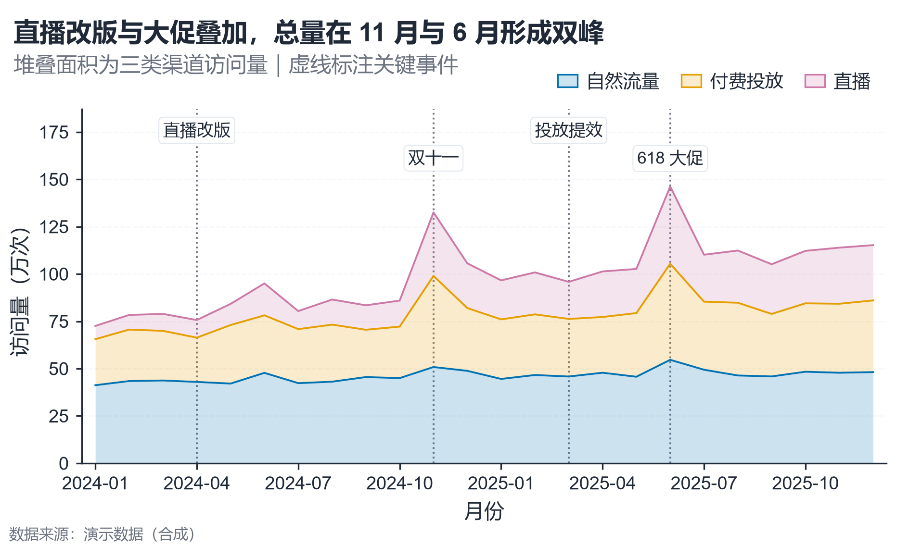

# 配方卡：堆叠面积 + 事件竖线（`stacked_area_events`）



## 何时用

- 数据：时间 + 2–4 个构成系列 + 关键事件时间点。
- 意图：看构成随时间变化，并把**事件**与拐点对齐。
- 不适用：需要精确比较单期数值（改分组柱/表）、事件 >6（标签拥挤）。

## 数据契约

长表：`月份`、`渠道`、`访问量`。事件在 `EVENTS` 中配置：`[{"x": "2024-04", "label": "直播改版"}]`。
`x` 必须与数据中的 X 值完全一致；不存在的会跳过并警告。

## PARAMS 槽位

| 参数 | 默认 | 说明 |
| :--- | :--- | :--- |
| `X_COL / SERIES_COL / VALUE_COL` | `月份 / 渠道 / 访问量` | 列映射 |
| `EVENTS` | 4 个示例事件 | 事件竖线与标签 |
| `TITLE / SUBTITLE` | 已填 | 事件结论需有数据支撑 |
| `WIDTH_MM / ASPECT` | `160 / 0.60` | 物理尺寸 |

## 源码保真要点

1. **面积层序**：按系列顺序累加；每层 `fill_between` alpha 0.20 + 同色上边界 0.9pt。
2. **零基线**：`ensure_zero_baseline(ax, "y")`，上限留 28% 给事件标签。
3. **事件线**：`axvline` 点线 + 顶部标签，标签在两条 y 高度交替，白底细框。
4. **X 刻度抽稀**：最多 8 个标签，避免拥挤。
5. **图例**：无框图例位于坐标区上方，与事件标签分层。

## 误用

- 事件标签压在数据峰值上：使用两条 y 高度交替并留顶部空间。
- 面积层过多导致中间层不可读：≤4 层。
- 把事件当成因果证明：只做时间对齐，不写因果。

## 验收

- [ ] 事件 x 与数据严格对齐
- [ ] 顶部标签互不重叠、不压数据
- [ ] 零基线、图例不遮挡
- [ ] 事件解释写进图注/副标题

## 命令

```bash
uv run skills/viz-python/scripts/get_recipe.py --id stacked_area_events --dest ./viz-work
uv run viz-work/stacked_area_events.py --data data.csv --outdir outputs --json
```
