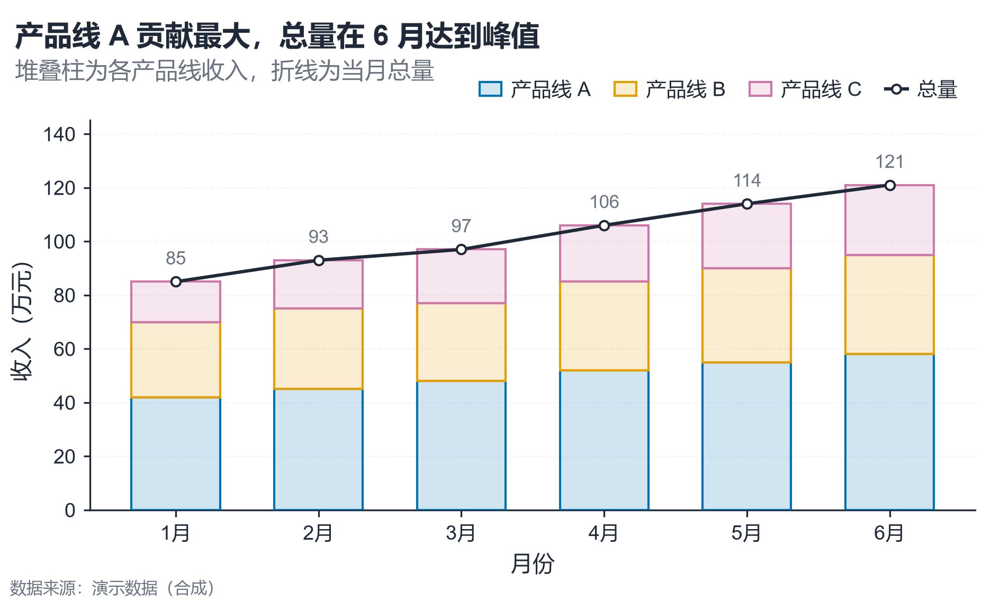

# 配方卡：堆叠柱 + 总量折线（`stacked_bar_total_line`）



## 何时用

- 数据：1 个分类/时间维 + 2–4 个系列 + 1 个数值维；系列之和有意义。
- 意图：同时看**构成**与**总量趋势**。
- 不适用：系列间需要比较总量（用分组柱）、系列 >5（堆叠过碎）。

## 数据契约

长表：`月份`、`产品线`、`收入`。缺失行剔除；X 轴按自然序排序（`1月`、`2月`）。

## PARAMS 槽位

| 参数 | 默认 | 说明 |
| :--- | :--- | :--- |
| `X_COL / SERIES_COL / VALUE_COL` | `月份 / 产品线 / 收入` | 列映射 |
| `SERIES_ORDER` | `None` | 显式堆叠顺序（底→顶） |
| `SORT_X` | `True` | 自然序排序 |
| `SHOW_TOTAL / ANNOTATE_TOTAL` | `True` | 总量线与数值标注 |
| `TITLE / SUBTITLE` | 已填 | 写事实，不写未检验结论 |
| `WIDTH_MM / ASPECT` | `160 / 0.60` | 物理尺寸 |

## 源码保真要点

1. **浅填深边**：每段用 `vs.bar_kwargs(color)`，alpha 0.18 + 同色描边；不要改纯色块。
2. **总量线**：深色 1.5pt，白色填充节点 + 深色边，zorder 高于柱。
3. **零基线**：`ensure_zero_baseline(ax, "y")`，上限留 20% 给总量标注。
4. **图例**：柱 + 总量共用一个无框图例，位于坐标区上方。
5. **堆叠顺序**：按 `SERIES_ORDER` 或数据出现顺序，不按大小重排（避免跨图错位）。

## 误用

- 用堆叠柱比较组间总量：各段起点不同，读者会误判。
- 系列过多导致中间段不可读：合并小类或改小多图。

## 验收

- [ ] 总量 = 各段之和；零基线
- [ ] 总量标注不压柱顶
- [ ] 系列色取自 `palette.pick(n)` 且 ≤ `safe_k`
- [ ] 图例不遮挡数据

## 命令

```bash
uv run skills/viz-python/scripts/get_recipe.py --id stacked_bar_total_line --dest ./viz-work
uv run viz-work/stacked_bar_total_line.py --data data.csv --outdir outputs --json
```
